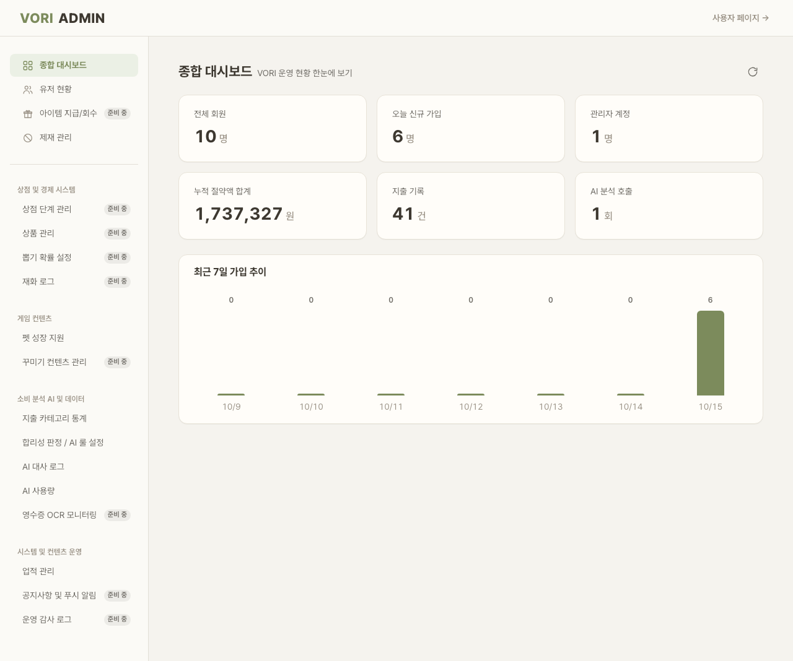
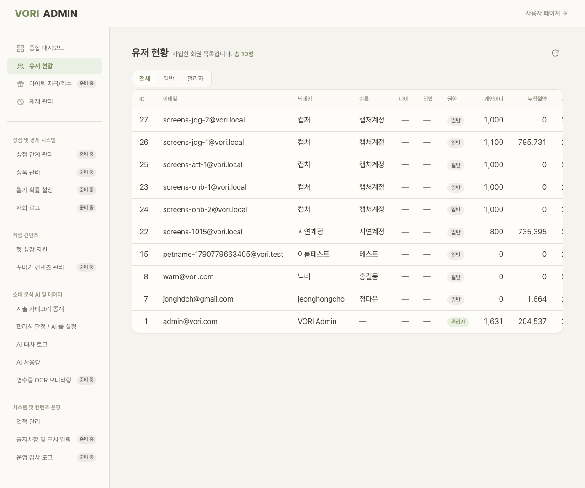
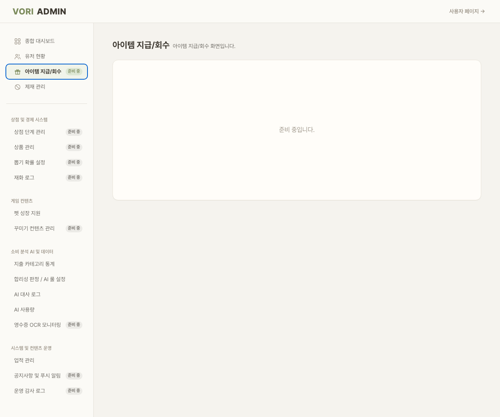

# ADM · 어드민

| 화면ID | 화면명 | 경로 | 파일 | 인증 | 버전 | 수정일 | 이미지 출처 |
|---|---|---|---|---|---|---|---|
| `ADM_DSH_01` | 어드민 종합 대시보드 | `/admin/dashboard` | `frontend/src/pages/Admin/DashboardPage.jsx` | ADMIN | v0.3 | 2026-10-15 | 실제 화면 캡처 (`0c0a9e4`, 1280px) |
| `ADM_USR_01` | 어드민 유저 현황 | `/admin/users` | `frontend/src/pages/Admin/UsersPage.jsx` | ADMIN | v0.3 | 2026-10-15 | 실제 화면 캡처 (`0c0a9e4`, 1280px) |
| `ADM_ETC_*` | 어드민 기타 메뉴 | `/admin/*` | `frontend/src/pages/Admin/` ([README 7-2](README.md#7-2-어드민-메뉴-구현-현황)) | ADMIN | v0.3 | 2026-10-15 | 실제 화면 캡처 (`0c0a9e4`, 1280px) |

**한 줄 목표**: 관리자가 VORI 운영 현황(KPI·가입 추이)과 회원 목록을 보고, 그 밖 운영 메뉴로 이동할 수 있어야 한다.

## 화면

**ADM_DSH_01 종합 대시보드**



**ADM_USR_01 유저 현황**



**ADM_ETC_* 준비 중 메뉴 (아이템 지급/회수)**



<details>
<summary>와이어프레임 (텍스트로 보기)</summary>

```
┌──────────────────────────────────────────────────┐
│ VORI ADMIN                         사용자 페이지 → │
├────────────────┬─────────────────────────────────┤
│ 종합 대시보드     │ 종합 대시보드          [⟳]        │
│ 유저 현황        │ VORI 운영 현황 한눈에 보기          │
│ 아이템 지급 준비 중│ ┌전체 회원┐┌오늘 신규┐┌관리자┐     │
│ 제재 관리        │ ┌누적 절약┐┌지출 기록┐┌AI 호출┐    │
│ ─────────       │ 최근 7일 가입 추이 (막대)           │
│ 상점·경제 …      │                                  │
└────────────────┴─────────────────────────────────┘
```

</details>

## Description

와이어프레임에 번호가 없어 구성요소 기준으로 적는다 (공통 틀: `frontend/src/pages/Admin/AdminLayout.jsx`).

| # | 요소 | 기능 | 동작 (누르면·입력하면) | 상태 | 예외·정책 |
|---|---|---|---|---|---|
| — | 상단 바 | "VORI ADMIN" 로고, "사용자 페이지 →" | 로고 → `/admin` (→ `/admin/dashboard`), "사용자 페이지 →" → `/home` | 정적 | — |
| — | 사이드바 | 어드민 메뉴 그룹·항목 (8절 표 → [README 7-2](README.md#7-2-어드민-메뉴-구현-현황)) | 항목을 누르면 그 경로로 이동 | 평소: 고른 항목 활성 색 · 준비 중 메뉴: "준비 중" 태그, 고르면 태그도 활성 색 | 첫 그룹(기본 관리)은 라벨 없이 맨 위, 아래에 구분선 |
| — | KPI 6장 (`ADM_DSH_01`) | 전체 회원·오늘 신규 가입·관리자 계정·누적 절약액 합계·지출 기록·AI 분석 호출 | — | 로딩: "불러오는 중…" · 실패: 오류 문구 + [다시 시도] · 값이 없으면 "—" | — |
| — | 최근 7일 가입 추이 막대 (`ADM_DSH_01`) | 날짜별 가입자 수 막대 | — | 막대 위에 수, 아래에 "M/D" | — |
| — | [새로고침] (`ADM_DSH_01`·`ADM_USR_01`) | 다시 불러오기 | `GET /admin/dashboard/summary` / `GET /admin/users?…` 재호출 | 로딩 중 비활성 | — |
| — | 권한 필터 (`ADM_USR_01`) | 전체·일반·관리자 | 누르면 그 권한으로 다시 조회하고 첫 페이지로 | 평소: 고른 탭 강조 | — |
| — | 유저 표 (`ADM_USR_01`) | ID·이메일·닉네임·이름·나이·직업·권한·게임머니·누적절약·가입일 | 조회 전용 | 로딩: "불러오는 중…" · 실패: 오류 문구 + [다시 시도] · 빈: "표시할 회원이 없습니다." · 빈 칸은 "—" | — |
| — | 페이지 이동 (`ADM_USR_01`) | 20명씩 페이지 | [이전]·[다음] | 첫·마지막 페이지에서 해당 버튼 비활성 | 2쪽 이상일 때만 보인다 |
| — | 준비 중 본문 (`ADM_ETC_*`) | "{메뉴명} 화면입니다. / 준비 중입니다." | — | 정적 | — |

## 세부

| 화면 ID | 화면 | 내용 |
|---|---|---|
| `ADM_DSH_01` | 종합 대시보드 | KPI 6장(전체 회원·오늘 신규 가입·관리자 계정·누적 절약액 합계·지출 기록·AI 분석 호출) + 최근 7일 가입 추이 막대. [새로고침]. `GET /admin/dashboard/summary` |
| `ADM_USR_01` | 유저 현황 | 권한 필터(전체·일반·관리자), 표(ID·이메일·닉네임·이름·나이·직업·권한·게임머니·누적절약·가입일), 20명씩 페이지. 조회 전용. `GET /admin/users?page=&size=20&role=` |
| `ADM_ETC_*` | 그 밖 메뉴 | 8절 표 ([README 7-2](README.md#7-2-어드민-메뉴-구현-현황)). 준비 중 메뉴는 "{메뉴명} 화면입니다. / 준비 중입니다." |

## 상태별 화면

| 상태 | 보이는 것 | 사용자가 할 수 있는 것 |
|---|---|---|
| 로딩 | 본문 "불러오는 중…", [새로고침] 비활성 | 사이드바 이동 |
| 실패 | 서버 문구 또는 "불러오기 실패" + [다시 시도] | 다시 시도 |
| 빈 | 유저 현황 "표시할 회원이 없습니다." | 필터 바꾸기 |
| 권한 없음 | 비로그인은 `/login`, 일반 사용자는 `/home` 으로 보낸다 (서버도 `hasRole("ADMIN")`) | — |

## 접근성

- 키보드: 확인 필요 (사이드바는 `NavLink`, 나머지는 일반 버튼)
- 스크린 리더 라벨: 사이드바 `nav` "어드민 메뉴". 로고 버튼 "VORI ADMIN 홈으로". [새로고침] `aria-label="새로고침"`. 권한 필터 `role="tablist"` "권한 필터" + `role="tab"` `aria-selected`. 사이드바 아이콘은 `aria-hidden`.
- 포커스: 확인 필요

## 참고

- API: `GET /admin/dashboard/summary`, `GET /admin/users?page=&size=20&role=`
- 반응형·쿼리·기타: `/admin` → `/admin/dashboard`. 메뉴별 구현 현황은 [README 7-2](README.md#7-2-어드민-메뉴-구현-현황).

## 의문·미해결

- 코드와 다름 (0c0a9e4, `c82610d`): "준비 중" 메뉴는 이제 글자를 흐리게 하지 않고 기본 색(muted) 그대로 두며, 옅은 바탕의 "준비 중" 태그로 구분한다. 준비 중 메뉴를 고르면 태그도 활성(초록) 색이 된다. 원문 와이어프레임·설명에는 이 표시 방식이 없다 (`frontend/src/pages/Admin/AdminLayout.css:148-164`).
- 코드와 다름 (0c0a9e4): 메뉴는 모두 18개이고 실제 화면이 붙은 것은 9개(`frontend/src/App.js:67-77` `ADMIN_PAGES`), 준비 중은 9개(`frontend/src/pages/Admin/adminNav.js` `soon: true`)다. README 7-2 의 "구현 10 · 준비 중 9" 와 스크린 리스트 `ADM_ETC_*` 의 "구현 8 · 준비 중 9" 는 코드 기준으로 각각 구현 9, 구현 7 이다.
