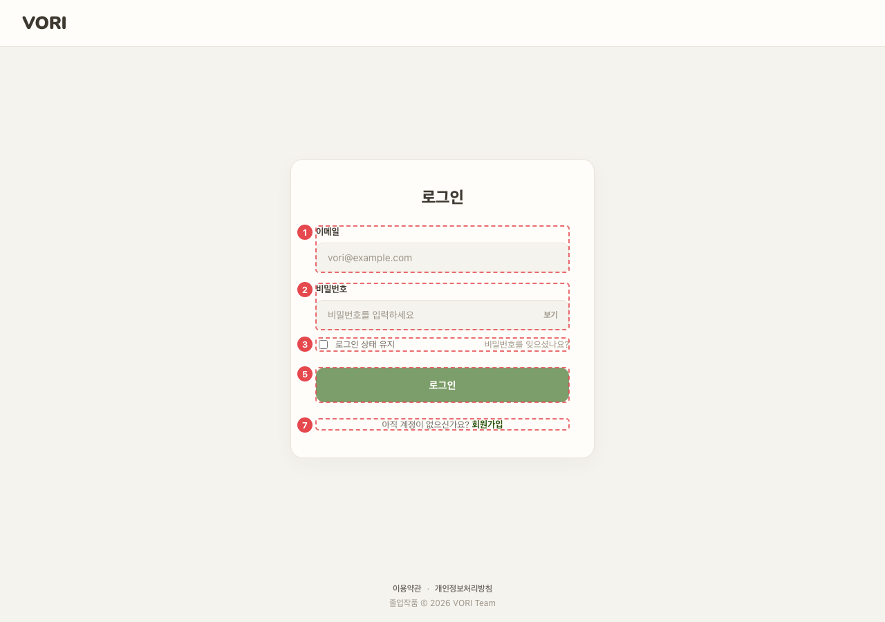
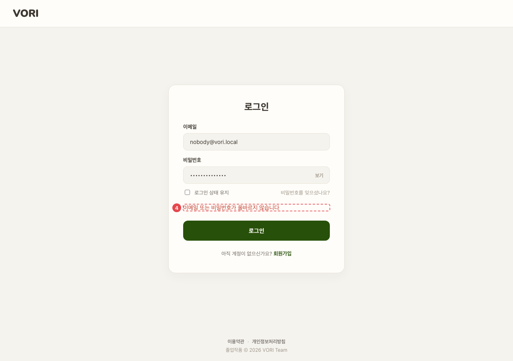

# AUTH_LGN_01 · 로그인

| 화면ID | 화면명 | 경로 | 파일 | 인증 | 버전 | 수정일 | 이미지 출처 |
|---|---|---|---|---|---|---|---|
| `AUTH_LGN_01` | 로그인 | `/login` | `frontend/src/pages/Login/LoginPage.jsx` | 공개 | v0.3 | 2026-10-15 | 실제 화면 캡처 (`0c0a9e4`, 1280px) |

**한 줄 목표**: 사용자가 이메일·비밀번호(또는 구글 계정)로 로그인하고, 계정 상태에 맞는 다음 화면으로 넘어갈 수 있어야 한다.

## 화면

**평소**



**④ 로그인 실패**



<details>
<summary>와이어프레임 (텍스트로 보기)</summary>

```
┌─────────────────────────────┐
│ VORI                         │
│ ┌─────────────────────────┐ │
│ │ 로그인                    │ │
│ │ ① 이메일 [vori@example.com]│ │
│ │ ② 비밀번호 [        ] 보기 │ │
│ │ ③ □ 로그인 상태 유지        │ │
│ │    비밀번호를 잊으셨나요?    │ │
│ │ ④ (오류 문구)              │ │
│ │ ⑤ [        로그인        ] │ │
│ │ ─────── 또는 ───────     │ │
│ │ ⑥ [G 구글 계정으로 계속]    │ │
│ │ ⑦ 아직 계정이 없으신가요? 회원가입│
│ └─────────────────────────┘ │
└─────────────────────────────┘
```

</details>

## Description

번호는 위 와이어프레임의 번호와 짝이다.

| # | 요소 | 기능 | 동작 (누르면·입력하면) | 상태 | 예외·정책 |
|---|---|---|---|---|---|
| ① | 이메일 | `type=email` | 입력값을 그대로 서버에 보냄 | 평소: 입력 가능 (처리 중에도 비활성 안 됨) | 클라이언트 검증 없음 (서버 응답에 맡김) |
| ② | 비밀번호 | 비밀번호 입력 | [보기]/[숨기기] 토글 | 평소: 가려짐 · 보기: 글자 표시, 버튼 "숨기기" | — |
| ③ | 상태 유지 · 비밀번호 찾기 | 체크박스와 링크 | 비밀번호 찾기는 "비밀번호 찾기 화면은 다음에 만들 예정이에요." 알림 | 평소: 체크박스는 눌러도 아무 데도 반영 안 됨 | **둘 다 아직 동작 없음.** 체크박스는 상태와 연결 안 됨 |
| ④ | 오류 | 로그인·상태 조회 실패 문구 | 상태 조회 실패의 [다시 시도] → 상태만 다시 조회 | 평소: 숨김 · 실패: 문구 표시 · 다시 시도 중: [다시 시도] 비활성 | 401 "이메일 또는 비밀번호가 올바르지 않습니다" · 그 밖 서버 message 또는 "로그인 실패 (코드)" · 상태 조회 실패 "로그인은 됐지만 계정 상태를 확인하지 못했어요." + [다시 시도] |
| ⑤ | 로그인 버튼 | 로그인 요청 | `POST /auth/login` → `GET /onboarding/status` → 분기 (README 6-2) | 평소: 활성 · 처리 중: "로그인 중…" 비활성 | 상태 조회 실패는 ④ 오류 |
| ⑥ | 구글 로그인 | 구글 계정 로그인 | `POST /auth/google` → 이후 ⑤와 같은 분기 | 평소: 구글 버튼 + 동의 문구 · 처리 중: "구글 계정으로 로그인하는 중…" · 실패: ④에 오류 문구 | 클라이언트 ID 가 설정된 환경에서만 보임. "구글로 계속하면 이용약관과 개인정보처리방침에 동의한 것으로 봐요." |
| ⑦ | 회원가입 링크 | 가입 화면으로 | → `/signup` | 정적 | — |

## 상태별 화면

| 상태 | 보이는 것 | 사용자가 할 수 있는 것 |
|---|---|---|
| 로딩 | ⑤ 버튼이 "로그인 중…" 으로 비활성 | 기다림 (입력칸은 계속 수정 가능) |
| 실패 (로그인) | ④ 오류 문구 (`role="alert"`) | 다시 입력해 로그인 |
| 실패 (상태 조회) | "로그인은 됐지만 계정 상태를 확인하지 못했어요." + [다시 시도], 화면 이동 없음 | [다시 시도] 로 상태만 다시 조회 |

## 접근성

- 키보드: `<form onSubmit>` 이라 Enter 로 로그인된다. 보기·비밀번호 찾기·다시 시도·회원가입 모두 `<button>`.
- 스크린 리더 라벨: 입력칸은 `<label>` 로 감싸 "이메일"·"비밀번호" 라벨이 붙는다. 보기 버튼 `aria-label` "비밀번호 보기"/"비밀번호 숨기기", 로고 `aria-label="VORI 홈으로"`, 오류 `role="alert"`, 구글 영역 `aria-busy`.
- 포커스: 입력칸에 `:focus` 스타일 있음 (`LoginPage.css:115`). 오류가 나도 포커스를 옮기지 않는다.

## 참고

- API: `POST /auth/login`, `GET /onboarding/status`, `POST /auth/google`.
- 반응형·쿼리·기타: 탈퇴 유예 중 계정이면 이동 전에 "탈퇴 신청이 취소되고 계정이 복구됐어요." 알림 (README 6-2).

## 의문·미해결

- "로그인 상태 유지" 체크박스와 "비밀번호를 잊으셨나요?" 가 동작하지 않는다 (README 8-2).
- 설문을 마친 로그인 사용자가 `/login`·`/signup` 에 들어와도 홈으로 돌려보내지 않는다 (README 8-2 `AUTH_*`).
- 코드와 다름 (0c0a9e4): 네트워크 오류처럼 서버 응답이 없으면 브라우저 오류 문구 또는 "로그인 중 오류가 발생했어요" 가 나온다 (`LoginPage.jsx:66`). 구글 스크립트를 못 불러오면 "구글 로그인 스크립트를 불러오지 못했어요" (`components/GoogleSignInButton.jsx:17`).
- 코드와 다름 (0c0a9e4): 와이어프레임에 없는 푸터가 있다 — 이용약관·개인정보처리방침 링크(새 탭) + "졸업작품 © 2026 VORI Team" (`LoginPage.jsx:206-217`).
