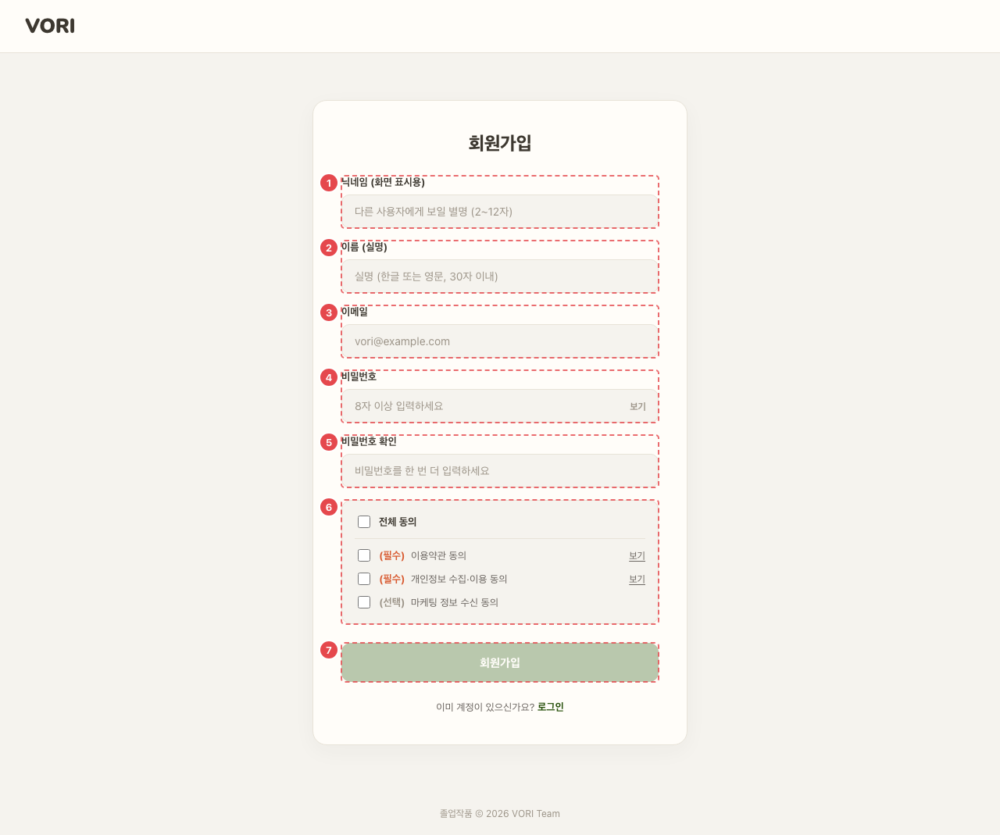

# AUTH_SGN_01 · 회원가입

| 화면ID | 화면명 | 경로 | 파일 | 인증 | 버전 | 수정일 | 이미지 출처 |
|---|---|---|---|---|---|---|---|
| `AUTH_SGN_01` | 회원가입 | `/signup` | `frontend/src/pages/Signup/SignupPage.jsx` | 공개 | v0.3 | 2026-10-15 | 실제 화면 캡처 (`0c0a9e4`, 1280px) |

**한 줄 목표**: 사용자가 계정 정보를 입력하고 필수 약관에 동의해 가입한 뒤, 자동 로그인으로 소비 프로필 설문까지 넘어갈 수 있어야 한다.

## 화면



<details>
<summary>와이어프레임 (텍스트로 보기)</summary>

```
┌─────────────────────────────┐
│ 회원가입                      │
│ ① 닉네임   [            ]    │
│ ② 이름     [            ]    │
│ ③ 이메일   [            ]    │
│ ④ 비밀번호 [            ] 보기│
│   비밀번호는 8자 이상이어야 해요.│
│ ⑤ 비밀번호 확인 [         ]   │
│ ⑥ ☑ 전체 동의                 │
│    ☑ (필수) 이용약관 동의  보기 │
│    ☑ (필수) 개인정보 수집·이용 보기│
│    □ (선택) 마케팅 정보 수신     │
│ ⑦ [       회원가입        ]   │
│   이미 계정이 있으신가요? 로그인 │
└─────────────────────────────┘
```

</details>

## Description

번호는 위 와이어프레임의 번호와 짝이다.

| # | 요소 | 기능 | 동작 (누르면·입력하면) | 상태 | 예외·정책 |
|---|---|---|---|---|---|
| ① | 닉네임 | 화면 표시용 | — | 평소: 입력 가능 | 최대 12자 (서버 2~12자) |
| ② | 이름 | 실명 | — | 평소: 입력 가능 | 최대 30자 |
| ③ | 이메일 | 로그인 ID | — | 평소: 입력 가능 | 중복이면 409 "이미 사용 중인 이메일입니다" |
| ④ | 비밀번호 | 비밀번호 입력, [보기]/[숨기기] 토글 | 입력 중 실시간 안내 | 평소: 안내 없음 · 규칙 위반: 8자 미만 "비밀번호는 8자 이상이어야 해요." · 특수문자 없음 "특수문자를 1개 이상 포함해 주세요." (한 번에 하나만) | — |
| ⑤ | 비밀번호 확인 | 비밀번호 재입력 | — | 평소: 안내 없음 · 불일치: "비밀번호가 일치하지 않아요." · ④의 [보기]를 따라 같이 보이고 가려짐 | 다르면 "비밀번호가 일치하지 않아요." |
| ⑥ | 약관 동의 | 전체 동의 + 필수 2개 + 선택 1개 | 전체 동의 = 선택 포함 전부. 개별이 모두 켜지면 전체도 자동 체크. [보기]는 새 탭 | 평소: 모두 꺼짐 | — |
| ⑦ | 회원가입 버튼 | 가입 요청 | `POST /auth/signup` 성공 → 자동 로그인 → `/signup/profile` | 비활성: 조건 미충족 · 처리 중: "가입 처리 중…" 비활성 | 모든 칸 입력 + 비밀번호 규칙 + 확인 일치 + 필수 약관 2개일 때만 활성. 자동 로그인만 실패하면 알림 후 `/login` |

## 세부

구글 가입 버튼은 없다 (구글은 로그인 화면에서 가입·로그인 겸용).

## 상태별 화면

| 상태 | 보이는 것 | 사용자가 할 수 있는 것 |
|---|---|---|
| 로딩 | ⑦ 버튼이 "가입 처리 중…" 으로 비활성 | 기다림 |
| 실패 (가입) | ⑦ 위에 오류 문구 (`role="alert"`). 409 "이미 사용 중인 이메일입니다" · 400 "입력값을 확인해 주세요 (비밀번호 8자 이상·특수문자 포함, 필수 약관 동의)" · 그 밖 서버 message 또는 "회원가입 실패 (코드)" (`api/auth.js:106-117`) | 고쳐서 다시 가입 |
| 실패 (자동 로그인) | "가입은 완료됐어요. 로그인 페이지에서 다시 로그인해 주세요." 알림 후 `/login` | 로그인 화면에서 로그인 |

## 접근성

- 키보드: `<form onSubmit>` 이라 Enter 로 제출된다 (버튼이 비활성이면 제출 안 됨). 체크박스는 `<label>` 로 감싸 글자를 눌러도 켜진다.
- 스크린 리더 라벨: 입력칸은 `<label>` 로 감싸 라벨이 붙는다. 보기 버튼 `aria-label` "비밀번호 보기"/"비밀번호 숨기기", 로고 `aria-label="VORI 홈으로"`, 가입 오류 `role="alert"`. 비밀번호 실시간 안내는 `role`·`aria-describedby` 연결이 없다.
- 포커스: 입력칸에 `:focus` 스타일 있음 (`SignupPage.css:135`). 오류가 나도 포커스를 옮기지 않는다.

## 참고

- API: `POST /auth/signup`, 자동 로그인 `POST /auth/login`.
- 반응형·쿼리·기타: 가입 보너스 1,000코인, 시작 펫 강아지 지급 (README 6-1).

## 의문·미해결

- 이메일 형식·닉네임 최소 2자를 화면에서 검사하지 않는다 (서버 400 에 맡김) (README 8-2).
- 설문을 마친 로그인 사용자가 `/login`·`/signup` 에 들어와도 홈으로 돌려보내지 않는다 (README 8-2 `AUTH_*`).
- 코드와 다름 (0c0a9e4): 와이어프레임 맨 위에 없는 VORI 로고 헤더(→ `/`)와 "졸업작품 © 2026 VORI Team" 푸터가 있다 (`SignupPage.jsx:109-118`, `:316`).
