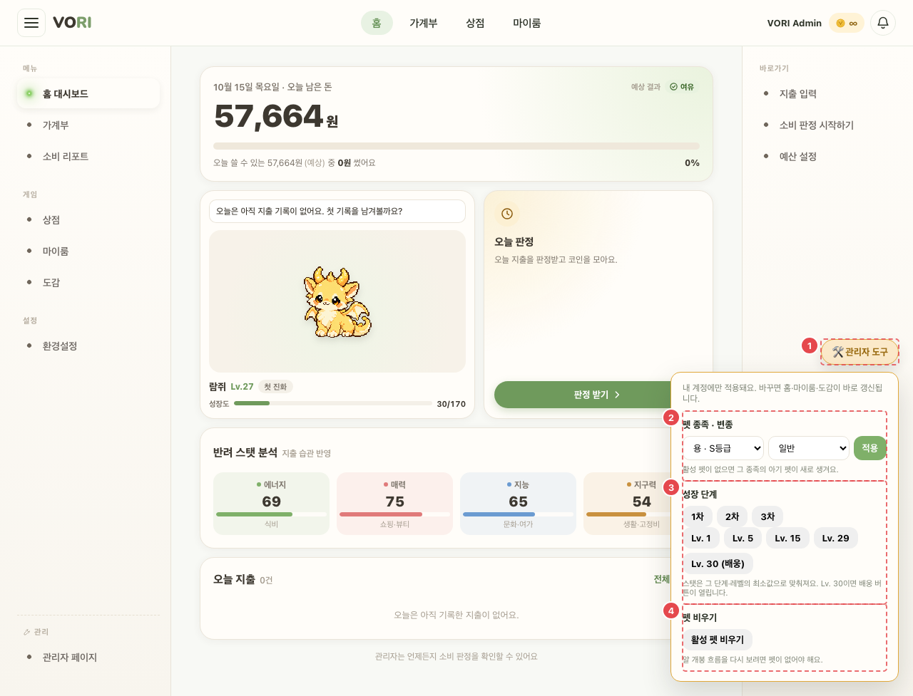

# CMN_ADM_01 · 어드민 도구 (플로팅)

| 화면ID | 화면명 | 경로 | 파일 | 인증 | 버전 | 수정일 | 이미지 출처 |
|---|---|---|---|---|---|---|---|
| `CMN_ADM_01` | 어드민 도구 (플로팅) | `(공통 — 앱 화면 위)` | `frontend/src/components/AdminTools.jsx` | ADMIN | v0.3 | 2026-10-15 | 실제 화면 캡처 (`0c0a9e4`, 1280px) |

**한 줄 목표**: ADMIN 이 시연용으로 자기 펫의 종족·변종·성장 단계를 바꾸거나 펫을 비울 수 있어야 한다.

ADMIN 계정에만 앱 화면 위에 뜬다. 펫 종족·변종 바꾸기, 성장 단계 바꾸기, 펫 비우기. 시연용.

## 화면

**① 토글을 눌러 패널을 연 상태 (ADMIN 계정)**

캡처에 안 보이는 번호: ⑤ — 결과 문구는 [적용]·단계·레벨·비우기 같은 작업을 실행한 뒤에만 나온다(`AdminTools.jsx:164`, `msg` 가 있을 때). 실행하면 어드민 계정의 펫이 바뀌어 누르지 않았다.

## Description

| # | 요소 | 기능 | 동작 (누르면·입력하면) | 상태 | 예외·정책 |
|---|---|---|---|---|---|
| ① | 토글 "🛠 관리자 도구" | 패널 열고 닫기 | 처음 열 때 종족 목록(`GET /admin/pet-species`)을 읽는다 | 평소: 닫힘 · 열림: 패널 | ADMIN 계정에만 앱 화면 위에 뜬다 |
| ② | 펫 종족 · 변종 | 펫 종족·변종 바꾸기 | 종족·변종(일반·이로치·에일리언) 고르고 [적용] → `PUT /admin/me/pet/appearance` | 처리 중: 모든 버튼·선택 비활성 · 종족 목록 없음: 종족 선택 비활성 | "활성 펫이 없으면 그 종족의 아기 펫이 새로 생겨요." |
| ③ | 성장 단계 | 성장 단계 바꾸기 | [1차] [2차] [3차] → `PUT /admin/me/pet/stage`. [Lv. 1] [Lv. 5] [Lv. 15] [Lv. 29] [Lv. 30 (배웅)] → `PUT /admin/me/pet/level` | 처리 중: 비활성 | "스탯은 그 단계·레벨의 최소값으로 맞춰져요. Lv. 30이면 배웅 버튼이 열립니다." |
| ④ | 펫 비우기 | 펫 비우기 | [활성 펫 비우기] → 확인 창 "활성 펫을 비울까요? (보상 0 으로 배웅 처리)" → `DELETE /admin/me/pet` | 처리 중: 비활성 | "알 개봉 흐름을 다시 보려면 펫이 없어야 해요." |
| ⑤ | 결과 문구 | 실행 결과 | — | 성공: "{작업} 완료" · 실패: 서버 message 또는 "{작업} 실패" | 바꾸면 펫 변경 이벤트로 홈·마이룸·도감이 바로 다시 읽는다 |

## 상태별 화면

| 상태 | 보이는 것 | 사용자가 할 수 있는 것 |
|---|---|---|
| 실패 | 종족 목록 조회 실패·작업 실패는 ⑤ 에 오류 문구 | 다시 시도 |
| 권한 없음 | 일반 계정에는 렌더되지 않는다 (AppShell 이 역할을 보고 붙인다) | — |

## 접근성

- 키보드: 모든 조작이 `<button>`·`<select>`
- 스크린 리더 라벨: 토글 `aria-expanded` + `aria-controls`, 패널 `role="region"` "관리자 도구", 선택 "종족"·"변종", 결과 문구 `role="status"`
- 포커스: 확인 필요 (포커스 이동 코드 없음)

## 참고

- API: 원문에 없음. 코드: `GET /admin/pet-species`, `PUT /admin/me/pet/appearance`, `PUT /admin/me/pet/stage`, `PUT /admin/me/pet/level`, `DELETE /admin/me/pet` (`frontend/src/api/admin.js:231-258`)
- 반응형·쿼리·기타: 오른쪽 아래 고정(`AppShell.css:526-530`), 하단 탭 바가 있는 폭에서는 위치를 바꾼다 (`AppShell.css:859`). [CMN_SHELL_01](CMN_SHELL_01.md) 이 붙인다.

## 의문·미해결

- README 8-2 에 이 화면 줄 없음.
- 코드와 다름 (0c0a9e4): 원문에 없는 레벨 바꾸기(Lv. 1·5·15·29·30) 버튼이 있다 (`frontend/src/components/AdminTools.jsx:130-140`). 원문 기준 `bbb6b3c` 에도 이미 있었다.
- 코드와 다름 (0c0a9e4): 토글 툴팁이 "관리자 도구 — 펫·코인을 바꿔 화면을 확인" 인데 코인을 바꾸는 기능은 없다 (`frontend/src/components/AdminTools.jsx:62`).
