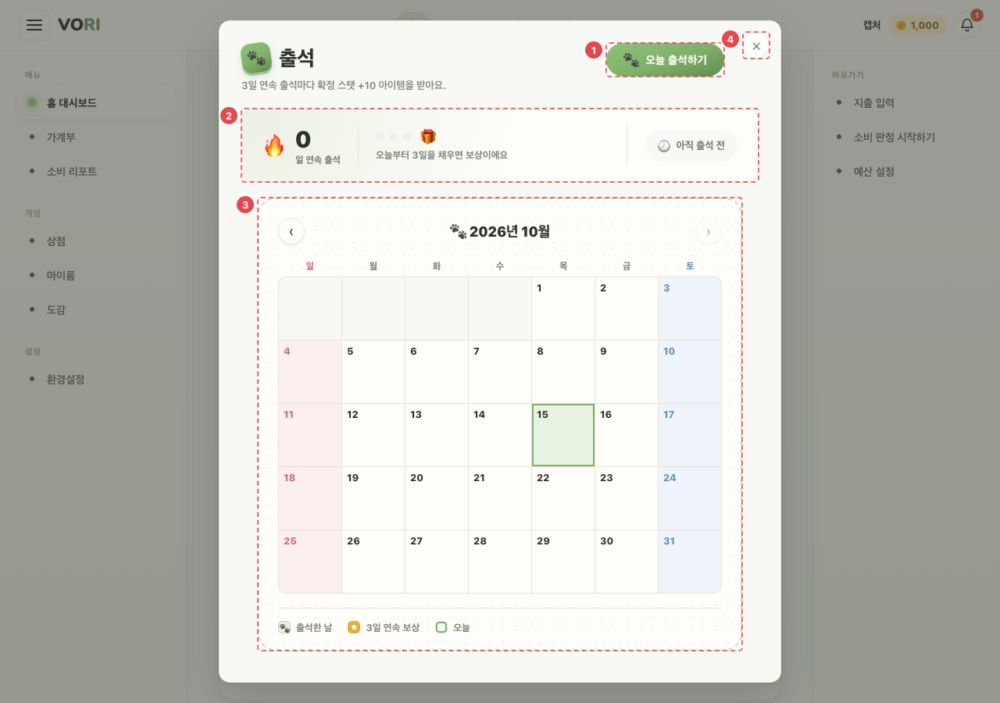
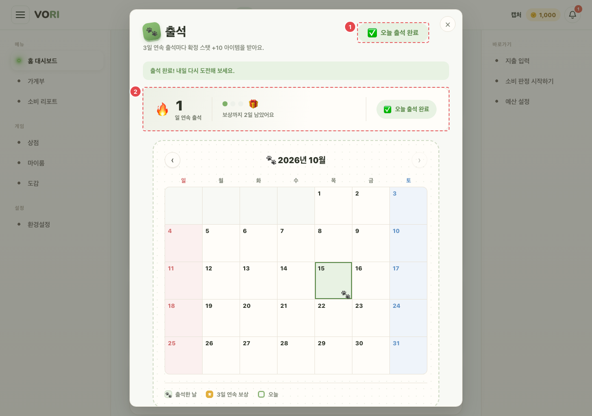

# CMN_ATT_01 · 출석 팝업

| 화면ID | 화면명 | 경로 | 파일 | 인증 | 버전 | 수정일 | 이미지 출처 |
|---|---|---|---|---|---|---|---|
| `CMN_ATT_01` | 출석 팝업 | `(공통 — 앱 화면 위)` | `frontend/src/components/AttendanceGate.jsx`, `frontend/src/components/AttendanceModal.jsx` | 로그인 | v0.3 | 2026-10-15 | 실제 화면 캡처 (`0c0a9e4`, 1280px) |

**한 줄 목표**: 사용자가 하루 한 번 출석하고 보상(스탯 아이템)을 받을 수 있어야 한다.

## 화면

**평소 (오늘 출석 전)**

**① [오늘 출석하기]를 누른 뒤**

## Description

| # | 요소 | 기능 | 동작 (누르면·입력하면) | 상태 | 예외·정책 |
|---|---|---|---|---|---|
| ① | 출석 버튼 | 오늘 출석 | 출석 시 60% 확률로 스탯 아이템. 받으면 "{아이템}을(를) 받았어요!", 못 받으면 "출석 완료! 내일 다시 도전해 보세요." | 평소: "오늘 출석하기" · 로딩: "불러오는 중…" 비활성 · 처리 중: "처리 중…" 비활성 · 완료: "오늘 출석 완료" 비활성 · 실패: 서버 message | 아이템은 마이룸 아이템 탭에서 사용 |
| ② | 연속 출석 띠 | 연속 출석 일수·다음 보상까지 남은 날·오늘 상태 | — | 로딩: 숫자 "…", "불러오는 중…", "확인 중…" · 평소: "아직 출석 전" / "오늘 출석 완료" / "오늘 아이템 획득" | — |
| ③ | 달력 | 이번 달 출석한 날·연속 보상 날 표시 | ‹ › 로 달 이동, 다른 달이면 "오늘로" | 다음 달 버튼: 이번 달이면 비활성 | 미래 달로는 못 넘어간다 |
| ④ | 닫기 (×) | 팝업 닫기 | 닫기 버튼·Esc·바깥 클릭으로 닫힌다 | 정적 | 한 번 닫으면 그날은 다시 안 뜬다(브라우저 기록). 다시 열기 = 계정 메뉴 → 출석 확인 |

## 세부

| 항목 | 내용 |
|---|---|
| 노출 조건 | 그날 출석 전이면 하루 한 번 자동. 한 번 닫으면 그날은 다시 안 뜬다(브라우저 기록). 이름 짓기 모달이 떠 있으면 미룬다 |
| 다시 열기 | 계정 메뉴 → 출석 확인 |
| 보상 | 출석 시 60% 확률로 스탯 아이템. 아이템은 마이룸 아이템 탭에서 사용 |

## 상태별 화면

| 상태 | 보이는 것 | 사용자가 할 수 있는 것 |
|---|---|---|
| 로딩 | ① "불러오는 중…" 비활성, ② "…"·"확인 중…" | 닫기, 달 이동 |
| 실패 | 자동 노출 판단용 조회(`GET /attendance`) 실패면 팝업을 띄우지 않는다. 팝업 안 조회·출석 실패는 빨간 안내 문구(서버 message) | 계정 메뉴 → 출석 확인으로 다시 연다 |

## 접근성

- 키보드: Esc 로 닫힘. 모든 조작이 `<button>`
- 스크린 리더 라벨: `role="dialog"` `aria-modal="true"`, 제목 "출석"으로 `aria-labelledby`. 닫기 "닫기", 달 이동 "이전 달"·"다음 달". 안내 문구는 성공 `role="status"`, 실패 `role="alert"`. 장식 이모지는 `aria-hidden`
- 포커스: 열리면 다이얼로그 자체에 포커스(`tabIndex=-1`). Tab 가두기는 없다. 떠 있는 동안 뒤 화면 스크롤 잠금

## 참고

- API: 원문에 없음. 코드: `GET /attendance`, 월별 출석 기록 조회, 출석하기 (`frontend/src/api/attendance.js`)
- 반응형·쿼리·기타: 브라우저 기록 키 `vori.attendance.shownOn`. 다시 열기 이벤트 `vori:open-attendance`. [CMN_SHELL_01](CMN_SHELL_01.md) 이 붙는 앱 화면에서만 뜬다. 가계부 작성(`/wallet/new`)·작성 확인·소비 분석은 AppShell 밖이라, 온보딩에서 [첫 지출 기록하기]로 가면 저장 뒤 AppShell 화면(가계부 등)에 처음 닿을 때 뜬다.

## 의문·미해결

- README 8-2 에 이 화면 줄 없음.
- 코드와 다름 (0c0a9e4): 원문 보상 칸에 없는 3일 연속 출석 보상이 있다. 연속 3일마다 확정으로 "연속 출석 …" 아이템(스탯 +10)을 주고, 확률 아이템은 +5 다 (`backend/src/main/java/com/vori/backend/attendance/AttendanceService.java:48-55`). 팝업 부제도 "3일 연속 출석마다 확정 스탯 +10 아이템을 받아요." 다 (`frontend/src/components/AttendanceModal.jsx`).
- 코드와 다름 (0c0a9e4): "이름 짓기 모달이 떠 있으면 미룬다" — 코드는 그 순간 자동으로 열지 않을 뿐 다시 시도하지 않는다. 그날 닫은 기록은 남기지 않으므로 다음 화면 이동(AppShell 다시 마운트) 때 뜬다 (`frontend/src/components/AttendanceGate.jsx:26-33`).
- 이미 출석한 날 다시 출석하면 서버가 409 "오늘은 이미 출석했어요." 를 준다 (`AttendanceService.java:44-46`). 화면에서는 버튼이 비활성이라 보통 나오지 않는다.
