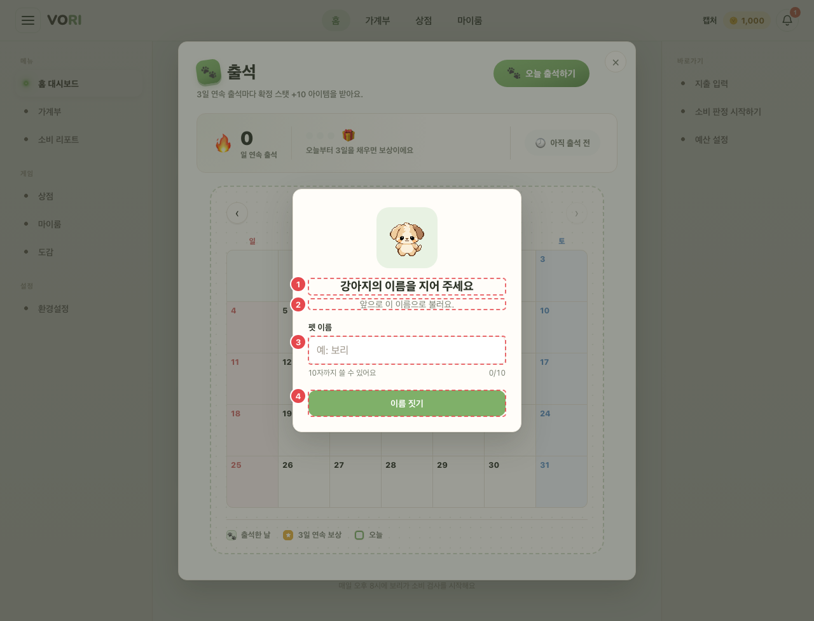

# CMN_PNM_01 · 펫 이름 짓기 (강제 모달)

| 화면ID | 화면명 | 경로 | 파일 | 인증 | 버전 | 수정일 | 이미지 출처 |
|---|---|---|---|---|---|---|---|
| `CMN_PNM_01` | 펫 이름 짓기 (강제 모달) | `(공통 — 앱 화면 위)` | `frontend/src/components/PetNameGate.jsx` | 로그인 | v0.3 | 2026-10-15 | 실제 화면 캡처 (`0c0a9e4`, 1280px) |

**한 줄 목표**: 이름 없는 활성 펫이 있을 때 사용자가 펫 이름을 지어야 한다 (지어야만 닫힌다).

## 화면

**평소 (가입 직후 이름 없는 시작 펫)**

**③ 빈 값으로 [이름 짓기]를 눌렀을 때**

## Description

| # | 요소 | 기능 | 동작 (누르면·입력하면) | 상태 | 예외·정책 |
|---|---|---|---|---|---|
| ① | 제목 | "{종족}의 이름을 지어 주세요" | — | 정적 (종족 이름이 없으면 "펫") | — |
| ② | 안내 | "앞으로 이 이름으로 불러요." | — | 정적 | — |
| ③ | 입력 | placeholder "예: 보리" | 입력하면 오류 문구가 지워진다 | 평소: 힌트 "10자까지 쓸 수 있어요" + 글자 수 "n/10" · 10자 초과·오류: 힌트 빨강 · 저장 중: 비활성 | 빈 값 "펫 이름을 입력해 주세요" · 10자 초과 "펫 이름은 10자 이내로 입력해 주세요" |
| ④ | [이름 짓기] | 이름 저장 | `PUT /pets/{id}/name` → 성공하면 모달이 사라지고 홈·마이룸이 새 이름으로 다시 그린다 | 평소: 활성 · 저장 중: "저장 중…" 비활성 · 실패: 서버 message, 없으면 "이름을 저장하지 못했어요. 다시 시도해 주세요." | 닫기 불가 (닫기 버튼·Esc·바깥 클릭 모두 막음) |

## 세부

| 항목 | 내용 |
|---|---|
| 노출 조건 | 이름 없는 활성 펫이 있을 때 (가입 직후 시작 펫, 알 개봉 직후) |
| 구성 | "{종족}의 이름을 지어 주세요" / "앞으로 이 이름으로 불러요." / 입력(placeholder "예: 보리") / [이름 짓기] |
| 닫기 | 불가 (닫기 버튼·Esc·바깥 클릭 모두 막음) |
| 검증 | 빈 값 "펫 이름을 입력해 주세요" · 10자 초과 "펫 이름은 10자 이내로 입력해 주세요" |
| API | `PUT /pets/{id}/name` |

## 상태별 화면

| 상태 | 보이는 것 | 사용자가 할 수 있는 것 |
|---|---|---|
| 로딩 | 활성 펫 조회(`GET /pets/active`) 중에는 모달이 뜨지 않는다 | 뒤 화면을 그대로 쓴다 |
| 실패 | 활성 펫 조회 실패면 모달을 띄우지 않는다 (조용히 넘김). 저장 실패면 ③ 아래 오류 문구 | 저장 실패 시 다시 [이름 짓기] |

## 접근성

- 키보드: Tab 이 모달 안(입력·버튼)에서만 돈다. Enter 로 제출 (`<form>`)
- 스크린 리더 라벨: `role="dialog"` `aria-modal="true"`, 제목으로 `aria-labelledby`. 입력 라벨 "펫 이름", 힌트를 `aria-describedby` 로 연결, 오류 시 `aria-invalid` + `role="alert"`
- 포커스: 뜨면 입력에 자동 포커스(`autoFocus`). 떠 있는 동안 뒤 화면 스크롤 잠금

## 참고

- API: `PUT /pets/{id}/name`
- 반응형·쿼리·기타: 상점 알 개봉 등에서 펫 변경 이벤트(`PET_CHANGED_EVENT`)를 받으면 활성 펫을 다시 읽는다. [CMN_SHELL_01](CMN_SHELL_01.md) 이 붙는 앱 화면에서만 뜬다. 가계부 작성(`/wallet/new`)·작성 확인·소비 분석은 AppShell 밖이라, 온보딩에서 [첫 지출 기록하기]로 가면 저장 뒤 AppShell 화면(가계부 등)에 처음 닿을 때 뜬다.

## 의문·미해결

- 없음
