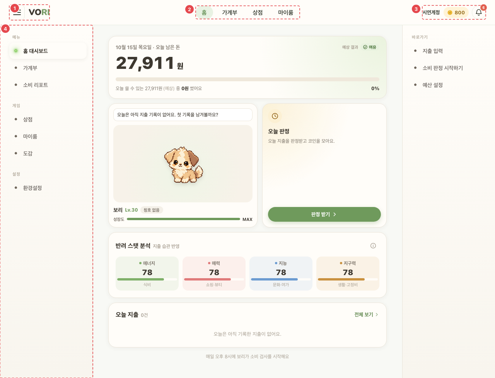
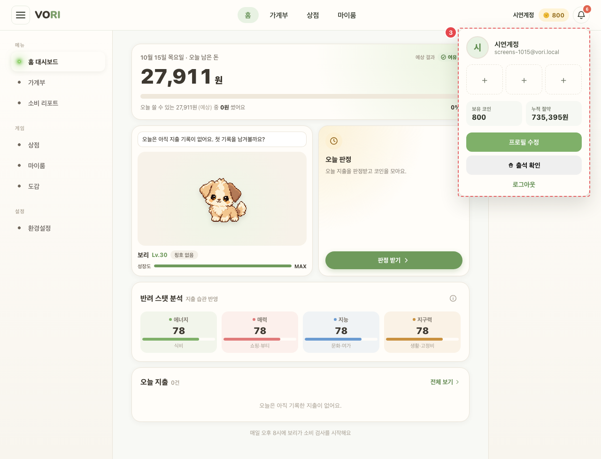
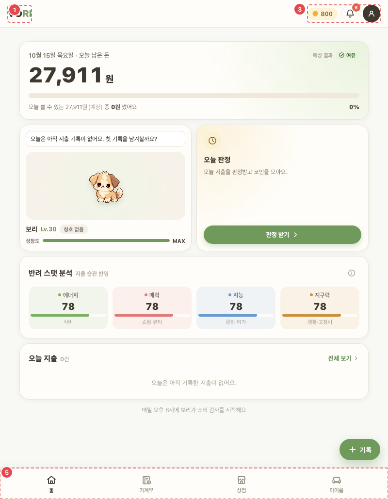

# CMN_SHELL_01 · AppShell (앱 화면 공통 틀)

| 화면ID | 화면명 | 경로 | 파일 | 인증 | 버전 | 수정일 | 이미지 출처 |
|---|---|---|---|---|---|---|---|
| `CMN_SHELL_01` | AppShell (앱 화면 공통 틀) | `(공통 — 앱 화면 위)` | `frontend/src/components/AppShell.jsx` | 로그인 (관리 메뉴는 ADMIN 만) | v0.3 | 2026-10-15 | 실제 화면 캡처 (`0c0a9e4`, 1280px) |

**한 줄 목표**: 사용자가 어느 앱 화면에서든 주 메뉴·사이드바·하단 탭 바로 다른 화면에 가고, 계정 메뉴에서 코인·알림·출석·로그아웃에 닿을 수 있어야 한다.

`components/AppShell.jsx`. 로그인 후 앱 화면(가계부 작성·어드민 제외)을 모두 감싼다.

## 화면

**평소 (폭 1280px)**



**③ 계정 메뉴 팝오버 열림**



**폭 1024px 이하 (폭 800px) — ⑤ 하단 탭 바**



<details>
<summary>와이어프레임 (텍스트로 보기)</summary>

```
┌───────────────────────────────────────────────────────────┐
│ ① ☰  VO|RI     ② 홈  가계부  상점  마이룸      ③ 닉네임·🪙 🔔 │
├──────────┬────────────────────────────────────────────────┤
│ ④ 메뉴    │                                                │
│  홈 대시보드│                                                │
│  가계부    │              (각 화면 본문)                     │
│  소비 리포트│                                                │
│ 게임      │                                                │
│  상점·마이룸│                                                │
│  도감      │                                                │
│ 설정      │                                                │
│ 관리(ADMIN)│                                                │
├──────────┴────────────────────────────────────────────────┤
│ ⑤ [홈] [가계부] [상점] [마이룸]          ← 1024px 이하에서만    │
└───────────────────────────────────────────────────────────┘
```

</details>

## Description

번호는 위 와이어프레임의 번호와 짝이다.

| # | 요소 | 기능 | 동작 (누르면·입력하면) | 상태 | 예외·정책 |
|---|---|---|---|---|---|
| ① | 햄버거 · 로고 | 햄버거 · 로고 | 1024px 이하는 드로어를 연다. 넓은 화면은 사이드바를 접고 펴며, 상태를 브라우저(`vori.sidebar.collapsed`)에 기억한다. 로고 → `/home` | 평소: 활성 · 드로어 열림: 뒤에 배경막, 배경막을 누르면 닫힘 · 브라우저 저장소를 못 읽으면 펼친 상태로 시작 | — |
| ② | 주 메뉴 | 홈 · 가계부 · 상점 · 마이룸 | 각 메뉴 화면으로 이동 | 평소: 현재 화면 강조 (`is-active`) | — |
| ③ | 계정 메뉴 | 닉네임·보유 코인(ADMIN 은 ∞), 알림 종 | 누르면 팝오버: 장착 업적 3칸, 누적 절약, 소비 리포트·도감·환경설정 링크, 프로필 수정, (ADMIN) 관리자 페이지, 출석 확인, 로그아웃 | 로딩: "내 정보 불러오는 중…" · 실패: "내 정보 다시 불러오기" 버튼 · 팝오버 값 로딩: 보유 코인·누적 절약 "…" · 알림 종: 안 읽은 개수 배지(10개 이상 "9+") | Esc·바깥 클릭으로 닫힘 |
| ④ | 사이드바 | 메뉴 / 게임 / 설정 / 관리(ADMIN 만) | 각 메뉴 화면으로 이동 (드로어는 이동하면서 닫힘) | 평소: 현재 메뉴 강조 · 비활성: "준비 중" (현재 해당 없음) · 일반 계정: 관리 섹션 없음 | 화면이 없는 메뉴는 "준비 중" 표시하고 비활성 (현재 해당 없음) |
| ⑤ | 하단 탭 바 | 주 메뉴와 같은 4개 | 각 메뉴 화면으로 이동 | 평소: 현재 탭 강조 (`aria-current="page"`, 아이콘 선 굵게) | 1024px 이하에서만 |

## 상태별 화면

| 상태 | 보이는 것 | 사용자가 할 수 있는 것 |
|---|---|---|
| 로딩 | ③ 자리에 "내 정보 불러오는 중…" (`AccountSummary.jsx`) | 다른 메뉴는 그대로 쓸 수 있다 |
| 실패 | ③ 자리에 "내 정보 다시 불러오기" 버튼. 알림 목록 조회 실패는 팝오버에 "알림을 불러오지 못했어요." | 버튼을 눌러 다시 읽는다. 알림은 팝오버를 다시 연다 |
| 빈 | 알림 팝오버에 "새 알림이 없어요." | 팝오버 닫기 |
| 권한 없음 | 일반 계정은 사이드바 관리 섹션·관리자 도구(`CMN_ADM_01`)가 렌더되지 않는다. 역할 조회(`getMe`) 실패도 일반 계정처럼 처리 | — |

## 접근성

- 키보드: 모든 메뉴가 `<button>`. 계정·알림 팝오버는 Esc 로 닫힌다. 하단 탭은 `:focus-visible` 스타일이 있다 (`AppShell.css:851`)
- 스크린 리더 라벨: 햄버거 `aria-label` "메뉴 열기"/"메뉴 닫기" + `aria-expanded`, 로고 "VORI 홈", 영역 라벨 "주 메뉴"·"사이드 메뉴"·"하단 메뉴", 계정 요약 "{닉네임}, 보유 코인 {n 또는 무제한}. 내 정보 열기", 알림 종 "알림 {n}개 안 읽음"/"알림", 팝오버 `role="dialog"` "내 정보"·"알림". 사이드바 링크·하단 탭·설정 링크는 현재 화면에 `aria-current="page"` (사이드바 메뉴·게임 섹션은 `is-active` 클래스만)
- 포커스: 팝오버를 열어도 포커스를 옮기지 않는다 (코드에 포커스 이동 없음)

## 참고

- API: `GET /users/me`, `GET /achievements`, `GET /notifications/unread-count`, `GET /pets/active`, `GET /attendance`.
- 반응형·쿼리·기타: GET 이 아닌 요청이 끝나면 `vori:account-updated` 이벤트로 코인·알림을 다시 읽는다.
- 공통 팝업: [CMN_PNM_01](CMN_PNM_01.md) · [CMN_ATT_01](CMN_ATT_01.md) · [CMN_ADM_01](CMN_ADM_01.md) 을 이 틀이 붙인다.

## 의문·미해결

- README 8-2 에 이 화면 줄 없음.
- 코드와 다름 (0c0a9e4): "GET 이 아닌 요청이 끝나면" 다시 읽는다고 했지만, 조회용 POST(`query`)는 이벤트를 보내지 않고 (`frontend/src/api/http.js:62`), 영수증 업로드(`upload`)도 보내지 않는다 (`frontend/src/api/http.js:73-81`). 반대로 코인은 창으로 돌아올 때(`focus`)도, 알림 개수는 1분마다도 다시 읽는다 (`frontend/src/components/AccountSummary.jsx:28`, `frontend/src/components/NotificationBell.jsx:55-56`).
- 코드와 다름 (0c0a9e4): 사이드바 "설정" 섹션 안 메뉴 이름은 "환경설정" 하나다 (`frontend/src/components/AppShell.jsx:200-216`). 와이어프레임에는 섹션 이름만 있다.
