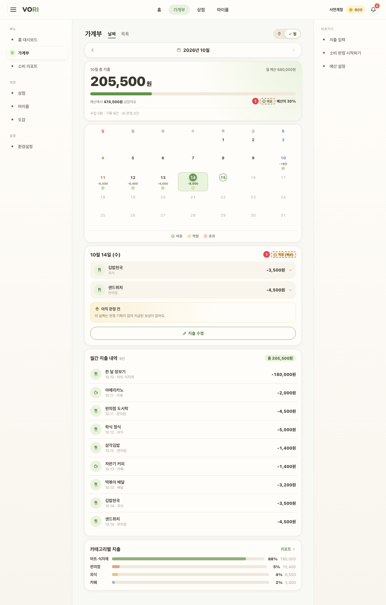
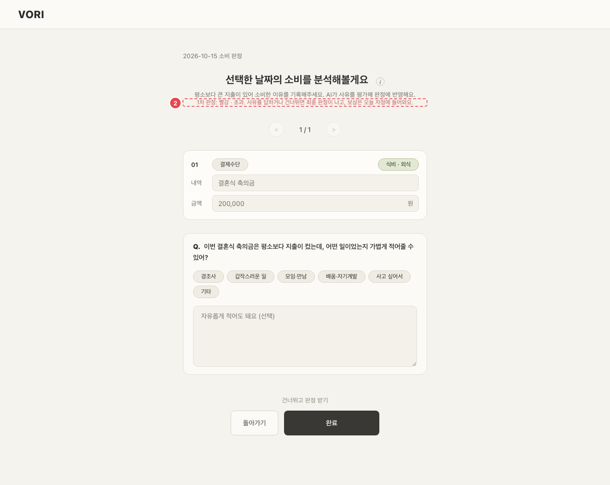

# CMN_SIG_01 · 신호 칩

| 화면ID | 화면명 | 경로 | 파일 | 인증 | 버전 | 수정일 | 이미지 출처 |
|---|---|---|---|---|---|---|---|
| `CMN_SIG_01` | 신호 칩 | `(공통 — 앱 화면 위)` | `frontend/src/components/SignalChip.jsx`, `frontend/src/signalLabels.js` | 로그인 | v0.3 | 2026-10-15 | 실제 화면 캡처 (`0c0a9e4`, 1280px) |

**한 줄 목표**: 사용자가 하루 판정 신호(여유·적정·초과·예산 소진)를 색에만 기대지 않고 알아볼 수 있어야 한다.

## 화면

**홈 — ① 칩 · ③ "예상 결과"**

**가계부 — ① 칩 (확정 전이라 "(예상)")**

**하루 판정 — ② 판정 화면 문구**

## Description

| # | 요소 | 기능 | 동작 (누르면·입력하면) | 상태 | 예외·정책 |
|---|---|---|---|---|---|
| ① | 칩 | 칩 문구 여유 · 적정 · 초과 | — | 정적 (서버 값이 `GREEN`·`GRAY`·`RED` 가 아니면 렌더하지 않음) | 색만으로 구분하지 않도록 칩은 항상 아이콘(체크·마이너스·경고)과 글자를 같이 보여 준다. |
| ② | 판정 화면 문구 | 초록 · 여유 / 노랑 · 적정 / 빨강 · 초과 / 주황 · 예산 소진 | — | 정적 | 예산 소진은 그룹 월예산을 다 쓴 경우 |
| ③ | 예상 표시 | "(예상)" 또는 "예상 결과" | — | 판정 확정 전에만 | 판정이 확정되기 전에는 칩 옆에 "(예상)" 또는 "예상 결과" 를 붙인다. |

## 세부

| 서버 값 | 색 | 칩 문구 | 판정 화면 문구 | 기준 (하루 판정, 스탯 그룹 단위) |
|---|---|---|---|---|
| `GREEN` | 초록 | 여유 | 초록 · 여유 | 사용 가능 금액의 85% 이하 사용 |
| `GRAY` | 노랑(amber) | 적정 | 노랑 · 적정 | 85% 초과 ~ 100% 이하 |
| `RED` | 빨강 | 초과 | 빨강 · 초과 | 100% 초과 |
| (예산 소진) | 주황 | — | 주황 · 예산 소진 | 그룹 월예산을 다 쓴 경우 |

색만으로 구분하지 않도록 칩은 항상 아이콘(체크·마이너스·경고)과 글자를 같이 보여 준다.
판정이 확정되기 전에는 칩 옆에 "(예상)" 또는 "예상 결과" 를 붙인다.

## 상태별 화면

| 상태 | 보이는 것 | 사용자가 할 수 있는 것 |
|---|---|---|
| 빈 | 알 수 없는 신호 값이면 칩을 그리지 않는다. 판정 결과 화면의 스탯 그룹은 저장된 판정이 없으면 "기록 없음" (`frontend/src/pages/WalletEntry/JudgmentResults.jsx:9`) | — |

## 접근성

- 키보드: 해당 없음 (누를 수 없는 표시)
- 스크린 리더 라벨: 아이콘은 장식이라 `aria-hidden`, 뜻은 글자(여유·적정·초과)가 전한다 (`frontend/src/components/Icon.jsx:225`)
- 포커스: 해당 없음

## 참고

- 쓰는 곳: 홈·가계부 (`SignalChip`), 판정 결과 (`JudgmentResults.jsx` 의 `SIGNAL_LABELS`·"주황 · 예산 소진"). "예상 결과" = `frontend/src/pages/Home/HomeDashboard.jsx:280`, "(예상)" = `frontend/src/pages/Home/HomeDashboard.jsx:310`, `frontend/src/pages/Wallet/WalletPage.jsx:1111`
- 문구 SSOT: `frontend/src/signalLabels.js`

## 의문·미해결

- README 8-2 에 이 화면 줄 없음.
- 코드와 다름 (0c0a9e4): 화면이 직접 계산하는 신호(`signalForUsage`)는 사용 가능 금액이 0 이하이면 쓴 돈이 있을 때 `RED`, 없을 때 `GRAY` 로 정한다 (`frontend/src/components/SignalChip.jsx:15-17`). 원문 기준 표에 이 경우가 없다.
