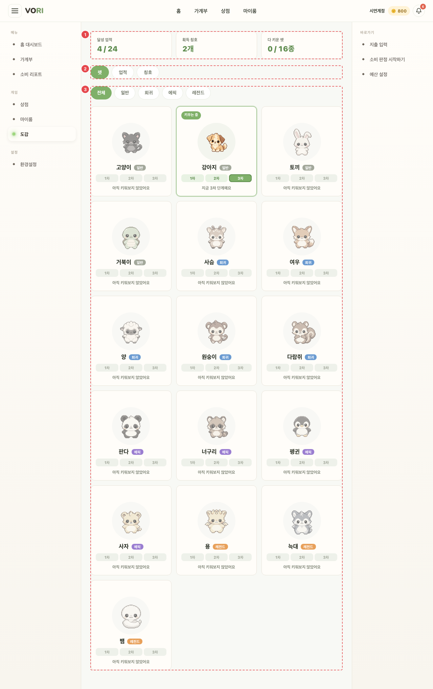
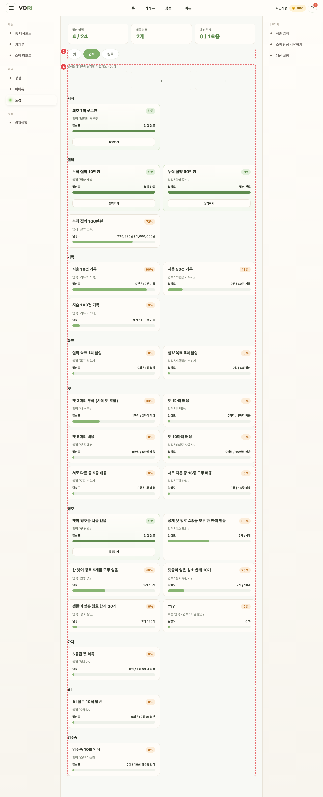
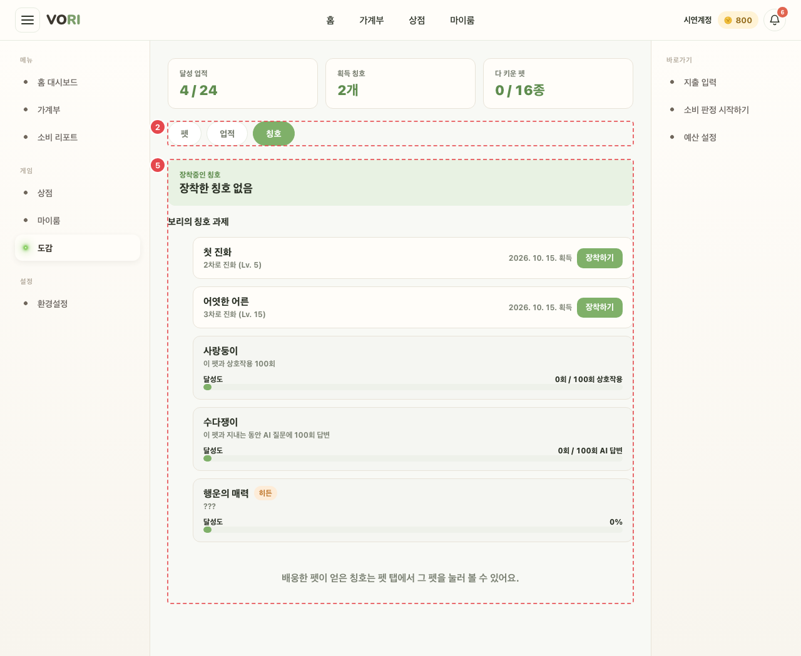

# GAME_DEX_01 · 도감

| 화면ID | 화면명 | 경로 | 파일 | 인증 | 버전 | 수정일 | 이미지 출처 |
|---|---|---|---|---|---|---|---|
| `GAME_DEX_01` | 도감 | `/dex` | `frontend/src/pages/PetDex/PetDexPage.jsx` | 로그인 | v0.3 | 2026-10-15 | 실제 화면 캡처 (`0c0a9e4`, 1280px) |

**한 줄 목표**: 사용자가 키운 펫 종족·업적·칭호를 한곳에서 보고, 업적과 칭호를 장착할 수 있어야 한다.

## 화면

**펫 탭**

**업적 탭**

**칭호 탭**

## Description

번호는 위 와이어프레임의 번호와 짝이다.

| # | 요소 | 기능 | 동작 (누르면·입력하면) | 상태 | 예외·정책 |
|---|---|---|---|---|---|
| ① | 요약 카드 3개 | 달성 업적 n/전체 · 획득 칭호 n개 · 다 키운 펫 n / 17종 | — | 로딩: 세 칸 모두 "…" · ADMIN: 다 키운 펫 "n / n종 (관리자)" | — |
| ② | 탭 | 펫 / 업적 / 칭호 | 누르면 해당 탭으로 바뀐다 | 평소: 고른 탭 강조(`aria-selected`) | `?tab=achievements|titles` 로 주소에 남는다 |
| ③ | 펫 탭 | 등급 필터(전체·일반·희귀·에픽·레전드). 종족 카드 | 도달한 단계만 눌러서 볼 수 있다. 이름 → `GAME_DEX_02` | 평소: "키우는 중"·"다 키움" 배지 · 비활성: 키워 본 적 없으면 흐리게, 도달 못 한 단계 버튼 비활성 · 실패: 오류 문구 · ADMIN: "관리자 열람" 배지, 전 단계 열림 | — |
| ④ | 업적 탭 | "업적은 3개까지 장착할 수 있어요 · n / 3". 카테고리별 카드(진행 바, [장착하기/장착 해제]) | `PUT /achievements/equipped` | 로딩: "불러오는 중…" · 처리 중: 장착 버튼 비활성 · 비활성: 3개를 다 장착하면 나머지 [장착하기] 비활성 · 실패: 오류 문구 | 히든 업적은 %만 보인다 |
| ⑤ | 칭호 탭 | 지금 키우는 펫 기준. 딴 칭호는 [장착하기], 못 딴 칭호는 달성도 | `PUT /pets/{id}/equipped-title` | 로딩: "불러오는 중…" · 처리 중: 버튼 비활성 · 실패: 오류 문구 · 성공: "칭호를 장착했어요. 홈에서 보여요." / "칭호 장착을 해제했어요." (10초 뒤 사라짐) | 펫이 없으면 "지금 키우는 펫이 없어요" + [상점 가기] |

## 상태별 화면

| 상태 | 보이는 것 | 사용자가 할 수 있는 것 |
|---|---|---|
| 로딩 | 요약 "…", 업적·칭호 탭 "불러오는 중…" | 탭 전환 |
| 실패 | 펫: 서버 문구 또는 "도감을 불러오지 못했어요". 업적: "칭호를 불러오지 못했어요". 칭호 탭: 서버 문구 또는 "칭호를 불러오지 못했어요" (펫·업적 오류는 따로 보여 한쪽만 실패해도 다른 탭은 뜬다) | 다른 탭 보기. 다시 시도 버튼은 없다 |
| 빈 | 칭호 탭에서 키우는 펫이 없으면 "지금 키우는 펫이 없어요" / "알을 열면 새 칭호 과제가 시작돼요" + [상점 가기] | 상점으로 이동 |
| 권한 없음 | 펫·업적 조회 중 401 이 있으면 `/login` 으로 보낸다 | — |

## 접근성

- 키보드: 확인 필요 (모든 동작이 일반 버튼·링크라 Tab·Enter 로 쓸 수 있다. 탭 줄 화살표 이동은 없다)
- 스크린 리더 라벨: 탭 줄 `role="tablist"` "도감 구분", 패널 `role="tabpanel"`. 등급 필터 `role="group"` "등급 필터" + `aria-pressed`. 단계 버튼 "{종족} n차 모습 보기" + `aria-pressed`. 화면 제목 "도감" 은 숨김 제목(`dex-sr-title`)으로 둔다. 오류는 `role="alert"`, 칭호 안내는 `role="status"`.
- 포커스: 확인 필요

## 참고

- API: `PUT /achievements/equipped`, `PUT /pets/{id}/equipped-title`
- 반응형·쿼리·기타: `?tab=achievements|titles` 로 주소에 남는다. 리다이렉트 `/titles` → `/dex?tab=titles`.

## 의문·미해결

- 코드와 다름 (0c0a9e4): 요약 카드 "다 키운 펫 n / 17종" 이지만 도감 목록 `PET_CATALOG` 는 16종이라 화면에는 "n / 16종" 으로 나온다 (`frontend/src/components/petCatalog.js:1`, `:9-26`, `frontend/src/pages/PetDex/PetDexPage.jsx:109`).
