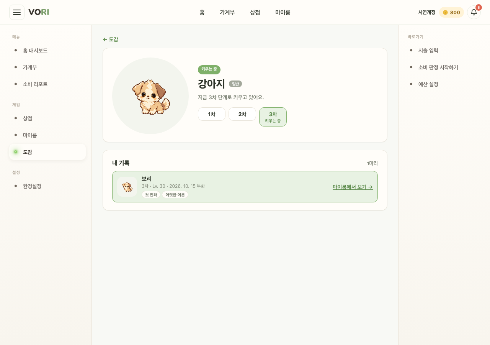

# GAME_DEX_02 · 펫 상세

| 화면ID | 화면명 | 경로 | 파일 | 인증 | 버전 | 수정일 | 이미지 출처 |
|---|---|---|---|---|---|---|---|
| `GAME_DEX_02` | 펫 상세 | `/dex/:appearanceKey` | `frontend/src/pages/PetDex/PetDetailPage.jsx` | 로그인 | v0.3 | 2026-10-15 | 실제 화면 캡처 (`0c0a9e4`, 1280px) |

**한 줄 목표**: 사용자가 한 종족의 단계별 모습과 그 종족으로 키운 펫 기록을 볼 수 있어야 한다.

## 화면

**강아지 (/dex/puppy) — 문서에 번호가 없어 배지 없음**

## Description

번호는 위 와이어프레임의 번호와 짝이다.

| # | 요소 | 기능 | 동작 (누르면·입력하면) | 상태 | 예외·정책 |
|---|---|---|---|---|---|
| — | [← 도감] | 도감으로 돌아가기 | `/dex` 로 이동 | 정적 | — |
| — | 히어로 카드 | 그림·등급·단계 버튼 | 단계 버튼을 누르면 그 단계 그림을 보여 준다 | 평소: "키우는 중"·"다 키움" 배지, 고른 단계 강조 · 비활성: 도달 못 한 단계는 "미도달" 표시와 함께 비활성 · ADMIN: "관리자 열람" 배지, 전 단계 열림 | — |
| — | 내 기록 카드 | 이 종족으로 키운 펫 목록: 변종·단계·레벨·부화일·칭호, 배웅일·코인 또는 [마이룸에서 보기 →] | [마이룸에서 보기 →] → `/myroom` | 로딩: 개수 자리 "…" · 실패: 오류 문구 · 빈: "아직 이 친구를 키워본 적이 없어요." + [상점 가기] | 키우는 중인 펫이 맨 앞. 장착한 칭호는 ★ 표시 |

## 세부

[← 도감], 히어로 카드(그림·등급·단계 버튼), 내 기록 카드(이 종족으로 키운 펫 목록: 변종·단계·레벨·부화일·칭호, 배웅일·코인 또는 [마이룸에서 보기 →]).
없는 종족 키면 `/dex` 로 돌린다.

## 상태별 화면

| 상태 | 보이는 것 | 사용자가 할 수 있는 것 |
|---|---|---|
| 로딩 | 내 기록 개수 "…" (히어로 카드는 바로 그린다) | [← 도감] |
| 실패 | 내 기록 카드에 서버 문구 또는 "펫 기록을 불러오지 못했어요" | [← 도감] |
| 빈 | "아직 이 친구를 키워본 적이 없어요." + [상점 가기]. 히어로 문구 "아직 키워보지 않은 친구예요. 상점에서 알을 데려오면 만날 수 있어요." | 상점으로 이동 |
| 권한 없음 | 401 이면 `/login` 으로 보낸다. 없는 종족 키면 `/dex` 로 돌린다 | — |

## 접근성

- 키보드: 확인 필요 (단계 버튼·링크는 일반 버튼·링크)
- 스크린 리더 라벨: 단계 목록 `aria-label="성장 단계 — 도달한 단계를 누르면 그 모습을 볼 수 있어요"`, 단계 버튼 `aria-pressed`. 펫별 칭호 목록 "{이름}이(가) 얻은 칭호", ★ 에 "장착한 칭호". 오류 `role="alert"`.
- 포커스: 확인 필요

## 참고

- API: 원문에 없음
- 반응형·쿼리·기타: 없는 종족 키면 `/dex` 로 돌린다.

## 의문·미해결

- 없음
