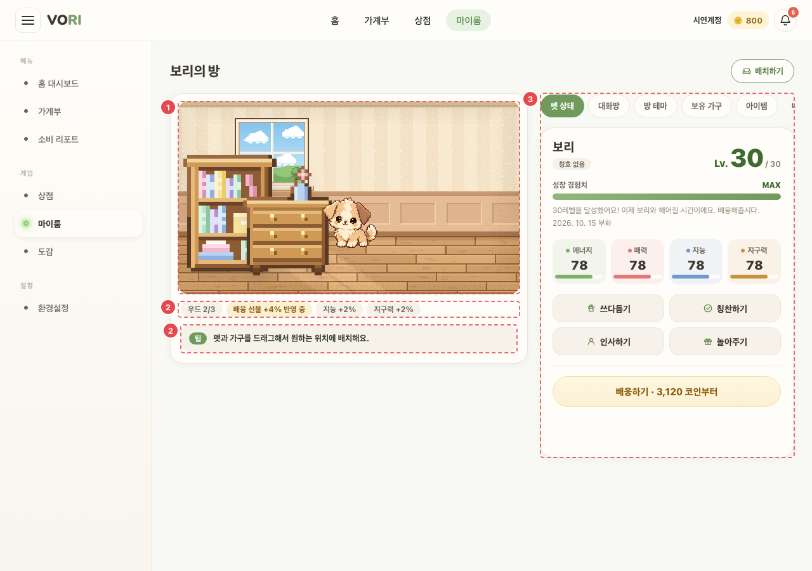
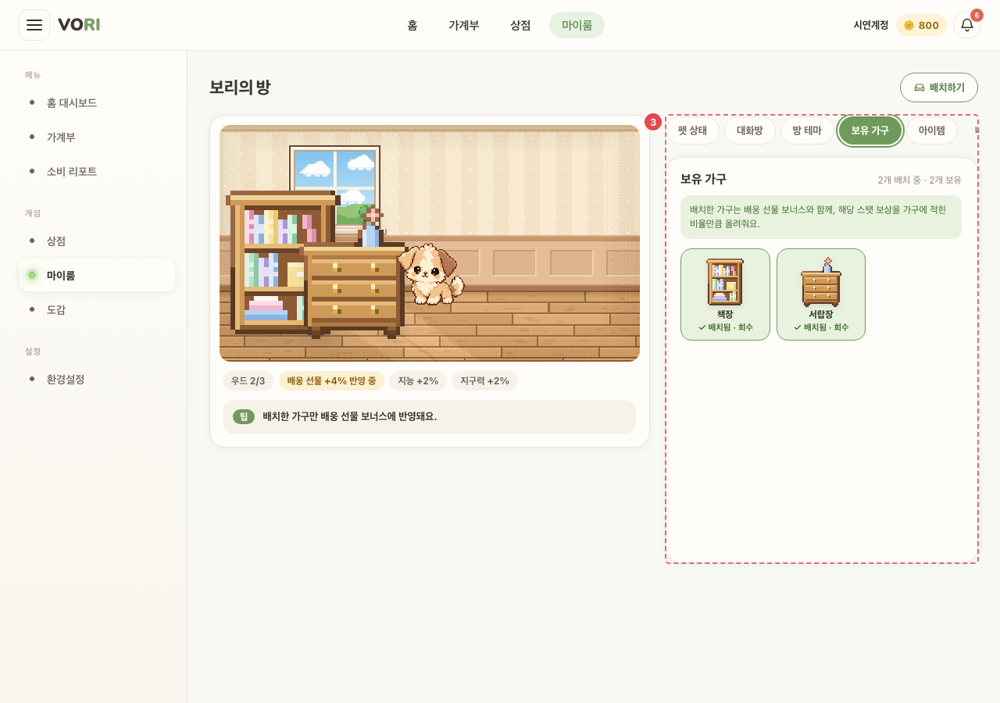
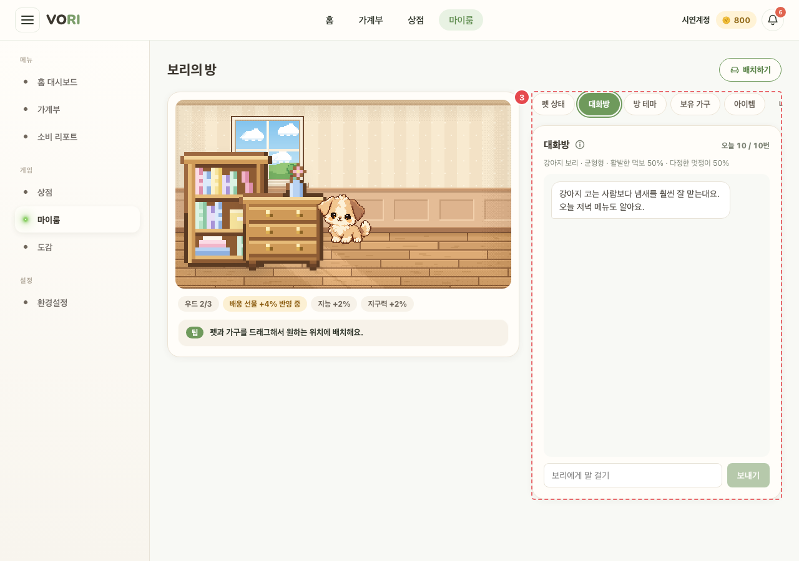

# GAME_ROOM_01 · 마이룸

| 화면ID | 화면명 | 경로 | 파일 | 인증 | 버전 | 수정일 | 이미지 출처 |
|---|---|---|---|---|---|---|---|
| `GAME_ROOM_01` | 마이룸 | `/myroom` | `frontend/src/pages/Pet/PetPage.jsx` | 로그인 | v0.3 | 2026-10-15 | 실제 화면 캡처 (`0c0a9e4`, 1280px) |

**한 줄 목표**: 사용자가 방에 가구를 배치하고, 펫의 상태를 보며 상호작용·대화·아이템 사용·배웅을 할 수 있어야 한다.

## 화면

**펫 상태 탭**



**③ 보유 가구 탭**



**③ 대화방 탭**



<details>
<summary>와이어프레임 (텍스트로 보기)</summary>

```
┌───────────────────────────────┬───────────────────────────────┐
│ 보리의 방            [배치하기]  │ ③ [펫 상태|대화방|방 테마|보유 가구│
│ ① ┌ 방 스테이지 ─────────────┐  │    |아이템|내역]                │
│    │  🛋     🪴              │  │  보리 [칭호]   Lv. 7 / 30        │
│    │       (펫)    🖥        │  │  성장 경험치 ■■■□ 120 / 160      │
│    └─────────────────────────┘  │  Lv. 15에 3차 진화.               │
│ ② 우드 2/3 · 배웅 선물 +5% 반영 중 │  에너지 ■■■□ 매력 ■□ …           │
│    팁: 가구는 더블클릭하면 회수돼요. │  [쓰다듬기][칭찬하기][인사하기][놀아주기]│
│                                 │  [배웅하기 · 1,200 코인부터] (비활성)│
└───────────────────────────────┴───────────────────────────────┘
                  (PC 는 2단, 폰은 한 줄)
```

</details>

## Description

번호는 위 와이어프레임의 번호와 짝이다.

| # | 요소 | 기능 | 동작 (누르면·입력하면) | 상태 | 예외·정책 |
|---|---|---|---|---|---|
| ① | 방 스테이지 | 방 테마 배경 위에 배치한 가구와 펫 | 가구는 드래그로 옮기고(`PATCH /furniture/{id}/place`, 좌표 0~100%) 더블클릭으로 회수. 펫도 드래그되지만 위치는 저장 안 함. 펫 우클릭·Enter 로 상호작용 메뉴 | 평소: 가구·펫 표시, 드래그 중 강조 · 저장 중: 해당 가구 `is-busy` · 빈: 펫이 없으면 "아직 키우는 펫이 없어요" + [상점 가기] (불러오는 중에는 안내를 띄우지 않는다) | 저장 실패(409 자리 겹침·400 범위 밖 등)는 서버 문구를 보이고 서버 좌표로 되돌린다 |
| ② | 보너스 · 팁 | 가구를 놓은 테마의 세트 진행(n/필요 수), 배웅 선물·스탯 보너스 합 | 팁에 마우스를 올리거나 포커스를 두면 멈춘다 | 평소: 발동한 세트는 체크 + "+n%" · 빈: 보너스가 없으면 "배치 가구 보너스 없음" | 팁 4개가 돌아가며 나온다 |
| ③ | 탭 패널 | 아래 표 | 탭을 누르면 패널 내용이 바뀐다. 머리의 [배치하기]는 보유 가구 탭을 열고 그쪽으로 스크롤한다 | 탭별 상태는 "상태별 화면" | — |

## 세부

| 탭 | 내용 |
|---|---|
| 펫 상태 | 이름·칭호·레벨·경험치·부화일·스탯 4종(100 만점). 상호작용 버튼 4개(`POST /pets/active/interact`). [배웅하기]는 Lv.30 부터 활성, 누르면 확인창 "…배웅하면 더는 함께 지낼 수 없고, 스탯에 따라 배웅 선물로 코인을 받아요." |
| 대화방 | "오늘 {남은}/{한도}번". 입력 최대 200자. 횟수를 다 쓰면 "오늘은 대화를 다 했어요". (i) "대화 내용은 저장되지 않아요." |
| 방 테마 | 배경 15종. **이 브라우저에만 저장** (서버 저장 없음) |
| 보유 가구 | "{n}개 배치 중 · {m}개 보유". 누르면 배치/회수. 비었을 때 [가구 상점 가기] |
| 아이템 | 출석 보상 아이템 목록 + [사용하기](`POST /attendance/items/{id}/use`) |
| 내역 | 펫: 함께한 펫 목록(배웅일·받은 코인 또는 "키우는 중"). 아이템: 월별 출석 보상 기록(미래 달 이동 불가) |

## 상태별 화면

| 상태 | 보이는 것 | 사용자가 할 수 있는 것 |
|---|---|---|
| 로딩 | 펫 상태 탭 "불러오는 중…". 내역 > 아이템 "불러오는 중…" | 탭 전환 |
| 실패 | 펫 정보: 서버 문구 또는 "펫 정보를 불러오지 못했어요". 가구·테마·아이템 조회와 각 동작 실패는 패널 아래 안내 줄(`role="alert"`)에 서버 문구. 대화 실패는 대화방 안 오류 줄. 내역 > 아이템은 "내역을 불러오지 못했어요." | 다른 탭 이용. 다시 시도 버튼은 없다 |
| 빈 | 펫 없음: 방에 "아직 키우는 펫이 없어요" + [상점 가기], 펫 상태 탭 "키우는 펫이 없어요. 상점에서 알을 개봉해 새 친구를 만나 보세요.", 대화방 "키우는 펫이 있어야 대화할 수 있어요.", 아이템 [사용하기] 비활성. 가구 없음: "아직 가구가 없어요. 상점에서 사서 배치하면 배웅 선물이 올라가요." + [가구 상점 가기 ›]. 아이템 없음: "보유한 아이템이 없어요. 출석 탭에서 출석 보상을 받아 보세요." 내역 없음: "아직 함께한 펫이 없어요." / "이 달에 받은 아이템이 없어요." | 상점으로 이동 |
| 권한 없음 | 펫 조회가 401 이면 `/login` 으로 보낸다 | — |

## 접근성

- 키보드: 펫은 `tabIndex=0` 이고 Enter·Space 로 상호작용 메뉴를 연다. 메뉴는 ↑↓·Home·End 로 항목 이동, Esc·Tab 으로 닫힌다. 대화방 (i) 안내는 Esc·바깥 누르기로 닫힌다. 가구 드래그·더블클릭 회수는 포인터 전용이고, 키보드로는 보유 가구 탭의 배치/회수 버튼을 쓴다.
- 스크린 리더 라벨: 탭 줄 `role="tablist"` "마이룸 메뉴", 패널 `role="tabpanel"`. 펫 `aria-haspopup="menu"` "{이름} 이동, 상호작용 메뉴 열기". 가구 "{이름} 이동". 펫 반응 대사는 `role="status"` 상시 영역으로 알린다(보이는 말풍선은 `aria-hidden`). 경험치 바 `role="progressbar"`. 보너스 목록 "배치 가구 보너스". 팁 `role="note"` "마이룸 팁". 대화 목록 `aria-live="polite"`, 입력 `aria-label="메시지"`. 방 테마·가구 테마 칩 `aria-pressed`. 내역 하위 탭 `role="tab"`.
- 포커스: 메뉴가 열리면 첫 항목으로, 메뉴에서 고르거나 닫으면 펫으로 돌아간다. 대화를 보내고 나면 입력칸으로 돌아간다.

## 참고

- API: `PATCH /furniture/{id}/place`, `POST /pets/active/interact`, `POST /attendance/items/{id}/use`
- 반응형·쿼리·기타: PC 는 2단, 폰은 한 줄. 방 테마는 이 브라우저에만 저장 (서버 저장 없음).

## 의문·미해결

- 방 테마가 브라우저에만 저장돼 다른 기기에서는 초기값으로 보인다
- 코드와 다름 (0c0a9e4): 원문 ①은 "펫 우클릭·Enter" 만 적었지만 Space 로도 메뉴가 열린다 (`frontend/src/pages/Pet/PetPage.jsx:657`).
