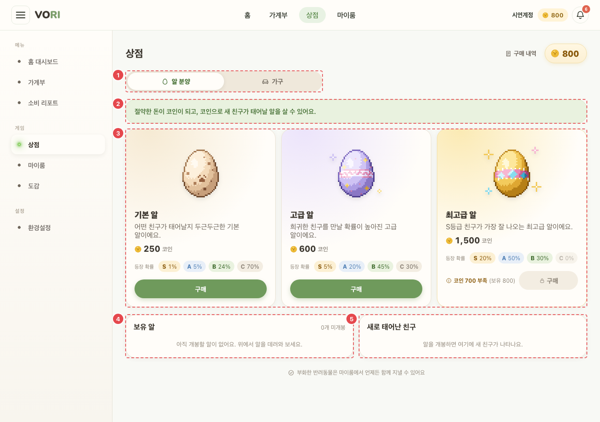
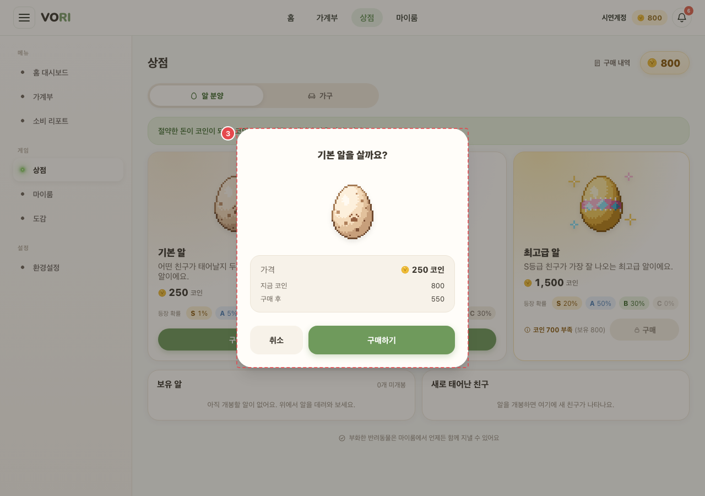
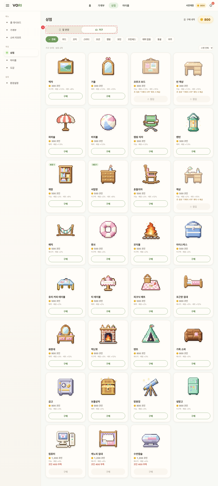

# GAME_SHP_01 · 상점

| 화면ID | 화면명 | 경로 | 파일 | 인증 | 버전 | 수정일 | 이미지 출처 |
|---|---|---|---|---|---|---|---|
| `GAME_SHP_01` | 상점 | `/shop` | `frontend/src/pages/Shop/ShopPage.jsx` | 로그인 | v0.3 | 2026-10-15 | 실제 화면 캡처 (`0c0a9e4`, 1280px) |

**한 줄 목표**: 사용자가 코인으로 알과 가구를 사고, 산 알을 개봉해 새 펫을 만날 수 있어야 한다.

## 화면

**알 분양 탭**



**③ [구매] → 구매 확인 시트**



**가구 탭**



<details>
<summary>와이어프레임 (텍스트로 보기)</summary>

```
┌───────────────────────────────────────────┐
│ 상점                    [구매 내역]  🪙 1,250 │
│ ① [알 분양 | 가구]                          │
│ ② 절약한 돈이 코인이 되고, 코인으로 새 친구가…   │
│ ③ ┌ 기본 알 ┐ ┌ 고급 알 ┐ ┌ 최고급 알 ┐       │
│    │ 250    │ │ 600    │ │ 1,500 🔒 │       │
│    │S1 A5…  │ │S5 A20… │ │코인 250 부족│       │
│    │ [구매] │ │ [구매] │ │ [구매]    │       │
│ ④ 보유 알 2개 미개봉   기본 알 · 250 코인 [개봉하기]│
│ ⑤ 새로 태어난 친구  고양이 · 희귀  [마이룸 가기 ›]│
└───────────────────────────────────────────┘
```

</details>

## Description

번호는 위 와이어프레임의 번호와 짝이다.

| # | 요소 | 기능 | 동작 (누르면·입력하면) | 상태 | 예외·정책 |
|---|---|---|---|---|---|
| ① | 탭 | 알 분양 / 가구 | 누르면 해당 탭 패널로 바뀐다 | 평소: 고른 탭 강조(`aria-selected`) | `?tab=furniture` 로 가구 탭부터 열 수 있다 |
| ② | 안내 | 코인을 버는 방법 한 줄 | — | 정적 | — |
| ③ | 알 카드 | 가격과 등급별 등장 확률(7-5 → [README 5-5](README.md#5-5-게임-경제)) | [구매] → 구매 확인 시트(세부) | 평소: [구매] 활성 · 구매 중: "구매 중…" · 비활성: 코인 부족이거나 다른 구매·개봉 처리 중 · 로딩: "상품을 불러오는 중…" · 실패: 오류 문구 | 코인이 모자라면 "코인 n 부족 (보유 n)" + 자물쇠, 구매 비활성 |
| ④ | 보유 알 | 미개봉 알 목록 + [개봉하기] | `POST /eggs/{id}/open` → 새 펫 → 이름 짓기 모달 | 평소: [개봉하기] 활성 · 처리 중: "개봉 중…", 다른 버튼도 비활성 · 빈: "아직 개봉할 알이 없어요. 위에서 알을 데려와 보세요." | 실패하면 서버 문구를 안내 줄에 보인다. 409 면 목록을 다시 불러온다 |
| ⑤ | 새로 태어난 친구 | 방금 태어난 펫 | [마이룸 가기 ›] → `/myroom` | 빈: "알을 개봉하면 여기에 새 친구가 나타나요." · 평소: 그림·종 이름·등급·단계·변종 태그 | — |

## 세부

가구 탭

| 요소 | 설명 |
|---|---|
| 필터 | 테마 칩(전체/테마별/테마 없음), 스탯 선택 |
| 가구 카드 | 그림·보유 수·이름·가격·"{스탯} · 배웅 +x% · 세트 +y%". 같은 가구를 여러 개 살 수 있다 |
| 잠긴 가구 | 숨기지 않고 "🔒 칭호 "{칭호명}" 획득 시 해금" + [잠김] |

구매 확인 시트: "{상품}을/를 살까요?" / 가격·지금 코인·구매 후 금액 / [취소] [구매하기]. 폰은 바텀시트, PC 는 가운데 창.
가구 구매 후 안내: "마이룸의 보유 가구에서 배치해야 효과가 생겨요." 코인 부족 오류엔 " 절약하면 10원당 1코인이 쌓여요." 를 덧붙인다.

## 상태별 화면

| 상태 | 보이는 것 | 사용자가 할 수 있는 것 |
|---|---|---|
| 로딩 | 알 탭: 코인 자리 "…", "상품을 불러오는 중…". 가구 탭: "가구를 불러오는 중…" | 탭 전환, [구매 내역] |
| 실패 | 알 탭: 서버 문구 또는 "상점을 불러오지 못했어요". 가구 탭: 서버 문구 또는 "가구를 불러오지 못했어요" (알·가구는 따로 불러 한쪽이 실패해도 다른 쪽은 뜬다) | 다른 탭 보기. 다시 시도 버튼은 없다 |
| 빈 | 보유 알 없음 / 개봉 결과 없음 문구(④⑤). 가구 탭에서 필터 결과가 없으면 "조건에 맞는 가구가 없어요." + [전체 가구 보기] | 알 구매, 필터 초기화 |
| 권한 없음 | 세션이 끊겨 401 이면 `/login` 으로 보낸다 | — |

## 접근성

- 키보드: 구매 확인 시트는 Esc 로 닫힌다(처리 중 제외). 바깥을 눌러도 닫힌다.
- 스크린 리더 라벨: 탭 줄 `role="tablist"` "상점 종류", 각 탭 `role="tab"` + `aria-controls`. 보유 코인 `role="status"` `aria-live="polite"` "보유 코인 n / 확인 중 / 무제한". 등장 확률 목록 `aria-label="등장 확률"`. 안내 줄은 오류면 `role="alert"`, 성공이면 `role="status"`. 시트 `role="dialog"` `aria-modal="true"` + 제목 연결. 가구 테마 칩 `aria-pressed`, 스탯 선택 `aria-label="올려 주는 스탯으로 골라 보기"`. 새로 태어난 친구 영역 `aria-live="polite"`.
- 포커스: 시트가 열리면 시트 패널로 포커스를 옮긴다. 시트 안 포커스 가두기와 닫힐 때 포커스 복귀 처리는 코드에 없다. 구매 내역 팝업은 닫힐 때 열기 전 포커스로 되돌린다.

## 참고

- API: `POST /eggs/{id}/open`
- 반응형·쿼리·기타: `?tab=furniture` 로 가구 탭부터 연다. 구매 확인 시트는 폰은 바텀시트, PC 는 가운데 창.

## 의문·미해결

- 코드와 다름 (0c0a9e4): " 절약하면 10원당 1코인이 쌓여요." 는 알 구매가 400 으로 실패할 때만 붙는다. 가구 구매 실패(코인 부족 400 포함)는 서버 문구만 보인다 (`frontend/src/pages/Shop/ShopPage.jsx:130`, `:169`). 알 쪽도 코인 부족인지 따지지 않고 400 이면 모두 붙는다.
- 코드와 다름 (0c0a9e4): 와이어프레임의 [구매 내역] 버튼(구매 내역 팝업)과 ADMIN 의 코인 표시 "∞"·확인 시트 "무제한" 은 원문 Description 에 없다 (`ShopPage.jsx:190`, `:490`).
