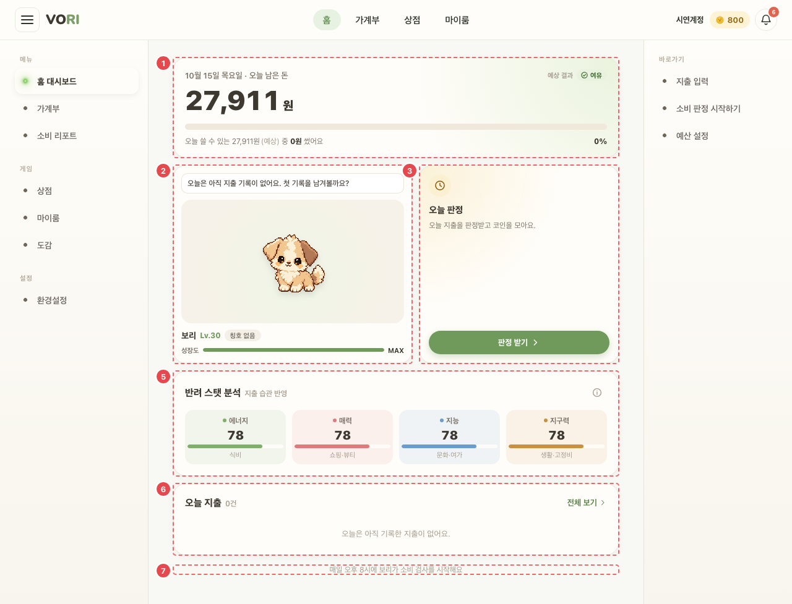
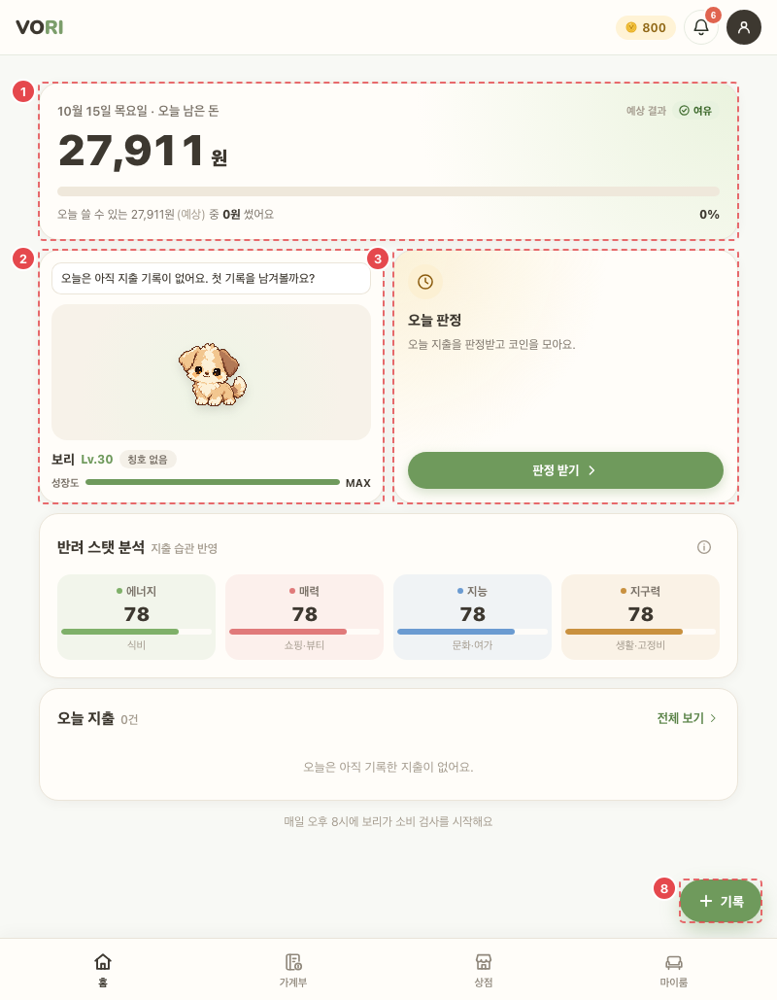

# HOME_DSH_01 · 홈 대시보드

| 화면ID | 화면명 | 경로 | 파일 | 인증 | 버전 | 수정일 | 이미지 출처 |
|---|---|---|---|---|---|---|---|
| `HOME_DSH_01` | 홈 대시보드 | `/home` | `frontend/src/pages/Home/HomeDashboard.jsx` | 로그인 | v0.3 | 2026-10-15 | 실제 화면 캡처 (`0c0a9e4`, 1280px) |

**한 줄 목표**: 사용자가 오늘 남은 돈·오늘 지출·펫 상태를 한눈에 보고, 오늘 판정이나 새 기록으로 바로 넘어간다.

## 화면

**평소 (폭 1280px)**



**폭 1024px 이하 (폭 800px) — ⑧ 기록 버튼**



캡처에 안 보이는 번호: ④ — 리포트 띠는 말일 12:00부터 7일 동안만 보인다(`reportWindowMonth`, `HomeDashboard.jsx:44`). 캡처한 10월 15일은 기간 밖이다.

<details>
<summary>와이어프레임 (텍스트로 보기)</summary>

```
┌───────────────────────────────────────────────────────┐
│ ① 10월 15일 수요일 · 오늘 남은 돈        [여유] 예상 결과 │
│   12,400원                                             │
│   ■■■■■■■□□□  오늘 쓸 수 있는 21,000원(예상) 중 8,600원 41%│
├──────────────────────────┬────────────────────────────┤
│ ② (말풍선) 오늘 점심은 뭐였어? │ ③ 오늘 판정                │
│    [펫 그림]              │   오늘 지출을 판정받고 코인을 모아요.│
│    보리 Lv.7  [칭호]       │   [판정 받기]               │
│    성장도 ■■■□□            │                            │
├──────────────────────────┴────────────────────────────┤
│ ④ 9월 소비 리포트가 나왔어요 ›          (말일 12시부터 7일)  │
├───────────────────────────────────────────────────────┤
│ ⑤ 반려 스탯 분석 · 지출 습관 반영 (i)                     │
│   에너지 12 | 매력 8 | 지능 5 | 지구력 10                 │
├───────────────────────────────────────────────────────┤
│ ⑥ 오늘 지출 3건                              전체 보기 › │
│   🍚 학식        식비     -5,500  [여유]                │
│   ☕ 스타벅스    카페     -4,500  [초과]                │
├───────────────────────────────────────────────────────┤
│ ⑦ 매일 오후 8시에 보리가 소비 검사를 시작해요     ⑧ [+ 기록]│
└───────────────────────────────────────────────────────┘
```

</details>

## Description

번호는 위 와이어프레임의 번호와 짝이다.

| # | 요소 | 기능 | 동작 (누르면·입력하면) | 상태 | 예외·정책 |
|---|---|---|---|---|---|
| ① | 오늘 남은 돈 | 판정이 있으면 그룹별 `availableToday` 합, 없으면 `(월예산 − 오늘 전까지 쓴 돈) ÷ 오늘 포함 남은 날` 로 계산하고 "(예상)" 표시 | 예산이 없을 때 "월수입 입력하기 ›"(→`/settings/profile`) | 로딩: 숫자 자리 스켈레톤 · 평소: 남은 돈 + 사용률 막대 + 신호 칩(판정 전·PENDING 이면 "예상 결과" 태그) · 예산 없음: 오늘 쓴 돈 + "오늘 쓴 돈이에요. 월수입을 입력하면 오늘 남은 돈을 알려 드려요." | 음수면 "오늘 넘은 돈". 예산이 없으면 오늘 쓴 돈만 보여 주고 "월수입 입력하기 ›" |
| ② | 펫 카드 | 말풍선 우선순위: 로딩 → 오늘 지출 0원 문구 → 안 본 월간 리포트 링크 → 무작위 대사 | 펫 그림 → `/myroom`, 칭호 → `/dex?tab=titles` | 로딩: 말풍선 "오늘 소비를 살펴보고 있어요…", 펫 그림 칸은 비워 둠 · 칭호 없음: "칭호 없음" · 만렙: 성장도 값 "MAX" | 펫이 없으면 "아직 키우는 펫이 없어요" + [상점 가기] |
| ③ | 오늘 판정 | 상태별 표시 (아래 표) | 버튼은 모두 `/wallet/analysis` 로 간다 | 20시 전: 버튼 비활성 (세부 표) | 판정 열림 여부는 1분마다 다시 계산한다 |
| ④ | 리포트 띠 | 그 달 소비 리포트 안내 | → `/report?month=` | 기간 밖: 띠 자체가 없음 | 말일 12:00 부터 7일 동안만 |
| ⑤ | 스탯 분석 | 에너지(식비)·매력(쇼핑·뷰티)·지능(문화·여가)·지구력(생활·고정비) | (i)를 누르면 "하루 예산보다 아낀 1,000원마다 그 스탯이 1씩 자라요" 설명 | 평소: 스탯 값 + 막대(최댓값 100 이상 기준) · (i) 다시 누르면 설명 접힘 | 펫이 있을 때만 |
| ⑥ | 오늘 지출 | 아이콘·내역·카테고리·금액·신호 | 행 → `/wallet?date=오늘` | 로딩: "불러오는 중…" · 빈: "오늘은 아직 기록한 지출이 없어요." · 신호 없는 행은 칩 없음 · 내역·카테고리가 비면 "지출"·"미분류" | 비었을 때 "오늘은 아직 기록한 지출이 없어요." |
| ⑦ | 안내 | 일반 "매일 오후 8시에 보리가 소비 검사를 시작해요" · ADMIN "관리자는 언제든지 소비 판정을 확인할 수 있어요" | — | 정적 (역할에 따라 문구) | — |
| ⑧ | 기록 버튼 | 떠 있는 버튼 | → `/wallet/new` | 평소: 창 폭 1024px 이하에서만 보임, 1025px 이상은 숨김 | — |

## 세부

③ 오늘 판정 카드 상태

| 상태 | 칩 | 문구 | 버튼 |
|---|---|---|---|
| 20시 전 | — | 오후 8시부터 오늘 지출을 판정받을 수 있어요. | [오후 8시부터] 비활성 |
| 열림 · 판정 전 | — | 오늘 지출을 판정받고 코인을 모아요. | [판정 받기] |
| PENDING | 1차 {여유/적정/초과} | 확인이 필요한 지출이 답을 기다리고 있어요. | [이어서 하기] |
| FINALIZED | 판정 신호 | 보상은 오늘 자정에 들어와요. / 오늘 보상을 받았어요. | [결과 보기] |

버튼은 모두 `/wallet/analysis` 로 간다. 판정 열림 여부는 1분마다 다시 계산한다.

## 상태별 화면

| 상태 | 보이는 것 | 사용자가 할 수 있는 것 |
|---|---|---|
| 로딩 | ① 스켈레톤, ② 말풍선 "오늘 소비를 살펴보고 있어요…", ⑥ "불러오는 중…". 펫 조회가 끝나기 전엔 "펫 없음" 안내를 띄우지 않는다 | ⑦·⑧, 다른 메뉴 이동 |
| 실패 | API 마다 따로 실패해도 화면은 뜬다. 홈 요약 실패면 오늘 쓴 돈을 0원으로 계산, 가계부 실패면 ⑥ 빈 상태 문구, 예산 실패면 ① 예산 없음 모양, 판정 조회 실패면 ③ 판정 전 상태, 펫 조회 실패면 ② 펫 그림·이름 없이 말풍선만 (오류 문구 없음) | 새로고침 |
| 빈 | 펫 없음: ② "아직 키우는 펫이 없어요" + [상점 가기], ⑤ 없음. 오늘 지출 없음: ⑥ "오늘은 아직 기록한 지출이 없어요." | [상점 가기], ⑧ 기록 |
| 권한 없음 | 비로그인이면 `/login` (`ProtectedRoute`) | — |

## 접근성

- 키보드: 이동하는 요소(펫 그림, 칭호, 리포트 띠·말풍선 링크, 판정 버튼, 지출 행, 전체 보기, (i), 기록 버튼)가 모두 `button` 이다.
- 스크린 리더 라벨: ① 사용률 막대 `role="progressbar"` + `aria-label="오늘 쓸 수 있는 돈 사용률"` + `aria-valuetext="{n}% 사용, {신호}[ 예상]"`, 로딩 중 `aria-busy` + 숨김 글자 "불러오는 중". 펫 그림 `aria-label="{펫 이름} — 마이룸 가기"`, 칭호 `aria-label="장착 칭호 {이름|없음} — 칭호 도감 열기"`, 성장도 `role="progressbar"` + `aria-label="다음 레벨까지"`. (i) `aria-label="스탯 설명"` + `aria-expanded`. 스탯 막대는 `aria-hidden`. 카드마다 `aria-labelledby` 제목.
- 포커스: `.hm button:focus-visible` 에 2px 테두리 (HomeScreen.css:161).

## 참고

- API: `GET /users/me/home`, `GET /pets/active`, `GET /monthly-reports/unread`, `GET /ledger?yearMonth=`,
`GET /spending-plan?yearMonth=`, `GET /daily-judgments/today` (병렬). 실패해도 해당 카드만 비워 두고 화면은 띄운다.
- 반응형·쿼리·기타: 폰은 위 순서대로 한 줄. 본문 860px 이상은 3열 그리드(남은 돈 2칸 + 판정 / 펫 + 스탯 / 펫 + 오늘 지출).

## 의문·미해결

- `HOME`·`WAL`: 판정 시각 표기가 "오후 8시부터" 와 "20시부터" 로 섞여 있다
- 코드와 다름 (0c0a9e4): API 목록에 없는 `GET /users/me` 도 부른다. 판정 열림 여부를 계산할 때 쓴다 (HomeDashboard.jsx:142).
- 코드와 다름 (0c0a9e4): ⑤ (i) 설명 실제 문구는 "지출 그룹마다 하루 예산보다 아낀 1,000원마다 그 스탯이 1씩 자라요. 아래 글자가 그 스탯을 키우는 지출 그룹이에요." (HomeDashboard.jsx:501).
- 코드와 다름 (0c0a9e4): ⑧ 기록 버튼은 창 폭 1024px 이하에서만 보인다 (HomeScreen.css:673, 692).
- 원문에 없음 (0c0a9e4): ⑥ "전체 보기 ›" 는 날짜 없이 `/wallet` 로 간다 (HomeDashboard.jsx:339).
- 홈 요약(`GET /users/me/home`)이 실패하면 오류 표시 없이 오늘 쓴 돈이 0원으로 계산돼, 예산이 있으면 ① 이 남은 돈을 실제보다 많이 보여 준다 (api/home.js:12-18, HomeDashboard.jsx:157).
