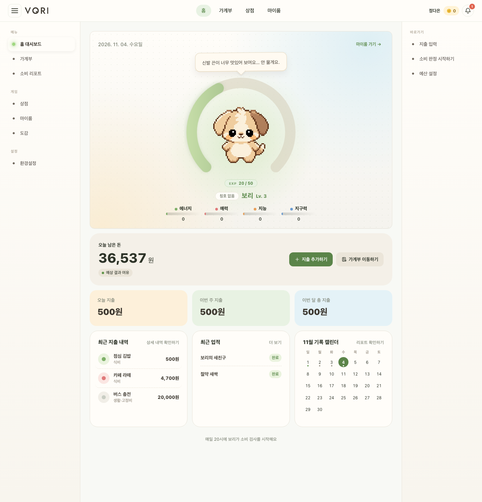
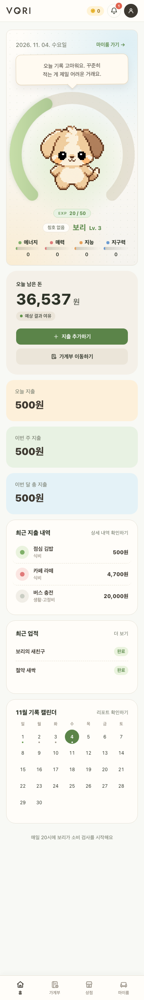

# HOME_DSH_01 · 홈 대시보드

| 화면ID | 화면명 | 경로 | 파일 | 인증 | 버전 | 수정일 | 이미지 출처 |
|---|---|---|---|---|---|---|---|
| `HOME_DSH_01` | 홈 대시보드 | `/home` | `frontend/src/pages/Home/HomeDashboard.jsx`, `TodayAllowanceCard.jsx` | 로그인 | v0.4 | 2026-11-04 | 빌드 화면 캡처 (API 응답은 예시 값, 1440px·375px) |

**한 줄 목표**: 사용자가 펫 상태와 오늘 남은 돈을 먼저 보고, 지출 기록이나 가계부로 바로 넘어간다.

## 화면

**폭 1440px**



**폭 375px**



<details>
<summary>와이어프레임 (텍스트로 보기)</summary>

```
┌───────────────────────────────────────────────────────┐
│ ① 날짜                                    마이룸 가기 → │
│   말풍선 · 경험치 게이지 · 펫 그림 · EXP · 칭호 · 이름 · 스탯 │
├───────────────────────────────────────────────────────┤
│ ② 오늘 남은 돈                                          │
│   27,911원            [+ 지출 추가하기] [가계부 이동하기] │
│   (예상 결과 여유)                                       │
├─────────────────┬─────────────────┬───────────────────┤
│ ③ 오늘 지출       │ 이번 주 지출       │ 이번 달 총 지출     │
├─────────────────┼─────────────────┼───────────────────┤
│ ④ 최근 지출 내역  │ ⑤ 최근 업적       │ ⑥ 기록 캘린더       │
├─────────────────┴─────────────────┴───────────────────┤
│ ⑦ 안내 문구                                             │
└───────────────────────────────────────────────────────┘
```

</details>

## Description

| # | 요소 | 기능 | 동작 (누르면) | 상태 | 예외·정책 |
|---|---|---|---|---|---|
| ① | 펫 카드 | 날짜, 말풍선, 경험치 게이지, 펫 그림, 칭호, 이름, 레벨, 스탯 4개 | "마이룸 가기" → `/myroom`, 칭호 → `/dex?tab=titles`, 말풍선 리포트 링크 → `/report` | 펫 조회 전: 그림 칸 비움 · 만렙: EXP "MAX" · 칭호 없음: "칭호 없음" | 펫이 없으면 "아직 키우는 펫이 없어요" + [상점 가기] |
| ② | 오늘 남은 돈 띠 | 판정이 있으면 그룹별 `availableToday` 합, 없으면 `(월예산 − 오늘 전까지 쓴 돈) ÷ 오늘 포함 남은 날` 에서 오늘 쓴 돈을 뺀다 | [지출 추가하기] → `/wallet/new`, [가계부 이동하기] → `/wallet` | 로딩: 숫자 자리 스켈레톤 · 평소: 금액 + 판정 칩 (판정 전·PENDING 은 "예상 결과 {신호}") | 음수면 "오늘 넘은 돈". 예산이 없으면 오늘 쓴 돈 + 안내 + "월수입 입력하기" → `/settings/profile` |
| ③ | 지출 3칸 | 오늘 지출, 이번 주 지출, 이번 달 총 지출 | — | 값이 없으면 0원 | 홈 요약 실패 시 0원 |
| ④ | 최근 지출 내역 | 신호 점, 내역, 카테고리, 금액 | "상세 내역 확인하기" → `/wallet` | 로딩: "불러오는 중…" · 빈: "아직 지출 기록이 없어요." | 신호가 없으면 회색 점 |
| ⑤ | 최근 업적 | 달성한 업적을 먼저, 최대 4개. 미달성은 진행 막대와 % | "더 보기" → `/dex?tab=achievements` | 로딩: "칭호 정보를 불러오는 중..." · 빈: "아직 표시할 업적이 없어요." | 달성한 업적은 막대 없이 "완료" |
| ⑥ | 기록 캘린더 | 이번 달 날짜. 기록이 있는 날은 숫자 아래 점으로 그날 판정을 보여 준다 | 말일 리포트 기간: "리포트 확인하기" → `/report?month=` · 평소: "가계부 이동" → `/wallet` | 판정 없음: 회색 점 · 오늘: 초록 원 | 점이 있어도 숫자 위치는 바뀌지 않는다. 칸 자체는 누를 수 없다 |
| ⑦ | 안내 | 일반 사용자와 ADMIN 문구가 다르다 | — | 정적 | — |

## 상태별 화면

| 상태 | 보이는 것 | 사용자가 할 수 있는 것 |
|---|---|---|
| 로딩 | ② 스켈레톤, ④ "불러오는 중…" | ② 버튼, 다른 메뉴 이동 |
| 실패 | API 마다 따로 실패해도 화면은 뜬다. 오류 문구는 없다 | 새로고침 |
| 빈 | 펫 없음: ① 안내 + [상점 가기] · 지출 없음: ④ 빈 문구 | [상점 가기], [지출 추가하기] |
| 권한 없음 | 비로그인이면 `/login` (`ProtectedRoute`) | — |

## 접근성

- 키보드: 이동하는 요소는 모두 `button` 이다. ② 띠와 제목 옆 링크에 포커스 테두리가 있다.
- ② 띠는 `aria-labelledby` 로 제목과 묶고, 로딩 중 숫자 자리에 `aria-busy` 와 숨김 글자 "불러오는 중"을 둔다.
- ⑥ 판정 점은 색으로만 구분된다.

## 참고

- API: `GET /users/me/home`, `GET /pets/active`, `GET /monthly-reports/unread`, `GET /achievements`, `GET /ledger?yearMonth=`, `GET /spending-plan?yearMonth=`, `GET /daily-judgments/today`.
- 반응형: 폭 1024px 이하는 카드를 한 줄씩 쌓는다. 폭 480px 이하는 ② 버튼도 세로로 쌓는다.
- ⑥ 점 표시는 홈 캘린더(`.home-cal`)에만 적용한다. 소비 리포트 캘린더는 그대로다.

## 의문·미해결

- ⑥ 판정 점이 색으로만 구분돼 스크린 리더와 색각 이상 사용자에게 판정이 전달되지 않는다.
- 이전에 있던 사용률 막대와 "오늘 쓸 수 있는 돈 (예상)" 문구는 이번 디자인에서 빠졌다.
