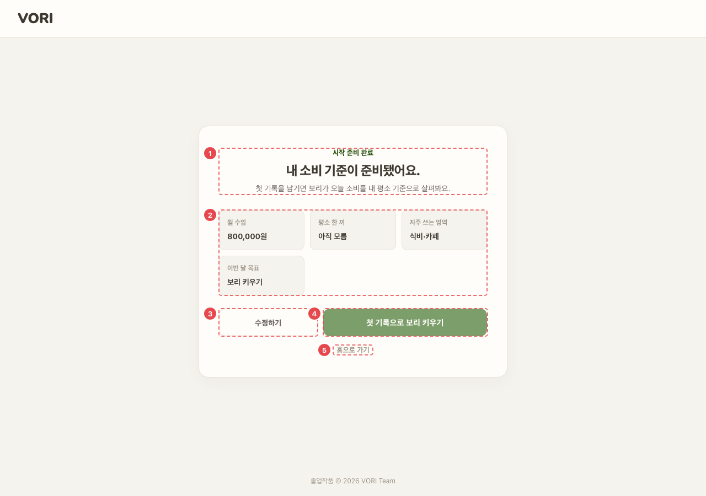

# ONB_DONE_01 · 온보딩(시작 준비 완료)

| 화면ID | 화면명 | 경로 | 파일 | 인증 | 버전 | 수정일 | 이미지 출처 |
|---|---|---|---|---|---|---|---|
| `ONB_DONE_01` | 온보딩(시작 준비 완료) | `/onboarding` | `frontend/src/pages/Onboarding/OnboardingPage.jsx` | 로그인 | v0.3 | 2026-10-15 | 실제 화면 캡처 (`0c0a9e4`, 1280px) |

**한 줄 목표**: 사용자가 설문으로 정한 소비 기준 요약을 확인하고, 온보딩 완료를 저장한 뒤 첫 기록(`/wallet/new`) 또는 홈(`/home`)으로 간다.

## 화면

**평소 (목표: 보리 키우기)**

## Description

번호는 아래 표 순서(화면 위에서 아래)와 짝이다.

| # | 요소 | 기능 | 동작 (누르면·입력하면) | 상태 | 예외·정책 |
|---|---|---|---|---|---|
| ① | 제목 | "시작 준비 완료" / "내 소비 기준이 준비됐어요." / "첫 기록을 남기면 보리가 오늘 소비를 내 평소 기준으로 살펴봐요." | — | 정적 | — |
| ② | 요약 4칸 | 월 수입 · 평소 한 끼 · 자주 쓰는 영역 · 이번 달 목표 | — | 평소: 월 수입은 "{n}원", 나머지는 설문에서 고른 선택지 이름 | 모르는 값은 "아직 모름", 목표를 모르면 "천천히 정하기" |
| ③ | [수정하기] | [수정하기] 버튼 | → `/signup/profile` (빈 설문부터 다시) | 처리 중: 비활성 | — |
| ④ | 주 버튼 | 목표에 따라 문구가 바뀜: 식비 줄이기 "오늘 식비 기록하기" · 보리 키우기 "첫 기록으로 보리 키우기" · 그 밖 "첫 지출 기록하기" | 먼저 `POST /onboarding/complete` 를 부르고, 성공해야 → `/wallet/new` | 처리 중: 비활성 (문구는 그대로) | 실패하면 "시작 준비를 저장하지 못했어요. 잠시 후 다시 눌러 주세요." |
| ⑤ | [홈으로 가기] | [홈으로 가기] 버튼 | 먼저 `POST /onboarding/complete` 를 부르고, 성공해야 → `/home` | 처리 중: 비활성 | 실패하면 "시작 준비를 저장하지 못했어요. 잠시 후 다시 눌러 주세요." |

## 세부

④·⑤는 먼저 `POST /onboarding/complete` 를 부르고, 성공해야 이동한다. 실패하면 "시작 준비를 저장하지 못했어요. 잠시 후 다시 눌러 주세요."
진입 시 설문 전이면 `/signup/profile`, 상태 조회 실패면 `/login` 으로 보낸다.

## 상태별 화면

| 상태 | 보이는 것 | 사용자가 할 수 있는 것 |
|---|---|---|
| 로딩 | 진입 시 `GET /onboarding/status` 가 끝날 때까지 아무것도 그리지 않는다 (빈 화면) | 기다리기 |
| 실패 | 상태 조회 실패: 화면 없이 `/login` 으로 보냄. 완료 저장 실패: 버튼 위 "시작 준비를 저장하지 못했어요. 잠시 후 다시 눌러 주세요." | 저장 실패는 ④·⑤ 를 다시 누름 |
| 권한 없음 | 비로그인이면 `/login` (`ProtectedRoute`). 설문 전이면 `/signup/profile` | — |

## 접근성

- 키보드: 모든 조작이 `button` 이라 Tab·Enter·Space 로 쓸 수 있다.
- 스크린 리더 라벨: 머리글 로고 버튼 `aria-label="VORI 홈으로"`. 저장 오류 문구는 `role="alert"`. 요약 4칸은 `span`(항목명) + `strong`(값)으로 표 구조 의미는 없다.
- 포커스: 확인 필요 (포커스 이동·표시 스타일 코드 없음).

## 참고

- API: `GET /onboarding/status` (진입), `POST /onboarding/complete` (④·⑤)
- 반응형·쿼리·기타: 완료 저장 성공 시 `vori:onboarding-done` 이벤트를 보낸다. 실패했는데 넘어가면 서버에 미완료로 남아 다음 로그인 때 이 화면으로 되돌아오므로 성공해야만 이동한다 (OnboardingPage.jsx:54-55 주석).

## 의문·미해결

- 원문에 없음 (0c0a9e4): 머리글 VORI 로고가 버튼이라 누르면 `/` 로 간다 (OnboardingPage.jsx:76-83). 완료 저장 없이 화면을 떠나는 길이다. 서버에 미완료로 남아 다음 로그인 때 온보딩으로 돌아온다. README 8-2 에 올렸다.
