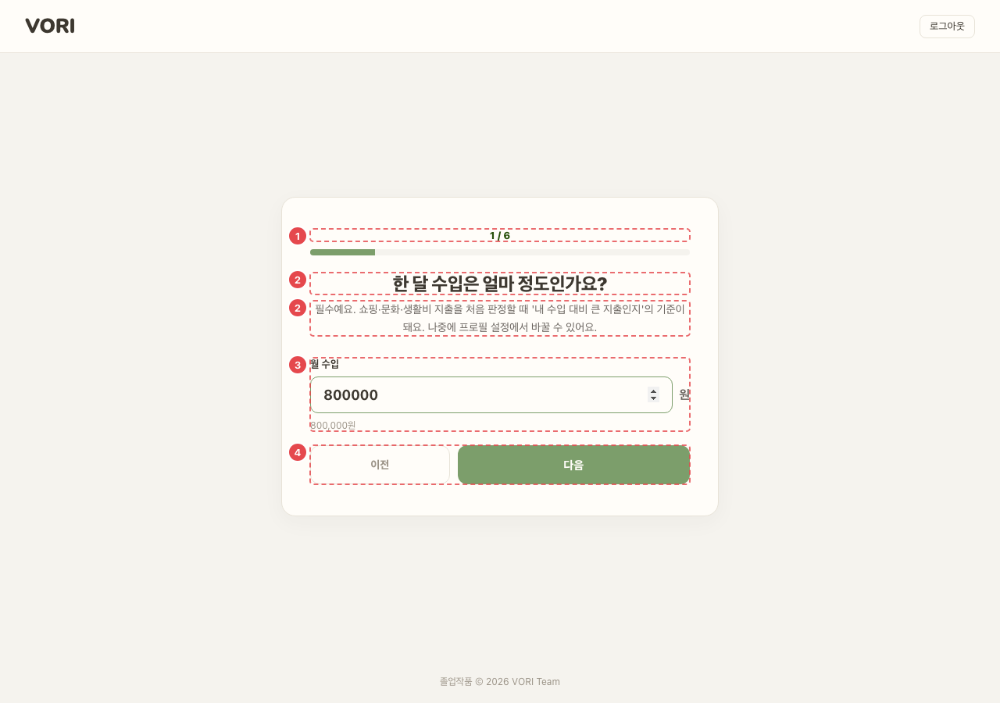
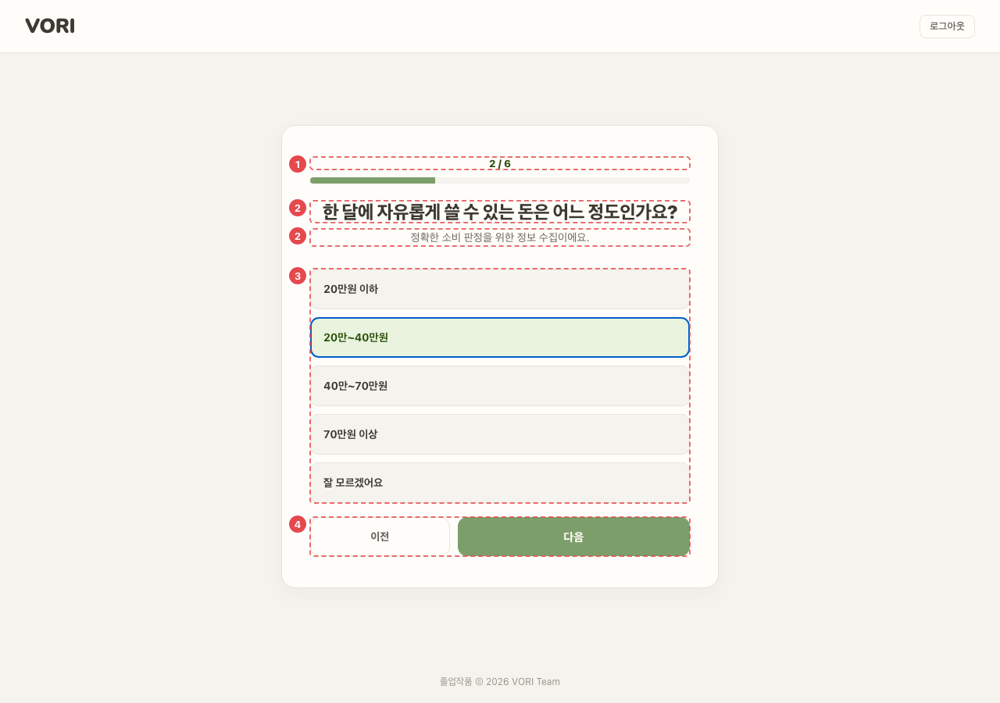
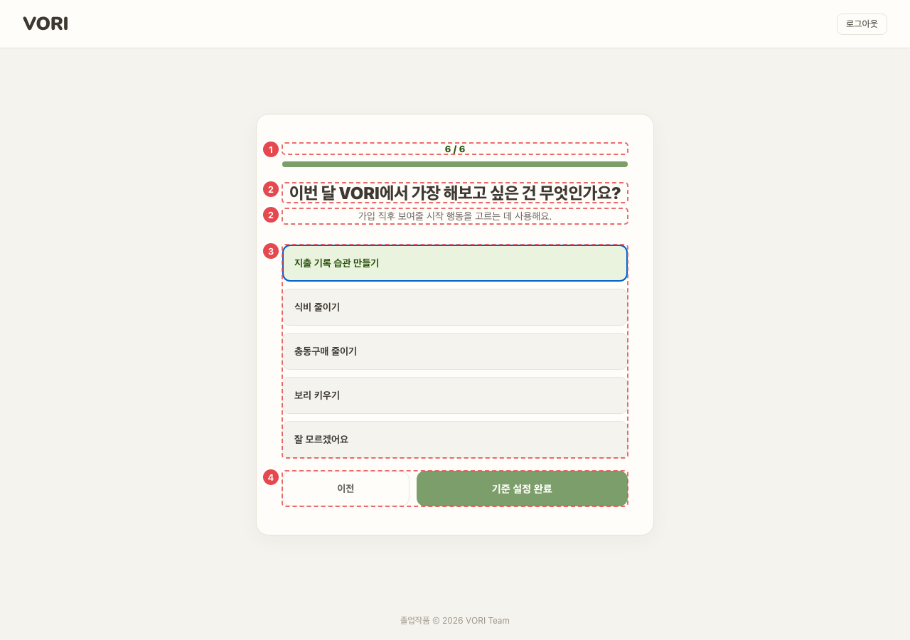

# ONB_PRF_01 · 소비 프로필 설문

| 화면ID | 화면명 | 경로 | 파일 | 인증 | 버전 | 수정일 | 이미지 출처 |
|---|---|---|---|---|---|---|---|
| `ONB_PRF_01` | 소비 프로필 설문 | `/signup/profile` | `frontend/src/pages/Signup/SignupProfilePage.jsx` | 로그인 | v0.3 | 2026-10-15 | 실제 화면 캡처 (`0c0a9e4`, 1280px) |

**한 줄 목표**: 사용자가 6문항(월 수입 숫자 입력 + 단일 선택 5개)에 답해 소비 기준을 저장하고 `/onboarding` 으로 넘어간다.

## 화면

**1 / 6 — 월 수입 입력**



**2 / 6 — 카드형 선택**



**6 / 6 — 마지막 문항 ([기준 설정 완료])**



<details>
<summary>와이어프레임 (텍스트로 보기)</summary>

```
┌─────────────────────────────┐
│ VORI (클릭 안 됨)     로그아웃 │
│ ① 2 / 6  ■■■□□□              │
│ ② 한 달에 자유롭게 쓸 수 있는   │
│    돈은 어느 정도인가요?        │
│    (질문하는 이유)             │
│ ③ ┌───────────────────────┐ │
│    │ 20만원 이하             │ │
│    ├───────────────────────┤ │
│    │ 20만~40만원        ✓   │ │
│    ├───────────────────────┤ │
│    │ … 잘 모르겠어요          │ │
│    └───────────────────────┘ │
│ ④ [이전]            [다음]    │
└─────────────────────────────┘
```

</details>

## Description

번호는 위 와이어프레임의 번호와 짝이다.

| # | 요소 | 기능 | 동작 (누르면·입력하면) | 상태 | 예외·정책 |
|---|---|---|---|---|---|
| ① | 진행 표시 | "N / 6" + 진행 막대 | — | 평소: 막대 폭 = (단계 ÷ 6) | — |
| ② | 질문 · 이유 | 문항별로 왜 묻는지 부제로 설명 | — | 정적 (문항마다 바뀜) | — |
| ③ | 입력 | 1번은 월 수입 숫자 입력(0 이상 정수, 쉼표 힌트, Enter 로 다음). 2~6번은 카드형 단일 선택 | 고르기만 해서는 넘어가지 않는다 | 평소: 1번 숫자 칸 자동 포커스, 숫자가 아닌 글자는 입력 즉시 지워짐, 0보다 크면 아래에 "{n}원" 힌트 · 선택: 고른 카드 강조 | — |
| ④ | 이전 · 다음 | 이전 · 다음 | `POST /onboarding/spending-profile` 성공 → `/onboarding` | [이전]은 1번에서 비활성. [다음]은 답이 없으면 비활성, 마지막엔 "기준 설정 완료" · 처리 중: "저장 중…", 두 버튼 비활성 | 저장 실패 시 서버 message, 없으면 "소비 기준 저장 중 오류가 발생했어요" (버튼 위 오류 문구) |

## 세부

문항

| 번호 | 질문 | 선택지 |
|---|---|---|
| 1 | 한 달 수입은 얼마 정도인가요? | 숫자 입력 (필수) |
| 2 | 한 달에 자유롭게 쓸 수 있는 돈은? | 20만원 이하 / 20만~40만원 / 40만~70만원 / 70만원 이상 / 잘 모르겠어요 |
| 3 | 평소 한 끼에 얼마 정도 쓰나요? | 7,000원 이하 / 7,000~10,000원 / 10,000~15,000원 / 15,000원 이상 / 잘 모르겠어요 |
| 4 | 요즘 가장 자주 돈을 쓰는 곳은? | 식비·카페 / 쇼핑·뷰티 / 문화·여가 / 교통·생활비 / 잘 모르겠어요 |
| 5 | 내 소비 습관에 가장 가까운 건? | 계획한 것만 / 필요하면 바로 / 할인·이벤트에 약함 / 기분에 따라 / 잘 모르겠어요 |
| 6 | 이번 달 VORI 에서 가장 해보고 싶은 건? | 지출 기록 습관 / 식비 줄이기 / 충동구매 줄이기 / 보리 키우기 / 잘 모르겠어요 |

- 설문이 끝나기 전에는 **공개 화면을 포함한 모든 경로**가 이 화면으로 돌아온다 (`ProfileRequiredGuard`, ADMIN 제외).
- 답을 브라우저에 남기지 않는다. 새로고침하면 처음부터 다시 답한다. (README 8-2)

## 상태별 화면

| 상태 | 보이는 것 | 사용자가 할 수 있는 것 |
|---|---|---|
| 로딩 | 마지막 문항에서 저장 중일 때 [다음] 자리에 "저장 중…", [이전]·[다음] 비활성 | 기다리기, 로그아웃 |
| 실패 | 저장 실패: 버튼 위에 서버 message 또는 "소비 기준 저장 중 오류가 발생했어요". 설문 상태 조회 실패(`ProfileRequiredGuard`): 화면 대신 "계정 상태를 확인하지 못했어요." + [다시 시도] | 저장 실패는 [기준 설정 완료]를 다시 누름. 조회 실패는 [다시 시도] (상태만 다시 조회) |
| 권한 없음 | 비로그인이면 화면 없이 `/login` 으로 보냄 (`ProtectedRoute`) | — |

## 접근성

- 키보드: 1번 숫자 칸에서 Enter 를 누르면 다음 문항으로 간다. 2~6번 선택지는 `button` 이라 Tab·Enter·Space 로 고른다.
- 스크린 리더 라벨: 숫자 칸은 "월 수입" 라벨로 감싼다. 선택지 묶음은 `role="radiogroup"` + `aria-label`(질문 문장)인데 각 선택지는 `radio` 가 아니라 `aria-pressed` 버튼이다. 진행 막대는 `aria-hidden` 이고 "N / 6" 글자로 읽힌다. 저장 오류 문구는 `role="alert"`.
- 포커스: 숫자 칸은 처음 나올 때 자동 포커스(`autoFocus`), 포커스 스타일은 `.signup-input:focus` (SignupPage.css:135). 문항이 바뀔 때 포커스를 질문으로 옮기는 코드는 없다. 선택지 카드의 포커스 표시 스타일은 확인 필요.

## 참고

- API: `POST /onboarding/spending-profile` (월 수입은 숫자, 나머지는 enum 문자열)
- 반응형·쿼리·기타: 머리글 VORI 로고는 누를 수 없고 [로그아웃]만 있다. 저장 성공 시 `vori:onboarding-done` 이벤트로 설문 가드를 푼다.

## 의문·미해결

- 코드와 다름 (0c0a9e4): 세부 문항 표의 질문·선택지는 줄인 문구다. 실제 화면 문구는 2번 "한 달에 자유롭게 쓸 수 있는 돈은 어느 정도인가요?", 4번 "요즘 가장 자주 돈을 쓰는 곳은 어디인가요?", 5번 "내 소비 습관에 가장 가까운 건 무엇인가요?" · 선택지 "계획한 것만 사는 편 / 필요하면 바로 사는 편 / 할인이나 이벤트에 약한 편 / 기분에 따라 쓰는 편", 6번 "이번 달 VORI에서 가장 해보고 싶은 건 무엇인가요?" · 선택지 "지출 기록 습관 만들기" (SignupProfilePage.jsx:17,41,53-60,65-68).
- 선택지 묶음이 `radiogroup` 인데 항목은 `aria-pressed` 버튼이라 역할이 맞지 않는다 (SignupProfilePage.jsx:174-181).
