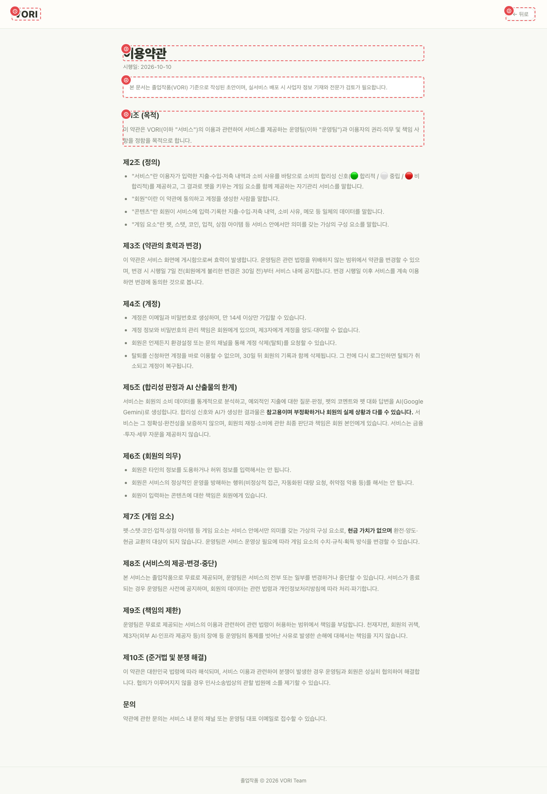
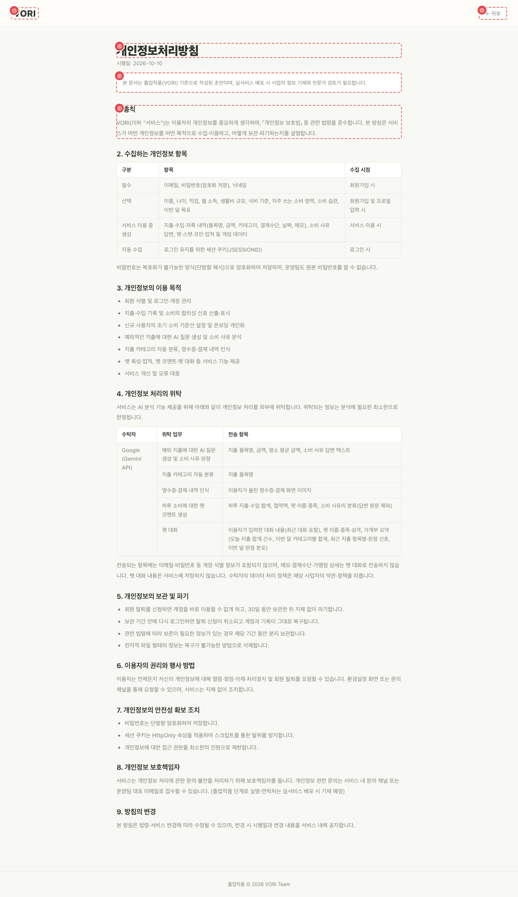

# PUB_LGL_01·02 · 이용약관 · 개인정보처리방침

| 화면ID | 화면명 | 경로 | 파일 | 인증 | 버전 | 수정일 | 이미지 출처 |
|---|---|---|---|---|---|---|---|
| `PUB_LGL_01` | 이용약관 | `/terms` | `frontend/src/pages/Legal/TermsPage.jsx` | 공개 | v0.3 | 2026-10-15 | 실제 화면 캡처 (`0c0a9e4`, 1280px) |
| `PUB_LGL_02` | 개인정보처리방침 | `/privacy` | `frontend/src/pages/Legal/PrivacyPage.jsx` | 공개 | v0.3 | 2026-10-15 | 실제 화면 캡처 (`0c0a9e4`, 1280px) |

**한 줄 목표**: 사용자가 가입 전후에 이용약관과 개인정보처리방침 전문을 읽을 수 있어야 한다.

## 화면

**PUB_LGL_01 이용약관**

**PUB_LGL_02 개인정보처리방침**

## Description

공통 틀(`LegalLayout.jsx`): 로고, [← 뒤로], 제목, "시행일: 2026-10-10", 초안 고지문, 본문.

| # | 요소 | 기능 | 동작 (누르면·입력하면) | 상태 | 예외·정책 |
|---|---|---|---|---|---|
| ① | 로고 | VORI 로고 | → `/` | 정적 | — |
| ② | [← 뒤로] | 이전 화면으로 | 브라우저 뒤로 가기 (`navigate(-1)`) | 정적 | — |
| ③ | 제목 · 시행일 | 문서 제목, "시행일: 2026-10-10" | — | 정적 | — |
| ④ | 초안 고지문 | 초안임을 알림 | — | 정적 | — |
| ⑤ | 본문 | 조항 본문 (아래 "세부") | — | 정적 | — |

## 세부

| 문서 | 구성 |
|---|---|
| 이용약관 | 제1조 목적 ~ 제10조 준거법, 문의. 제5조에 합리성 판정·AI 산출물의 한계 |
| 개인정보처리방침 | 1~9항. 4항 위탁(펫 대화에 메모·결제수단·가맹점 정보 미전송, 대화 미저장), 5항 탈퇴 후 30일 보관·복구 |

## 상태별 화면

| 상태 | 보이는 것 | 사용자가 할 수 있는 것 |
|---|---|---|
| 로딩 | 화면 코드를 불러오는 동안 빈 화면 (`lazy` + `Suspense fallback={null}`, `App.js:44-45`) | 기다림 |
| 권한 없음 (설문 전 계정) | `/signup/profile` 로 이동 (`App.js` `ProfileRequiredGuard`) | 설문 진행 |

## 접근성

- 키보드: 로고·[← 뒤로] 모두 `<button>`.
- 스크린 리더 라벨: 로고 `aria-label="VORI 홈으로"`. 제목 `<h1>`, 조항 제목 `<h2>`, 개인정보처리방침 4항 위탁 표는 `<table>` + `<th>`.
- 포커스: 확인 필요 (`LegalPages.css` 에 포커스 스타일 없음).

## 참고

- API: 없음.
- 반응형·쿼리·기타: 없음.

## 의문·미해결

- 확인 필요: 회원가입 [보기]·로그인 화면 푸터·구글 동의 문구는 약관을 새 탭으로 연다(랜딩 푸터는 같은 탭). 새 탭으로 열면 돌아갈 기록이 없어 [← 뒤로] (`navigate(-1)`, `LegalLayout.jsx:24`)가 아무 일도 하지 않는지 확인이 필요하다.
