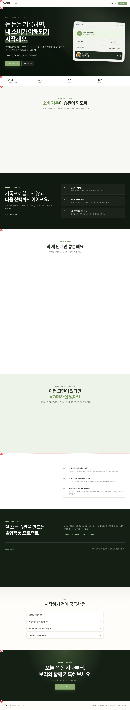

# PUB_LND_01 · 랜딩

| 화면ID | 화면명 | 경로 | 파일 | 인증 | 버전 | 수정일 | 이미지 출처 |
|---|---|---|---|---|---|---|---|
| `PUB_LND_01` | 랜딩 | `/` | `frontend/src/pages/Landing/LandingPage.jsx` | 공개 | v0.3 | 2026-10-15 | 실제 화면 캡처 (`0c0a9e4`, 1280px) |

**한 줄 목표**: 처음 온 사용자가 VORI 소개를 읽고 회원가입(로그인 사용자는 홈)으로 넘어갈 수 있어야 한다.

## 화면



<details>
<summary>와이어프레임 (텍스트로 보기)</summary>

```
┌───────────────────────────────────────────────┐
│ ① VORI  스토리                  로그인  회원가입 │
├───────────────────────────────────────────────┤
│ ② AI CONSUMPTION JOURNAL                       │
│   쓴 돈을 기록하면, 내 소비가 이해되기 시작해요.    │   [미리보기 카드]
│   #자동분류 #AI판정 #펫성장 #소비리포트           │
│   [무료로 시작하기]  [사용 방법 보기]              │
├───────────────────────────────────────────────┤
│ ③ 3단계 · 3가지 시그널 · 4종 스탯 · 16종 펫       │
│ ④ 기능 카드 6개                                 │
│ ⑤ 딱 세 단계면 충분해요 (새 기록→판정→보리의 방)   │
│ ⑥ 원칙 · 팀 소개 · FAQ 4개                       │
│ ⑦ 오늘 쓴 돈 하나부터, 보리와 함께 기록해보세요.    │
│   [무료로 시작하기]                              │
│ ⑧ 이용약관 · 개인정보처리방침 · © 2026 VORI Team  │
└───────────────────────────────────────────────┘
```

</details>

## Description

번호는 위 와이어프레임의 번호와 짝이다.

| # | 요소 | 기능 | 동작 (누르면·입력하면) | 상태 | 예외·정책 |
|---|---|---|---|---|---|
| ① | 헤더 | 로고, 스토리 링크, 계정 버튼 | 로고 → `/`, 스토리 → `/story`. 로그인: [VORI 시작하기](→`/home`) + 아바타 메뉴(환경설정·로그아웃) | 비로그인: [로그인] [회원가입] · 로그인: [VORI 시작하기] + 아바타 메뉴 | — |
| ② | 히어로 | 소개 문구 · 태그 · 미리보기 카드 · 버튼 2개 | 주 버튼은 비로그인 "무료로 시작하기"(→`/signup`), 로그인 "내 기록 보러가기"(→`/home`). [사용 방법 보기]는 ⑤로 부드럽게 스크롤 | 평소: 처음 그려질 때 문구·미리보기 카드가 나타나는 애니메이션 · 비로그인/로그인에 따라 주 버튼 문구가 바뀜 | — |
| ③~⑥ | 소개 구간 | 정적 콘텐츠 | 스크롤에 맞춰 나타나는 애니메이션 | 정적 | 코드와 다름 — 아래 "의문·미해결" 참고 |
| ⑦ | 마지막 CTA | 가입 유도 버튼 | 비로그인 "무료로 시작하기", 로그인 "VORI로 돌아가기"(→`/home`) | 비로그인/로그인에 따라 문구가 바뀜 | — |
| ⑧ | 푸터 | 약관 두 문서 링크 | 같은 탭으로 `/terms` · `/privacy` 이동 | 정적 | — |

## 상태별 화면

| 상태 | 보이는 것 | 사용자가 할 수 있는 것 |
|---|---|---|
| 권한 없음 (설문 전 계정) | 화면 대신 `/signup/profile` 로 이동 (`App.js` `ProfileRequiredGuard`) | 설문 진행 |
| 실패 (설문 상태 조회 실패, 로그인 계정) | "계정 상태를 확인하지 못했어요." + [다시 시도] (`App.js` `ProfileRequiredGuard`) | 다시 시도 |

API 를 부르지 않는 화면이라 화면 자체의 로딩·빈 상태는 없다.

## 접근성

- 키보드: 헤더·히어로·CTA 버튼은 모두 `<button>`, FAQ 질문도 `<button>` 이라 Tab 으로 이동·Enter/Space 로 동작한다.
- 스크린 리더 라벨: 로고 `aria-label="VORI 메인으로"`, 아바타 `aria-label="내 계정 메뉴"` + `aria-expanded`, 핵심 수치 구간 `aria-label="VORI 핵심 특징"`, 기술 스택 `aria-label="사용 기술"`, FAQ 질문 `aria-expanded`. 배경 그림은 `alt=""` + `aria-hidden`.
- 포커스: 확인 필요 (랜딩 CSS 에 `:focus`·`:focus-visible` 스타일 없음. `prefers-reduced-motion` 대응도 없음).

## 참고

- API: 없음.
- 반응형·쿼리·기타: 없음.

## 의문·미해결

- 코드와 다름 (0c0a9e4): 와이어프레임에 없는 구간이 세 개 더 있다 — "AFTER RECORDING"(기록으로 끝나지 않고…, [VORI 이야기 보기] → `/story`), "MADE FOR YOUR ROUTINE"(이런 고민이 있다면 카드 3개), 실제 순서는 히어로 → ③ → ④ → AFTER RECORDING → ⑤ → MADE FOR YOUR ROUTINE → 원칙 → 팀 → FAQ → ⑦ (`pages/Landing/LandingPage.jsx:64-73`).
- 코드와 다름 (0c0a9e4): ③~⑥ 이 전부 정적이지는 않다. FAQ 4개는 눌러 펼치는 아코디언이고(`LandingPage.jsx:29-32`), AFTER RECORDING 구간에 [VORI 이야기 보기] 버튼이 있다(`LandingPage.jsx:67`). ③ 핵심 수치 구간에는 스크롤 애니메이션이 없다(`LandingPage.jsx:65`).
- 코드와 다름 (0c0a9e4): ④ 기능 카드 문구가 "초록·회색·빨강 신호" 라고 쓴다(`LandingPage.jsx:40`). 공통 정책의 신호 이름은 여유·적정·초과다 (README 5-3, 8-1).
- 코드와 다름 (0c0a9e4): ⑧ 푸터 실제 문구는 "졸업작품 © 2026 VORI Team" 이고 "AI 소비 기록 · 펫 성장 서비스" 소개가 같이 있다 (`LandingPage.jsx:74`).
