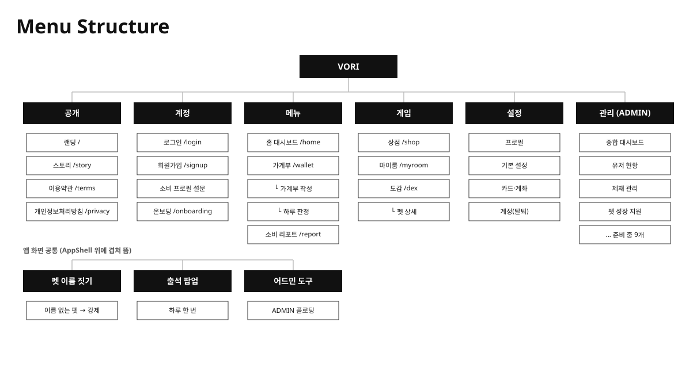
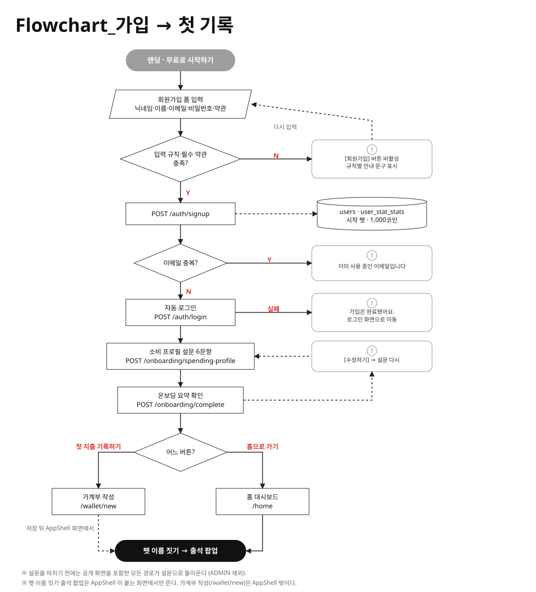
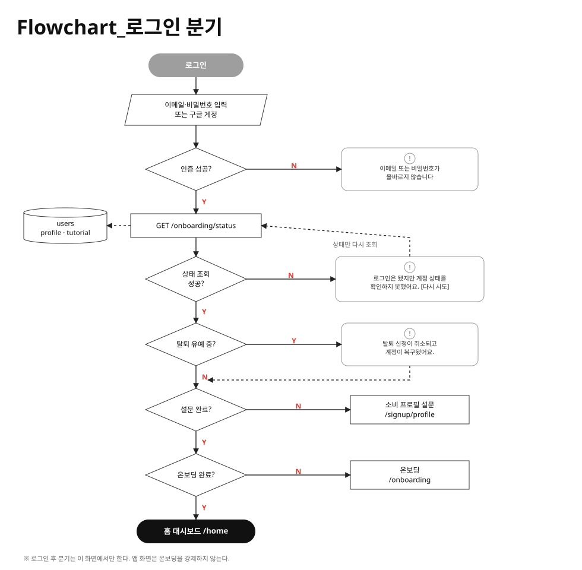
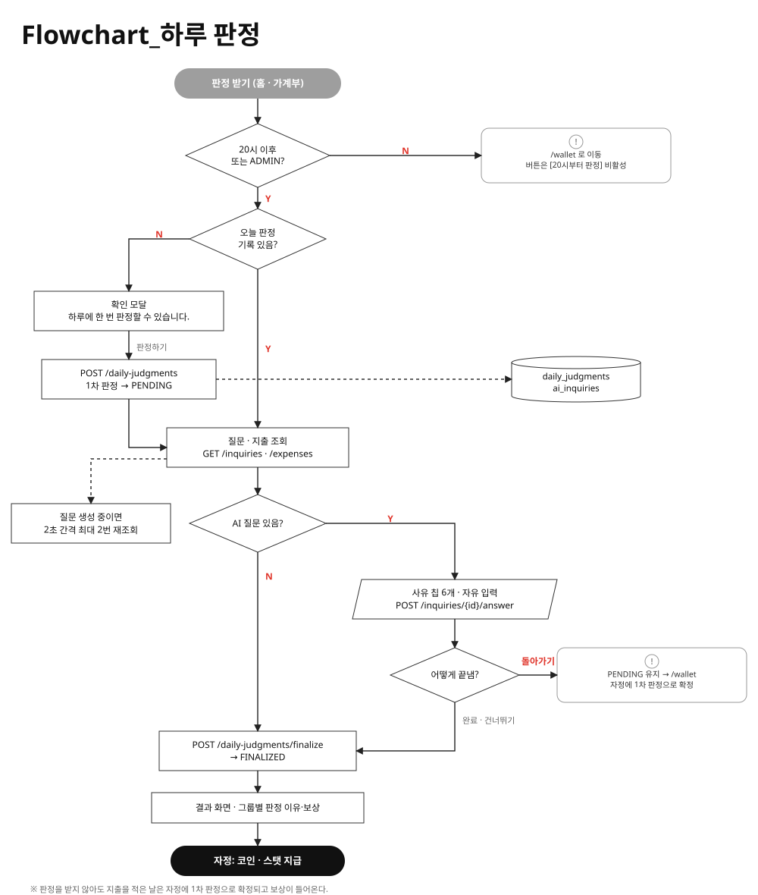

# VORI 화면설계서

| 항목 | 내용 |
|---|---|
| 프로젝트 | VORI |
| 문서 버전 | v0.7 |
| 작성일 | 2026-10-15 |
| 작성 | 정다은 |
| 기준 코드 | `jonghdch` 브랜치 `bbb6b3c` (v0.3 에서 화면 문서는 `0c0a9e4` 기준으로 상태 칸 추가) |

> 화면마다 어떤 모양이고 어떤 기능을 하는지 적은 문서. 이 README 에 표지·수정 이력·기획의도·화면 목록·공통 정책·흐름·권한을,
> 화면마다 파일 하나(`<화면 ID>.md`)에 와이어프레임과 디스크립션을 둔다.
> 양식은 [화면설계서 내용·양식·작성법](https://m.blog.naver.com/soomichip_/223128859692)의 구성을 따르고,
> 디스크립션에 **상태 칸**(평소·로딩·실패·빈·비활성)을 더했다.

> ⚠️ **코드 기준 스냅샷이다.** 화면이 바뀌면 이 문서보다 코드가 맞다. 화면을 고친 사람이 해당 화면 파일과 아래 수정 이력을 같은 커밋에서 갱신한다.
> 기획 의도나 미구현 제안은 [`signup-flow.md`](../signup-flow.md) · [`tutorial-flow.md`](../tutorial-flow.md) ·
> [`judgment-flow.md`](../judgment-flow.md) 에 있고 이 문서는 지금 구현된 화면만 다룬다.

## 화면 바로가기

화면 문서 전체를 메뉴 순서로 모았다. 경로·파일·인증까지 보려면 [3-2. 스크린 리스트](#3-2-스크린-리스트).

| 구분 | 화면 |
|---|---|
| 공개 | [랜딩](PUB_LND_01.md) · [스토리](PUB_STR_01.md) · [이용약관 · 개인정보처리방침](PUB_LGL_01-02.md) |
| 계정 | [로그인](AUTH_LGN_01.md) · [회원가입](AUTH_SGN_01.md) · [소비 프로필 설문](ONB_PRF_01.md) · [온보딩](ONB_DONE_01.md) |
| 메뉴 | [홈 대시보드](HOME_DSH_01.md) · [가계부 날짜 탭](WAL_MAIN_01.md) · [가계부 목록 탭](WAL_MAIN_02.md) · [가계부 작성](WAL_ENT_01.md) · [작성 확인](WAL_ENT_02.md) · [하루 판정](WAL_JDG_01.md) · [소비 리포트](RPT_MAIN_01.md) |
| 게임 | [상점](GAME_SHP_01.md) · [마이룸](GAME_ROOM_01.md) · [도감](GAME_DEX_01.md) · [펫 상세](GAME_DEX_02.md) |
| 설정 | [환경설정 (프로필 · 기본 설정 · 카드·계좌 · 계정)](SET_MAIN_01-04.md) |
| 관리 (ADMIN) | [어드민 (대시보드 · 유저 현황 · 기타 메뉴)](ADM.md) |
| 공통 요소 | [AppShell](CMN_SHELL_01.md) · [펫 이름 짓기](CMN_PNM_01.md) · [출석 팝업](CMN_ATT_01.md) · [어드민 도구](CMN_ADM_01.md) · [신호 칩](CMN_SIG_01.md) · [공통 오류 문구](CMN_ERR_01.md) |

## 목차

1. [읽는 법](#읽는-법)
2. [수정 이력](#1-수정-이력)
3. [기획의도 · KPI](#2-기획의도--kpi)
4. [메뉴 구조 · 화면 목록 · 화면 외 개발 대상](#3-메뉴-구조--화면-목록--화면-외-개발-대상)
5. [공통 요소](#4-공통-요소)
6. [공통 정책](#5-공통-정책)
7. [흐름도](#6-흐름도)
8. [권한](#7-권한)
9. [문서와 코드가 다른 곳 · 알려진 문제](#8-문서와-코드가-다른-곳--알려진-문제)

### 읽는 법

- **화면 ID** — `대분류_중분류_번호`. 개발자와 화면을 짚어 말할 때 쓴다. 대분류는 아래와 같다.

  | 대분류 | 뜻 |
  |---|---|
  | `PUB` | 공개 화면 (랜딩·스토리·약관) |
  | `AUTH` | 로그인·회원가입 |
  | `ONB` | 소비 프로필 설문·온보딩 |
  | `HOME` | 홈 대시보드 |
  | `WAL` | 가계부 (조회·작성·판정) |
  | `RPT` | 소비 리포트 |
  | `GAME` | 마이룸·도감·상점 |
  | `SET` | 환경설정 |
  | `ADM` | 어드민 |
  | `CMN` | 여러 화면에 겹치는 공통 요소 |

- **와이어프레임의 ①②③** 은 같은 화면 파일의 디스크립션 표 번호와 짝이다.
- **상태 칸**은 그 요소가 평소·로딩·실패·빈·비활성일 때 어떻게 보이는지 적는다. 해당 없는 상태는 적지 않고, 코드에서 확인하지 못한 칸은 "확인 필요" 로 둔다.
- API 경로는 `/api` 접두어를 뺀 채 적는다. 모든 호출은 세션 쿠키를 같이 보낸다.
- 큰따옴표 안 문구는 화면에 실제로 나오는 문구다.

---

## 1. 수정 이력

화면(섹션)별 구현·수정 이력과 진척도다. 문서 자체의 형식 변경은 git 이력을 본다.
작성자는 그 기간에 화면 코드·흐름 문서를 커밋한 git 작성자 이름이고(머지 커밋 제외), 날짜는 그 기간의 마지막 커밋 날짜다. 기준 브랜치는 `jonghdch` `0c0a9e4` 까지.

| 버전         | 작성자                                            | 내용                                                                                                                                                                                                                                                                                                                                                                                                                                                                                                                                                                                                                                                                                                                                                                                                                         | 날짜         |     |
| ---------- | ---------------------------------------------- | -------------------------------------------------------------------------------------------------------------------------------------------------------------------------------------------------------------------------------------------------------------------------------------------------------------------------------------------------------------------------------------------------------------------------------------------------------------------------------------------------------------------------------------------------------------------------------------------------------------------------------------------------------------------------------------------------------------------------------------------------------------------------------------------------------------------------- | ---------- | --- |
| v0.1       | Jeong Hong Cho, gaeun                          | • 랜딩·스토리·로그인·회원가입 화면 구현<br>• 스토리 화면 수정 (세계관·달·캐릭터 연출 강화, 챕터 스크롤 간격 조정, 데스크톱 전환 끊김·번들 크기 개선)<br>• 랜딩 화면 수정 (카드 등장 효과, 루미나 안내서 링크)<br>• 회원가입 화면 수정 (이름 칸 추가, 가입 뒤 자동 로그인, 라벨·안내 문구 정리)<br>• 홈 대시보드 화면 구현 (임시 시안)<br>• 공통: 화면 이동(라우터) 도입, 홈 로그인 가드                                                                                                                                                                                                                                                                                                                                                                                                                                                                                                                                                                            | 2026-05-20 |     |
| v0.2       | Jeong Hong Cho, gaeun                          | • 가계부 작성 화면 구현 (3단계 작성, AI 분석·카테고리·스탯 연결)<br>• 가계부 화면 구현 (달력 백엔드 연동·월 이동)<br>• 가계부 작성·가계부 화면 수정 (코드 리뷰 Blocker·Warning 반영, 입력 UI 개선, 급여 수입 추가, 소비 분석을 작성 흐름에서 떼어 오후 8시 이벤트로, AI 판정 배지는 예외 지출에만)<br>• 홈 대시보드 화면 수정 (백엔드 연동)<br>• 어드민 화면 구현 (종합 대시보드·소비 분석 3종·합리성 룰 설정·제재 관리, 타이포 가이드 적용)<br>• 키우기(현 마이룸)·상점 화면 구현<br>• 환경설정 화면 구현 (1차)<br>• 공통: 사이드바 스타일 정리, 로그인 가드 보안 수정                                                                                                                                                                                                                                                                                                                                                                                                                                                   | 2026-06-20 |     |
| v0.3       | Jeong Hong Cho                                 | • 가계부 화면 수정 (UX 검토 Blocker 4건·Warning 5건 반영, 소비 사유 노출, 주/월 보기 전환, 지출 표 상시 표시·페이지 나누기, 헤더 총 지출액)<br>• 홈 대시보드 화면 수정 (펫 카드 개편, 칭호 배지, 원형 경험치 게이지, 최근 지출 신호를 색 원으로)<br>• 이용약관·개인정보처리방침 화면 구현<br>• 랜딩 화면 수정 (히어로 제목 위치를 스토리 표지와 맞춤, how 섹션 영상을 CSS 목업으로)<br>• 소비 리포트 화면 구현 (자리 표시 화면 → 주간 리포트 1차, 지난주/다음주 이동)<br>• 공통: 모바일 햄버거 메뉴, 헤더 로그아웃 제거                                                                                                                                                                                                                                                                                                                                                                                                                                                                                   | 2026-08-26 |     |
| v0.4       | Jeong Hong Cho, hwang chae rin, gaeun, sdy3393 | • 홈 대시보드 화면 수정 (카테고리 차트를 월간 기록 달력으로, "펫 키우기" → "마이룸")<br>• 마이룸·상점 화면 수정 (펫·상점·가구 API 연동, 테마 세트 현황 칩, 방 이미지 교체, 알 개봉 실패 문구)<br>• 가계부 작성 화면 수정 (영수증 사진 인식 진입 복원·업로드 전 축소, 날짜를 골라 작성·수정, 완료 뒤 가계부로 복귀)<br>• 하루 판정 화면 구현 (일일 소비 판정·지출 수정), 가계부 화면에 판정 진행·사유 표시<br>• 업적/칭호·도감 화면 구현, 어드민 칭호 관리 화면 구현<br>• 스토리 화면 수정 (캐릭터·가구 소개를 실제 카탈로그로)<br>• 환경설정 프로필 화면 구현 (닉네임·이름 규칙을 가입과 맞춤), 공통: 사이드바 토글·헤더 계정 표시<br>• 튜토리얼 흐름 시나리오 작성                                                                                                                                                                                                                                                                                                                                                                                                    | 2026-09-28 |     |
| v0.5       | Jeong Hong Cho, gaeun, hwang chae rin, sdy3393 | • 로그인 화면 수정 (구글 로그인), 가입 흐름 시나리오 작성 (소비 프로필 설문·온보딩)<br>• 소비 프로필 설문·온보딩 화면 구현 (월 수입 필수, 설문 필수·이탈 막기, 안내 문구 정리)<br>• 홈 대시보드 화면 수정 (디자인 수정, 펫 없음 안내, "소비 판정 시작하기" 바로가기, 펫 스탯 한 줄, 알림 종·상황별 말풍선, 리포트 버튼은 월말 정산 뒤 일주일만)<br>• 가계부·하루 판정 화면 수정 (디자인 수정, 판정 끝난 날 체크, 예산 카드 API 연결, Enter 로 다음 칸 이동, 스탯 예산 봉투 판정, 판정 이유를 신호별로 묶음, 판정 전 확인 창, 다시 열어도 결과 유지)<br>• 마이룸 화면 수정 (펫 우클릭 상호작용, 대화방 탭·펫 자유 대화, 펫 상태 탭 통합, 내역 보기, 배경·가구 추가, 레벨 1\~30 성장 구조, 경로 `/raise` → `/myroom`)<br>• 상점·도감 화면 수정 (등급별 알·가구 이미지, 구매 내역 팝업, 코인 아이콘, 좁은 화면 카드 겹침 / 2차 동물·성장 단계별 모습, 업적/칭호를 도감 탭으로 합침, 관리자는 전부 열람), 펫 상세 화면 구현<br>• 랜딩·환경설정·소비 리포트 화면 수정 (랜딩 어두운 히어로 개편·대상 사용자·AI 기준·팀 소개 / 환경설정 사이드바 탭·고정지출 / 리포트 디자인)<br>• 공통: 출석 팝업·펫 이름 짓기 팝업·어드민 도구 구현, 헤더 내 정보 상자, 어드민 펫·도감 관리 화면 연결                                                                   | 2026-10-03 |     |
| v0.6       | Jeong Hong Cho, hwang chae rin                 | • 하루 판정 시나리오 작성 (1차 판정 · 예외 지출 사유 · 자정 확정으로 재설계)<br>• 하루 판정 화면 수정 (1차 판정 → 예외 지출 사유 → 확정 때 보상 1회, 자정 지난 미확정 판정은 1차 판정으로 확정, 신호 문구를 여유·적정·초과로 통일)<br>• 가계부 작성 화면 수정 (애매한 내역은 칩으로 되묻기, 음식은 매장·포장 / 배달, 전에 고른 카테고리 우선, 메모 칸, 사유 칩 답변, AI 한도 안내·끄기 스위치, 입력 줄이 사라지던 문제)<br>• 환경설정 계정 화면 구현 (회원 탈퇴 — 30일 유예 뒤 삭제, 기간 안 로그인 시 복구)<br>• 이용약관·개인정보처리방침 화면 수정 (Gemini 위탁 항목·탈퇴 유예·펫 AI 산출물 반영, 시행일 갱신)<br>• 스토리 화면 수정 (표지 빛 번짐·빛줄기, 달 일러스트)<br>• 마이룸·도감 화면 수정 (펫 분양·졸업 문구를 "달나라로 보내는 배웅"으로 통일)<br>• 공통: API 호출 모듈 통일, 공용 컴포넌트 스타일 분리, 앱·탭 아이콘을 VORI 로고로, 골든패스 E2E 테스트 추가                                                                                                                                                                                                                                                             | 2026-10-10 |     |
| v0.7       | Jeong Hong Cho, gaeun                          | • 홈·가계부 화면 수정 (리디자인 — 선 아이콘·신호 칩·계정 메뉴)<br>• 상점·마이룸 화면 수정 (리디자인)<br>• 가계부 작성 화면 수정 (지출 기록 구조 변경, 결제 수단 칩·카드사 색 점, 수입 받은 곳·저축 모은 곳 고르기)<br>• 가계부 목록 탭 화면 구현 (내역 필터·검색·수입 출처, 상세는 폰 시트·넓은 화면 오른쪽 패널), 리뷰 지적 반영 (필터 칩·상세 패널·시트 포커스)<br>• 환경설정 카드·계좌 화면 구현 (등록, 이름·카드사·잔액 수정), 리뷰 지적 반영 (오류 위치·잔액 상한·삭제 연타)<br>• 소비 리포트 화면 수정 (결제수단별 지출·판정, 지난달 비교 한 줄, 지난 기간 지출이 없으면 비교 숨김)<br>• 어드민 화면 수정 (화면 없는 메뉴에 "준비 중" 표시, 글자 대비)<br>• 가입·튜토리얼 시나리오 수정 (라우트·온보딩을 현재 구현에 맞춤)<br>• 화면설계서 v0.7 제작 (화면별 문서·상태 칸·실제 화면 캡처)                                                                                                                                                                                                                                                                                                                   | 2026-10-15 |     |
| 진척도 (v0.7) | —                                              | **각 섹션 별 진척도**<br>• 랜딩·스토리·약관 (100% — 화면 4개 구현, 손볼 곳 0건. 확인 필요 1건: 새 탭으로 연 약관의 \[← 뒤로\])<br>• 로그인·가입 (100% — 화면 2개 구현, 손볼 곳 3건: 로그인 상태 유지·비밀번호 찾기 미동작, 가입 입력 검사, 설문 마친 사용자 되돌리기)<br>• 설문·온보딩 (100% — 화면 2개 구현, 손볼 곳 0건. 튜토리얼 설계안 중 첫 방문 슬라이드·홈 체크리스트·인앱 하이라이트는 미구현, `tutorial-flow.md`)<br>• 홈 (100% — 손볼 곳 1건: 판정 시각 표기 혼재)<br>• 가계부 (80% — 화면 5개 중 4개 구현, 작성 확인 화면은 진입 경로 없음. 손볼 곳 5건. 판정 흐름 미결 질문 1건, `judgment-flow.md` Q1)<br>• 리포트 (100% — 손볼 곳 2건: 미래 기간 이동·이모지 아이콘, 판정 분포와 결제수단별 지출의 기준 차이)<br>• 상점 (100% — 손볼 곳 0건)<br>• 마이룸 (100% — 손볼 곳 1건: 방 테마가 브라우저에만 저장됨)<br>• 도감 (100% — 도감·펫 상세 2개 구현, 손볼 곳 0건)<br>• 환경설정 (100% — 탭 4개 구현, 손볼 곳 0건)<br>• 어드민 (50% — 메뉴 18개 중 9개 구현, 9개 준비 중)<br>• 공통 요소 (구현 완료 — AppShell·펫 이름 짓기·출석 팝업·어드민 도구·신호 칩·공통 오류 문구 6개, 손볼 곳 0건)<br>• 화면 외 개발 대상 (구현 완료 — 3-3 의 8개 대상 모두 코드에 있음) | 2026-10-15 |     |

진척도 = 3-2 스크린 리스트·7-2 어드민 메뉴에 있는 화면(메뉴) 가운데 상태가 "구현"인 비율. 손볼 곳 = 8-2 표에서 그 섹션에 걸린 줄 수. 화면 목록에 없는 공통 요소·화면 외 개발 대상은 비율 대신 구현 여부만 적었다.

---

## 2. 기획의도 · KPI

### 기획의도

가계부를 쓴다고 소비가 바뀌지는 않는다. VORI 는 지출을 평가해 주는 데서
출발했다. 평가가 이어지려면 기록이 끊기지 않아야 해서 **가계부 습관**을 주제로 삼았다. 습관이 붙게 하는
수단으로 펫 육성·알 뽑기·마이룸 같은 게이미피케이션을 넣었다. 자세한 흐름은
[`roadmap.md`](../roadmap.md) 1절.

화면 설계에 이 순서가 그대로 드러난다.

| 단계 | 화면에서 하는 일 | 해당 화면 |
|---|---|---|
| 소비 평가 | 지출마다 신호(여유·적정·초과), 큰 지출엔 AI 가 이유를 묻고 판정에 반영 | `WAL_JDG_01`, `HOME_DSH_01` |
| 가계부 습관 | 빠른 입력, 영수증 인식, 출석 보상, 하루 판정 보상 | `WAL_ENT_01`, `CMN_ATT_01` |
| 접근성·재미 | 펫 성장, 알 뽑기, 가구 배치, 칭호·업적 | `GAME_*` |

### KPI (측정 항목)

목표 수치는 팀에서 아직 정하지 않았다. 아래는 무엇을 재는지만 적고 값은 정해지면 채운다.
어드민 대시보드(`ADM_DSH_01`)에서 이미 볼 수 있는 항목은 표시해 두었다.

| KPI | 정의 | 어디서 보나 | 목표 |
|---|---|---|---|
| 신규 가입 | 하루·최근 7일 가입자 수 | `ADM_DSH_01` | TBD |
| 설문 완료율 | 가입자 중 소비 프로필 설문을 끝낸 비율 | 미구현 | TBD |
| 기록 지속일 | 사용자별 지출을 적은 날 수 / 가입 후 경과일 | `RPT_MAIN_01` "기록한 날" (개인) | TBD |
| 하루 판정 참여율 | 지출을 적은 날 중 하루 판정까지 받은 비율 | 미구현 | TBD |
| AI 질문 응답률 | 초과 지출 질문 중 사유를 답한 비율 (건너뛰기 제외) | `ADM` AI 대사 로그 | TBD |
| 누적 절약액 | 전체 사용자 `total_saved` 합 | `ADM_DSH_01` | TBD |

## 3. 메뉴 구조 · 화면 목록 · 화면 외 개발 대상

### 3-1. 메뉴 트리



<details>
<summary>텍스트로 보기</summary>

```
VORI
├─ 공개
│  ├─ 랜딩 (/)
│  ├─ 스토리 (/story)
│  └─ 이용약관 (/terms) · 개인정보처리방침 (/privacy)
├─ 계정
│  ├─ 로그인 (/login)
│  ├─ 회원가입 (/signup)
│  ├─ 소비 프로필 설문 (/signup/profile)
│  └─ 온보딩 (/onboarding)
└─ 앱 (AppShell)
   ├─ 메뉴
   │  ├─ 홈 대시보드 (/home)
   │  ├─ 가계부 (/wallet)
   │  │  ├─ 작성 (/wallet/new)
   │  │  └─ 하루 판정 (/wallet/analysis)
   │  └─ 소비 리포트 (/report)
   ├─ 게임
   │  ├─ 상점 (/shop)
   │  ├─ 마이룸 (/myroom)
   │  └─ 도감 (/dex, /dex/:appearanceKey)
   ├─ 설정
   │  └─ 환경설정 (/settings/profile · general · payment · account)
   └─ 관리 (ADMIN 전용)
      └─ 어드민 (/admin/*)
```

</details>

### 3-2. 스크린 리스트

| 화면 ID | 화면명 | 경로 | 파일 | 인증 | 상태 | 문서 |
|---|---|---|---|---|---|---|
| `PUB_LND_01` | 랜딩 | `/` | `pages/Landing/LandingPage.jsx` | 공개 | 구현 | [PUB_LND_01](PUB_LND_01.md) |
| `PUB_STR_01` | 스토리 | `/story` | `pages/Story/StoryPage.jsx` | 공개 | 구현 | [PUB_STR_01](PUB_STR_01.md) |
| `PUB_LGL_01` | 이용약관 | `/terms` | `pages/Legal/TermsPage.jsx` | 공개 | 구현 | [PUB_LGL_01-02](PUB_LGL_01-02.md) |
| `PUB_LGL_02` | 개인정보처리방침 | `/privacy` | `pages/Legal/PrivacyPage.jsx` | 공개 | 구현 | [PUB_LGL_01-02](PUB_LGL_01-02.md) |
| `AUTH_LGN_01` | 로그인 | `/login` | `pages/Login/LoginPage.jsx` | 공개 | 구현 | [AUTH_LGN_01](AUTH_LGN_01.md) |
| `AUTH_SGN_01` | 회원가입 | `/signup` | `pages/Signup/SignupPage.jsx` | 공개 | 구현 | [AUTH_SGN_01](AUTH_SGN_01.md) |
| `ONB_PRF_01` | 소비 프로필 설문 | `/signup/profile` | `pages/Signup/SignupProfilePage.jsx` | 로그인 | 구현 | [ONB_PRF_01](ONB_PRF_01.md) |
| `ONB_DONE_01` | 온보딩(시작 준비 완료) | `/onboarding` | `pages/Onboarding/OnboardingPage.jsx` | 로그인 | 구현 | [ONB_DONE_01](ONB_DONE_01.md) |
| `HOME_DSH_01` | 홈 대시보드 | `/home` | `pages/Home/HomeDashboard.jsx` | 로그인 | 구현 | [HOME_DSH_01](HOME_DSH_01.md) |
| `WAL_MAIN_01` | 가계부 — 날짜 탭 | `/wallet` | `pages/Wallet/WalletPage.jsx` | 로그인 | 구현 | [WAL_MAIN_01](WAL_MAIN_01.md) |
| `WAL_MAIN_02` | 가계부 — 목록 탭 | `/wallet?view=list` | 〃 | 로그인 | 구현 | [WAL_MAIN_02](WAL_MAIN_02.md) |
| `WAL_ENT_01` | 가계부 작성 | `/wallet/new` | `pages/WalletEntry/WalletEntryPage.jsx` | 로그인 | 구현 | [WAL_ENT_01](WAL_ENT_01.md) |
| `WAL_ENT_02` | 작성 확인 | `/wallet/new/confirm` | `pages/WalletEntry/WalletConfirmPage.jsx` | 로그인 | **진입 경로 없음** (8절) | [WAL_ENT_02](WAL_ENT_02.md) |
| `WAL_JDG_01` | 하루 판정 | `/wallet/analysis` | `pages/WalletEntry/WalletAnalysisPage.jsx` | 로그인 | 구현 | [WAL_JDG_01](WAL_JDG_01.md) |
| `RPT_MAIN_01` | 소비 리포트 | `/report` | `pages/Report/ReportPage.jsx` | 로그인 | 구현 | [RPT_MAIN_01](RPT_MAIN_01.md) |
| `GAME_SHP_01` | 상점 | `/shop` | `pages/Shop/ShopPage.jsx` | 로그인 | 구현 | [GAME_SHP_01](GAME_SHP_01.md) |
| `GAME_ROOM_01` | 마이룸 | `/myroom` | `pages/Pet/PetPage.jsx` | 로그인 | 구현 | [GAME_ROOM_01](GAME_ROOM_01.md) |
| `GAME_DEX_01` | 도감 | `/dex` | `pages/PetDex/PetDexPage.jsx` | 로그인 | 구현 | [GAME_DEX_01](GAME_DEX_01.md) |
| `GAME_DEX_02` | 펫 상세 | `/dex/:appearanceKey` | `pages/PetDex/PetDetailPage.jsx` | 로그인 | 구현 | [GAME_DEX_02](GAME_DEX_02.md) |
| `SET_MAIN_01` | 환경설정 — 프로필 | `/settings/profile` | `pages/Settings/ProfileSettingsPanel.jsx` | 로그인 | 구현 | [SET_MAIN_01-04](SET_MAIN_01-04.md) |
| `SET_MAIN_02` | 환경설정 — 기본 설정 | `/settings/general` | `pages/Settings/GeneralSettingsPanel.jsx` | 로그인 | 구현 | [SET_MAIN_01-04](SET_MAIN_01-04.md) |
| `SET_MAIN_03` | 환경설정 — 카드·계좌 | `/settings/payment` | `pages/Settings/PaymentSettingsPanel.jsx` | 로그인 | 구현 | [SET_MAIN_01-04](SET_MAIN_01-04.md) |
| `SET_MAIN_04` | 환경설정 — 계정(탈퇴) | `/settings/account` | `pages/Settings/AccountSettingsPanel.jsx` | 로그인(일반) | 구현 | [SET_MAIN_01-04](SET_MAIN_01-04.md) |
| `ADM_DSH_01` | 어드민 종합 대시보드 | `/admin/dashboard` | `pages/Admin/DashboardPage.jsx` | ADMIN | 구현 | [ADM](ADM.md) |
| `ADM_USR_01` | 어드민 유저 현황 | `/admin/users` | `pages/Admin/UsersPage.jsx` | ADMIN | 구현 | [ADM](ADM.md) |
| `ADM_ETC_*` | 어드민 기타 메뉴 | `/admin/*` | 7-2 표 | ADMIN | 구현 8 · 준비 중 9 | [ADM](ADM.md) |

리다이렉트 전용 경로: `/raise` → `/myroom`, `/titles` → `/dex?tab=titles`, `/settings` → `/settings/profile`,
`/admin` → `/admin/dashboard`.

### 3-3. 화면 외 개발 대상

화면은 없지만 표의 관련 화면들이 이 대상에 기댄다.

| 대상 | 내용 | 관련 화면 |
|---|---|---|
| 자정 판정 확정 | 판정을 안 받았거나 PENDING 인 날을 1차 판정으로 확정하고 보상 지급 | `WAL_MAIN_01`, `HOME_DSH_01` |
| 자동 분류 | `POST /categories/categorize` — 내역 문자열로 카테고리 추천, 애매하면 되묻기 유형 반환 | `WAL_ENT_01` |
| AI 사유 질문 | 초과(RED)·비반복 지출 저장 시 Gemini 로 질문 생성, 답변을 `reason_category` 로 분류 | `WAL_JDG_01` |
| 영수증 인식 | `POST /receipts` — Gemini 이미지 인식으로 금액·내역·날짜·결제수단 추출 | `WAL_ENT_01` |
| 월간 리포트 알림 | 말일 12:00 부터 7일 동안 "리포트가 나왔어요" 노출, 읽음 처리 | `HOME_DSH_01`, `RPT_MAIN_01` |
| 펫 대화 | `POST /pets/active/chat` — 하루 10회, 대화 내용 저장 안 함 | `GAME_ROOM_01` |
| 탈퇴 유예 파기 | 탈퇴 신청 30일 뒤 데이터 삭제, 그 안에 로그인하면 복구 | `SET_MAIN_04`, `AUTH_LGN_01` |
| 시드 데이터 | 어드민 계정, 시작 펫(강아지), 알 등급·가구·테마·업적·칭호 마스터 | 전체 |

---

## 4. 공통 요소

여러 화면에 겹치는 요소. 화면과 같은 양식으로 파일을 둔다.

| ID | 요소 | 문서 |
|---|---|---|
| `CMN_SHELL_01` | AppShell (앱 화면 공통 틀) | [CMN_SHELL_01](CMN_SHELL_01.md) |
| `CMN_PNM_01` | 펫 이름 짓기 (강제 모달) | [CMN_PNM_01](CMN_PNM_01.md) |
| `CMN_ATT_01` | 출석 팝업 | [CMN_ATT_01](CMN_ATT_01.md) |
| `CMN_ADM_01` | 어드민 도구 (플로팅) | [CMN_ADM_01](CMN_ADM_01.md) |
| `CMN_SIG_01` | 신호 칩 | [CMN_SIG_01](CMN_SIG_01.md) |
| `CMN_ERR_01` | 공통 오류 문구 | [CMN_ERR_01](CMN_ERR_01.md) |

---

## 5. 공통 정책

모든 화면에 적용한다. 화면 파일의 "예외·정책" 칸은 여기와 다를 때만 적는다.

### 5-0. 화면 공통 규칙

| 영역 | 정책 |
|---|---|
| 시트·모달 | 넓은 화면은 가운데 창, 640px 이하는 바텀시트. 뒤 화면 스크롤 잠금, Tab 포커스 가두기, 닫으면 여는 버튼으로 포커스 복귀 (`WAL_MAIN_02` 기준) |
| 오류 문구 | 서버 message 가 있으면 그대로, 없으면 `CMN_ERR_01` 대체 문구 |
| 신호 표시 | 색만으로 구분하지 않고 아이콘 + 글자. 확정 전엔 "(예상)" (`CMN_SIG_01`) |

### 5-1. 계정 · 인증

| 항목 | 정책 |
|---|---|
| 비밀번호 | 8자 이상 + 특수문자 1개 이상. BCrypt 단방향 저장 |
| 닉네임 · 이름 | 닉네임 2~12자, 이름 2~30자 (프로필 수정 기준. 가입 화면은 최대 길이만 막음) |
| 로그인 유지 | 세션 쿠키(HttpOnly). "로그인 상태 유지" 체크박스는 아직 기능 없음 |
| 설문 강제 | 설문 전 계정은 공개 화면 포함 모든 경로가 설문으로 (ADMIN 제외) |
| 온보딩 | 로그인 직후 분기에서만 보낸다. 앱 화면을 막지는 않는다 |
| 탈퇴 | 신청 즉시 로그아웃, 30일 뒤 지출·수입·펫·칭호·코인 삭제. 30일 안에 로그인하면 복구 + 알림 |

### 5-2. 지출 기록

| 항목 | 정책 |
|---|---|
| 날짜 | 오늘까지만. 미래 날짜는 고를 수 없고 주소로 넣어도 오늘로 바뀐다 |
| 금액 | 숫자만, 최대 12자리 |
| 필수 | 금액 · 내역 · 카테고리 (지출) |
| 자동 분류 | 입력을 멈추고 400ms 뒤 요청. 서버 오류·네트워크 오류면 600ms 뒤 한 번 다시 시도 |
| 반복 결제 | 통신비·구독 같은 반복 결제는 초과(RED)를 주지 않는다 |
| 기록 보상 | 지출 기록 시 100 코인 (`RECORD_REWARD_COINS`) |

### 5-3. 판정

| 항목 | 정책 |
|---|---|
| 판정 단위 | 같은 스탯 그룹(식비·쇼핑뷰티·문화여가·생활고정비)의 지출을 합해 하루 한 번 |
| 열리는 시각 | 일반 계정은 20:00 부터 그날만. ADMIN 은 언제든, 날짜도 고를 수 있다. 화면은 클라이언트 시계로, 실제 차단은 서버 403 |
| 신호 기준 | 사용 가능 금액 대비 85% 이하 여유 · 100% 이하 적정 · 초과 초과 (`CMN_SIG_01`) |
| 사용 가능 금액 | 하루 기본 예산 + 전날 남긴 돈의 절반 |
| AI 질문 | 초과(RED)이고 반복 결제가 아닌 지출에만 |
| 사유 반영 | 경조사·갑작스러운 일·배움·자기계발 → 여유 / 모임·만남 → 적정 / 사고 싶어서·기타 → 그대로 ([`domain.md`](../domain.md)) |
| 확정 | 답하거나 건너뛰면 FINALIZED. 판정을 안 받거나 PENDING 으로 둔 날은 자정에 1차 판정으로 확정 |
| 보상 지급 | 자정. 판정 뒤에 지출을 고쳐도 보상은 바뀌지 않는다 |
| 스탯 보상 | 그룹마다 하루 예산보다 아낀 1,000원마다 그 스탯 +1 |

### 5-4. 영수증 인식

| 단계 | 정책 |
|---|---|
| 업로드 | 이미지 파일만. 긴 변 2048px 로 줄여 JPEG(품질 0.85)로 보냄. 10MB 초과면 "사진이 너무 커요 ({n}MB). 10MB 이하로 올려주세요." |
| 소요 | "사진을 읽는 중이에요. 10~15초쯤 걸려요." |
| 실패 | 결제가 여러 건 / 결제 내역이 아님(취소·환불·입금) / 못 읽음 — 각각 다른 안내 |
| 성공 | **바로 저장하지 않고 폼만 채운다.** 사용자가 확인하고 저장 |
| 날짜가 다를 때 | 사진 속 날짜를 알려 주고 작성 중인 날짜는 바꾸지 않는다 |

### 5-5. 게임 경제

| 항목 | 정책 |
|---|---|
| 가입 보너스 | 1,000 코인 |
| 코인 적립 | 절약 10원당 1코인, 기록 보상, 출석, 배웅 선물 |
| ADMIN | 코인 무제한 (∞) |

알 등급별 가격과 확률 (2026-10-08 가격 1/10 인하)

| 알 | 가격 | S | A | B | C |
|---|---|---|---|---|---|
| 기본 알 | 250 | 1% | 5% | 24% | 70% |
| 고급 알 | 600 | 5% | 20% | 45% | 30% |
| 최고급 알 | 1,500 | 20% | 50% | 30% | 0% |

- 확률은 **구매 시점에 알에 저장**한다. 나중에 확률을 바꿔도 이미 산 알은 그대로다.
- 변종: 일반 90% · 이로치 8% · 에일리언 2%.

### 5-6. 펫 성장 · 마이룸

| 항목 | 정책 |
|---|---|
| 진화 | Lv.1 1차 · Lv.5 2차 · Lv.15 3차 |
| 경험치 | 스탯 합 × 10. 레벨업 필요량 `10 × (4 + ⌊(레벨−1)/2⌋)` (누적 Lv.5 180 · Lv.15 980 · Lv.30 3,120) |
| 배웅 | Lv.30 부터. 배웅 선물 = 경험치 × (1 + (배치 가구 보너스 합 + 발동한 세트 보너스 합) / 100), 내림 |
| 가구 효과 | **배치한 가구만** 보너스에 반영. 사기만 하면 효과 없음 |
| 테마 세트 | 같은 테마 가구를 필요 수 이상 배치하면 발동 — 우드 +8% · 코지 +12% · 스터디 +15% |
| 가구 자리 | 같은 좌표엔 하나만 (서버 409). 기본 자리가 차 있으면 옆으로 밀어 빈자리를 찾는다 |
| 상호작용 | 1회마다 1% 확률로 매력 +1 |
| 대화 | 하루 10회(서버 설정으로 변경 가능), 메시지 1~200자, AI 응답 실패 시 횟수 차감 안 함. 대화 내용은 서버에 저장하지 않는다 |
| 잠긴 상품 | 숨기지 않고 해금 조건(칭호)과 함께 보여 준다 |
| 칭호 | 펫 단위로 딴다. 새 펫이 오면 과제가 처음부터 |
| 업적 | 최대 3개 장착. 조회할 때 서버가 조건을 다시 평가해 놓친 업적을 지급 |

---

## 6. 흐름도

### 6-1. 가입 → 첫 기록



<details>
<summary>텍스트로 보기</summary>

```
[랜딩 PUB_LND_01]
   │ 무료로 시작하기
   ▼
[회원가입 AUTH_SGN_01] ── POST /auth/signup → 자동 POST /auth/login
   │                         (가입 보너스 1,000코인, 시작 펫 강아지 지급)
   ▼
[소비 프로필 설문 ONB_PRF_01]  6문항, 건너뛰기 없음
   │ POST /onboarding/spending-profile
   ▼
[온보딩 ONB_DONE_01] 요약 확인
   │ POST /onboarding/complete
   ├── 첫 지출 기록하기 ──▶ [가계부 작성 WAL_ENT_01]
   └── 홈으로 가기 ──────▶ [홈 HOME_DSH_01]
                               │ (앱 화면 첫 진입 시)
                               ▼
                         [펫 이름 짓기 CMN_PNM_01] 이름 없는 펫이 있으면 강제
                               ▼
                         [출석 팝업 CMN_ATT_01] 하루 한 번
```

</details>

### 6-2. 로그인 분기



<details>
<summary>텍스트로 보기</summary>

```
[로그인 AUTH_LGN_01] ── POST /auth/login (또는 /auth/google)
   │
   ▼ GET /onboarding/status
   ├── 조회 실패 ───────▶ 이동하지 않음, "다시 시도" (상태만 다시 조회)
   ├── 설문 전 ─────────▶ ONB_PRF_01
   ├── 온보딩 전 ───────▶ ONB_DONE_01
   └── 둘 다 끝남 ──────▶ HOME_DSH_01
   (탈퇴 유예 중 계정이면 먼저 "계정이 복구됐어요" 알림)
```

</details>

### 6-3. 하루 소비 흐름 (화면 + 데이터)

```
[가계부 작성 WAL_ENT_01]
   │ 내역 입력 → 400ms 뒤 POST /categories/categorize (자동 분류)
   │ (선택) 영수증 → POST /receipts → 폼 자동 채움, 사용자가 확인
   │ 저장 → POST /ledger/entries
   │        └ 서버: expenses INSERT, EMA 갱신, signal_initial 산정,
   │                초과(RED)·비반복이면 ai_inquiries INSERT
   ▼
[가계부 조회 WAL_MAIN_01]  달력에 그날 신호(예상) 표시
   │ 20:00 이후 "판정 받기" (어드민은 항상)
   ▼
[하루 판정 WAL_JDG_01]
   │ 확인 모달 → POST /daily-judgments (1차 판정, PENDING)
   │ 질문 있음 ─▶ 사유 칩·글 → POST /inquiries/{id}/answer
   │             └ 서버: reason_category 로 signal_final 보정
   │ 질문 없음/답변 끝 ─▶ POST /daily-judgments/finalize (FINALIZED)
   ▼
[판정 결과]  그룹별 판정 이유, 받을 코인·스탯
   │ 자정: 보상 지급 (코인 + 펫 스탯 → 경험치)
   ▼
[홈·마이룸] 펫 성장 반영 → Lv.5 2차 진화 · Lv.15 3차 진화 · Lv.30 배웅 가능
```

판정을 받지 않아도 지출을 적은 날은 자정에 1차 판정 그대로 확정되고 보상이 들어온다.



### 6-4. 게임 루프

```
코인 (판정 보상 · 기록 보상 · 출석 · 배웅 선물)
   │
   ▼
[상점 GAME_SHP_01] ── 알 구매 POST /eggs/buy ─▶ 알 개봉 POST /eggs/{id}/open
   │                                              └▶ 새 펫 → 이름 짓기 CMN_PNM_01
   └─ 가구 구매 POST /furniture/buy
          ▼
[마이룸 GAME_ROOM_01] 가구 배치 PATCH /furniture/{id}/place
   │                  (배치한 가구만 배웅 선물·스탯 보너스에 반영)
   ▼ Lv.30
배웅 POST /pets/{id}/release → 배웅 선물 코인 → 다시 상점
```

## 7. 권한

### 7-1. 역할별 접근

| 구분 | 비로그인 | 일반(USER) | 관리자(ADMIN) |
|---|---|---|---|
| 공개 화면 (`PUB_*`, `AUTH_*`) | O | O (설문 전이면 설문으로) | O |
| 설문 · 온보딩 (`ONB_*`) | → `/login` | O | 설문 강제 안 함 |
| 앱 화면 (`HOME`·`WAL`·`RPT`·`GAME`·`SET`) | → `/login` | O | O |
| 하루 판정 | — | 20:00 이후 · 오늘만 | 언제든 · 날짜 선택 |
| 환경설정 계정 탭(탈퇴) | — | O | 탭 숨김 · 서버 403 |
| 코인 | — | 보유량만큼 | 무제한 |
| 도감 | — | 키워 본 종족·단계만 | 전부 열람 |
| 어드민 도구(플로팅) | — | X | O |
| 어드민 (`/admin/*`) | → `/login` | → `/home` | O (서버도 `hasRole("ADMIN")`) |

### 7-2. 어드민 메뉴 구현 현황

| 그룹 | 메뉴 | 경로 | 상태 |
|---|---|---|---|
| 기본 관리 | 종합 대시보드 | `/admin/dashboard` | 구현 |
| | 유저 현황 | `/admin/users` | 구현 |
| | 아이템 지급/회수 | `/admin/items` | 준비 중 |
| | 제재 관리 | `/admin/sanctions` | 구현 |
| 상점 및 경제 | 상점 단계 관리 · 상품 관리 · 뽑기 확률 설정 · 재화 로그 | — | 준비 중 (4) |
| 게임 컨텐츠 | 펫 성장 지원 | `/admin/pets` | 구현 |
| | 꾸미기 컨텐츠 관리 | `/admin/cosmetics` | 준비 중 |
| 소비 분석 AI · 데이터 | 지출 카테고리 통계 · 합리성 판정·AI 룰 설정 · AI 대사 로그 · AI 사용량 | — | 구현 (4) |
| | 영수증 OCR 모니터링 | `/admin/ocr-jobs` | 준비 중 |
| 시스템 · 컨텐츠 운영 | 업적 관리 | `/admin/achievements` | 구현 |
| | 공지사항 및 푸시 알림 · 운영 감사 로그 | — | 준비 중 (2) |

구현 10 · 준비 중 9.

## 8. 문서와 코드가 다른 곳 · 알려진 문제

화면설계서를 쓰다가 아래 항목들을 찾았다. 고칠지 말지는 팀에서 정한다.

### 8-1. 다른 문서와 다른 곳 (코드 기준으로 이 문서를 썼다)

| 문서 | 문서 내용 | 코드 |
|---|---|---|
| `signup-flow.md` | 가입 2단계(계정 → 약관) | 한 장짜리 폼 |
| `signup-flow.md` | 설문 5단계, 월소득은 묻지 않음 | 월 수입 숫자 입력 포함 6단계 |
| `signup-flow.md` | 온보딩 = 시작 펫 확인 → 판정 방식 2장 → 시작 버튼 | 요약 화면 한 장. 시작 펫은 이름 짓기 모달로 처음 보여 줌 |
| `signup-flow.md` | 목표별 버튼 문구·이동 위치가 다름 | 주 버튼은 모두 `/wallet/new` |
| `domain.md` · `judgment-flow.md` | 신호 이름 과지출 / 평소·애매 / 절약, GRAY = 회색 | 초과 / 적정 / 여유, GRAY = 노랑 |
| `domain.md` | 스탯 보상 "초록 +11 · 노랑 +6 · 주황 +2" | 아낀 1,000원마다 +1 (`judgment-flow.md` 와 같음) |
| `tutorial-flow.md` | 첫 방문 슬라이드·홈 체크리스트 | 미구현 (문서에도 미구현으로 표시) |

### 8-2. 화면에서 손볼 곳

| 화면 | 문제 |
|---|---|
| `AUTH_LGN_01` | "로그인 상태 유지" 체크박스와 "비밀번호를 잊으셨나요?" 가 동작하지 않는다 |
| `AUTH_SGN_01` | 이메일 형식·닉네임 최소 2자를 화면에서 검사하지 않는다 (서버 400 에 맡김) |
| `AUTH_*` | 설문을 마친 로그인 사용자가 `/login`·`/signup` 에 들어와도 홈으로 돌려보내지 않는다 |
| `WAL_ENT_02` | 들어오는 길이 없는 화면. 수입이 모두 "현금" 묶음으로 들어가는 문제도 있다 |
| `WAL_ENT_01` | 영수증 날짜가 다를 때 "금액만 채웠어요" 라고 안내하지만 실제로는 내역·결제수단도 채운다 |
| `WAL_MAIN_01` | 판정 보상 조회 실패 문구 "백엔드를 다시 시작해 주세요." 가 사용자에게 그대로 보인다 |
| `HOME`·`WAL` | 판정 시각 표기가 "오후 8시부터" 와 "20시부터" 로 섞여 있다 |
| `RPT_MAIN_01` | 미래 기간으로 넘어갈 수 있다 (가계부는 막음). 아이콘이 이모지라 다른 화면의 선 아이콘과 다르다 |
| `RPT_MAIN_01` | "AI 판정 분포" 는 AI 판정 지출만, "결제수단별 지출" 은 모든 지출의 신호를 써서 기준이 다르다 |
| `GAME_ROOM_01` | 방 테마가 브라우저에만 저장돼 다른 기기에서는 초기값으로 보인다 |
| 코드 정리 | `pages/Wallet/BudgetCard.jsx` 는 어디서도 쓰지 않는다 |

## 관련 문서

- [`architecture.md`](../architecture.md) — 라우트 표·시스템 구성
- [`domain.md`](../domain.md) — 판정 계산식·용어 (SSOT)
- [`judgment-flow.md`](../judgment-flow.md) — 하루 판정 흐름 설계
- [`signup-flow.md`](../signup-flow.md) · [`tutorial-flow.md`](../tutorial-flow.md) — 가입·온보딩 설계
- [`api-integration.md`](../api-integration.md) — 프론트·백엔드 API 연결
