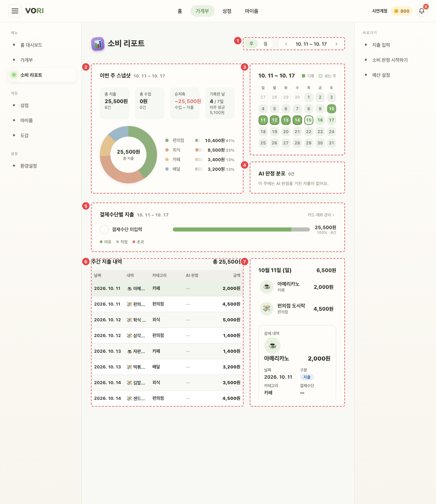
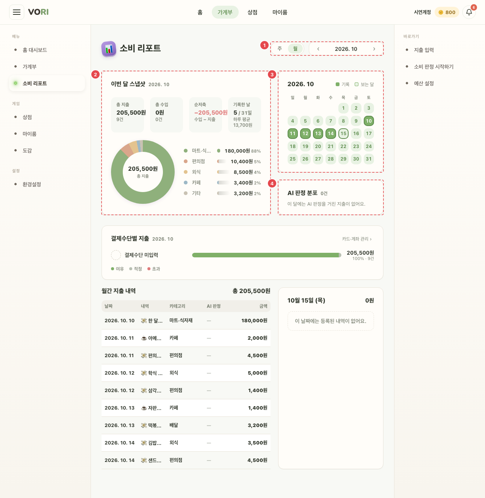

# RPT_MAIN_01 · 소비 리포트

| 화면ID | 화면명 | 경로 | 파일 | 인증 | 버전 | 수정일 | 이미지 출처 |
|---|---|---|---|---|---|---|---|
| `RPT_MAIN_01` | 소비 리포트 | `/report` | `frontend/src/pages/Report/ReportPage.jsx` | 로그인 | v0.3 | 2026-10-15 | 실제 화면 캡처 (`0c0a9e4`, 1280px) |

**한 줄 목표**: 사용자가 주·월 단위로 지출·수입·순저축·기록한 날, AI 판정 분포, 결제수단별 지출을 보고 날마다 내역을 들여다본다.

## 화면

**주 보기 — ⑥ 첫 행에 마우스를 올린 상태**



**월 보기 (?month=2026-10)**



<details>
<summary>와이어프레임 (텍스트로 보기)</summary>

```
┌───────────────────────────────────────────────────────┐
│ 📊 소비 리포트   ① [주|월]  ‹ 10. 12 ~ 10. 18 ›          │
├─────────────────────────┬──────────────┬──────────────┤
│ ② 이번 주 스냅샷          │ ③ 기록 캘린더  │ ④ AI 판정 분포 │
│  총 지출 · 총 수입         │  ■■□■■□□     │  여유 3 적정 1 │
│  순저축 · 기록한 날 4/7     │              │  초과 2        │
│  지난주 같은 기간보다 X원 덜…│              │               │
│  (도넛: 상위 4 + 기타)     │              │               │
├─────────────────────────┴──────────────┴──────────────┤
│ ⑤ 결제수단별 지출                       카드·계좌 관리 › │
│   신한체크  ■■■■■■■□  120,000원 · 42% · 9건 · 초과 22%   │
├─────────────────────────────────┬─────────────────────┤
│ ⑥ 주간 지출 내역 표                 │ ⑦ 선택한 날 카드      │
│   날짜 내역 카테고리 AI판정 금액      │   상세 내역           │
└─────────────────────────────────┴─────────────────────┘
```

</details>

## Description

번호는 위 와이어프레임의 번호와 짝이다.

| # | 요소 | 기능 | 동작 (누르면·입력하면) | 상태 | 예외·정책 |
|---|---|---|---|---|---|
| ① | 기간 | 기본 주 보기(일요일 시작) | `?month=YYYY-MM` 이면 그 달 월 보기. 월 보기로 열면 `POST /monthly-reports/{월}/read` 로 읽음 처리 | 평소: 주 "MM. DD ~ MM. DD", 월 "YYYY. MM" · 선택한 [주]/[월]은 강조 | 읽음 처리 실패는 조용히 넘어간다 |
| ② | 스냅샷 | 총 지출·총 수입·순저축·기록한 날. 도넛은 상위 4개 + 기타 | — | 로딩: 도넛 "불러오는 중…" · 빈: 도넛 "지출 없음", 범례 "이 {주/달}에는 지출이 없어요." · 순저축 음수면 "−" | 진행 중인 기간은 같은 날 수끼리 직전 기간과 비교 |
| ③ | 기록 캘린더 | 기록한 날 표시 | 날짜를 누르면 그 기간으로 이동 | 평소: 기록한 날·보는 기간 강조, 주 보기는 앞뒤 달 날짜도 표시 | — |
| ④ | AI 판정 분포 | AI 판정을 거친 지출만 센다 | — | 빈: "이 {주/달}에는 AI 판정을 거친 지출이 없어요." | — |
| ⑤ | 결제수단별 지출 | 등록 카드별(카드 없이 적은 지출은 종류별, 삭제한 카드는 "삭제한 카드·계좌"). 막대 안을 신호별 금액으로 나눠 칠한다 | — | 로딩: "불러오는 중…" · 빈: "이 {주/달}에는 지출이 없어요." · 카드 없이 적은 종류 줄엔 "카드를 고르지 않은 지출", 결제수단이 없으면 "결제수단 미입력" | 판정된 지출이 2건 이상인 수단이 2개 이상이면 "{이름}(으)로 쓴 지출의 초과 비율이 가장 높아요 (n%)." |
| ⑥ | 내역 표 | 기간의 지출 내역 (날짜·내역·카테고리·AI판정·금액) | 마우스를 올리면 ⑦에 미리보기, 클릭·Enter 로 선택 | 로딩: "불러오는 중…" · 실패: 오류 문구 + [다시 시도] · 빈: "이 기간에는 지출이 없어요." · AI 판정 안 거친 행은 "—" | — |
| ⑦ | 선택한 날 | 그날 지출 합 + 상세(날짜·구분·카테고리·결제수단·메모·소비 사유·AI 판정) | — | 빈: "이 날짜에는 등록된 내역이 없어요." · 행 미선택: 상세 없음 · 소비 사유·AI 판정은 있을 때만 | — |

## 상태별 화면

| 상태 | 보이는 것 | 사용자가 할 수 있는 것 |
|---|---|---|
| 로딩 | ② 도넛·⑤·⑥ 에 "불러오는 중…". 직전 기간을 다 불러오기 전엔 비교 한 줄을 숨긴다 | 기간·보기 바꾸기 |
| 실패 | 가계부 조회 실패: ⑥ 자리에 서버 message(없으면 "불러오기 실패") + [다시 시도], 다른 카드는 빈 상태. 401 이면 `/login` 으로 보냄. 직전 기간 조회 실패: 비교 한 줄만 숨김. 카드 목록 실패: ⑤ 를 카드 대신 결제수단 종류로 묶음 | [다시 시도] |
| 빈 | ②·④·⑤·⑥ 각각 빈 문구 (Description 상태 칸) | 다른 기간으로 이동 |
| 권한 없음 | 비로그인이면 `/login` (`ProtectedRoute`) | — |

## 접근성

- 키보드: ⑥ 표의 행은 `role="button"` + `tabIndex=0`, Enter·Space 로 선택. ③ 캘린더 날짜는 `button`. ⑦ 미리보기는 마우스 올림(`onMouseEnter`)에만 반응하고 키보드 포커스로는 바뀌지 않는다.
- 스크린 리더 라벨: [주|월] 묶음 `role="group"` + `aria-label="보기 방식"`, 각 버튼 `aria-pressed`. 기간 화살표 `aria-label="이전 {주/달}"`·`"다음 {주/달}"`. 캘린더 날짜 `aria-label="M월 D일"`(기록 여부는 라벨에 없음). ⑤ 막대 `role="img"` + `aria-label="{이름} {금액}, 전체의 n%. 여유 n건, 적정 n건, 초과 n건"`. ④ 막대는 `aria-hidden`, 범례 글자로 읽힌다. ⑦ 상세는 `aria-live="polite"`. 제목 아이콘 📊 는 `aria-hidden`.
- 포커스: 표 행 `:focus` 2px 테두리 (WalletPage.css:191), "카드·계좌 관리 ›" `:focus-visible` 테두리 (ReportPage.css:361). 그 밖 요소는 확인 필요.

## 참고

- API: 기간에 걸친 달마다 `GET /ledger?yearMonth=` (비교 기간 포함), `GET /payment-instruments`.
- 반응형·쿼리·기타: 1100px 이하 상단 1열, 900px 이하 하단 1열.

## 의문·미해결

- `RPT_MAIN_01`: 미래 기간으로 넘어갈 수 있다 (가계부는 막음). 아이콘이 이모지라 다른 화면의 선 아이콘과 다르다
- `RPT_MAIN_01`: "AI 판정 분포" 는 AI 판정 지출만, "결제수단별 지출" 은 모든 지출의 신호를 써서 기준이 다르다
- 코드와 다름 (0c0a9e4, `af63ed6`): ② 비교 한 줄은 직전 기간(같은 날 수)에 쓴 돈이 0원이면 숨긴다. 이번 달 가입한 사람에게 "지난달보다 N원 더 쓰는 중" 이 뜨던 문제를 막았다 (ReportPage.jsx:373-374). 로딩 중·직전 기간 조회 실패·기간에 지난 날이 없을 때도 숨긴다 (ReportPage.jsx:364).
- 코드와 다름 (0c0a9e4, `af63ed6`): ⑤ 카드 목록에 없는(삭제·보관한) 카드는 카드마다가 아니라 "삭제한 카드·계좌" 한 줄로 합친다. 카드 목록을 못 불러오면 카드 대신 결제수단 종류로 묶고 "카드를 고르지 않은 지출" 설명을 달지 않는다 (ReportPage.jsx:390-404).
- 코드와 다름 (0c0a9e4): ③ 이미 보고 있는 기간의 날짜를 누르면 기간은 그대로 두고 그날을 ⑦에 선택한다 (ReportPage.jsx:470-477).
- 코드와 다름 (0c0a9e4): ⑥ 표 행은 Enter 뿐 아니라 Space 로도 선택된다 (ReportPage.jsx:848). 표에는 지출만 나오고, 월 보기에서는 제목이 "월간 지출 내역" 이다 (ReportPage.jsx:799, 837).
- 원문에 없음 (0c0a9e4): ⑤ "카드·계좌 관리 ›" 는 `/settings/payment` 로 간다 (ReportPage.jsx:719).
