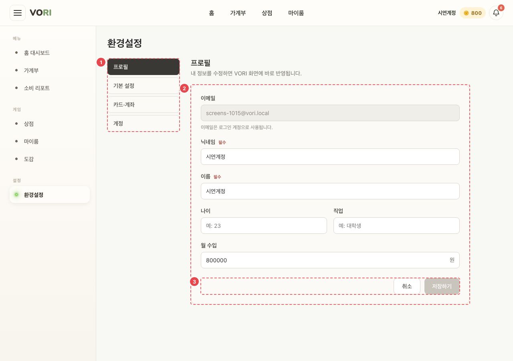
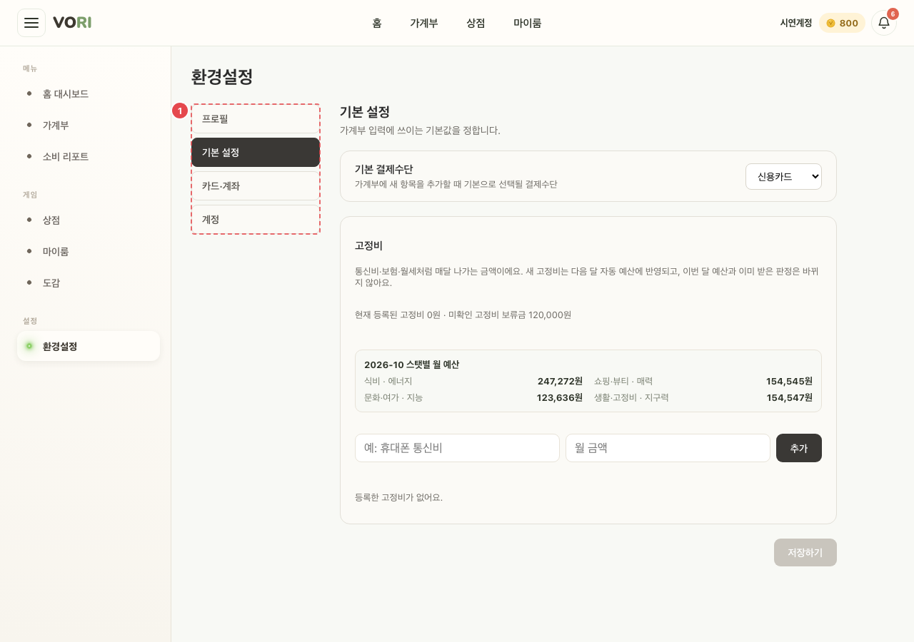
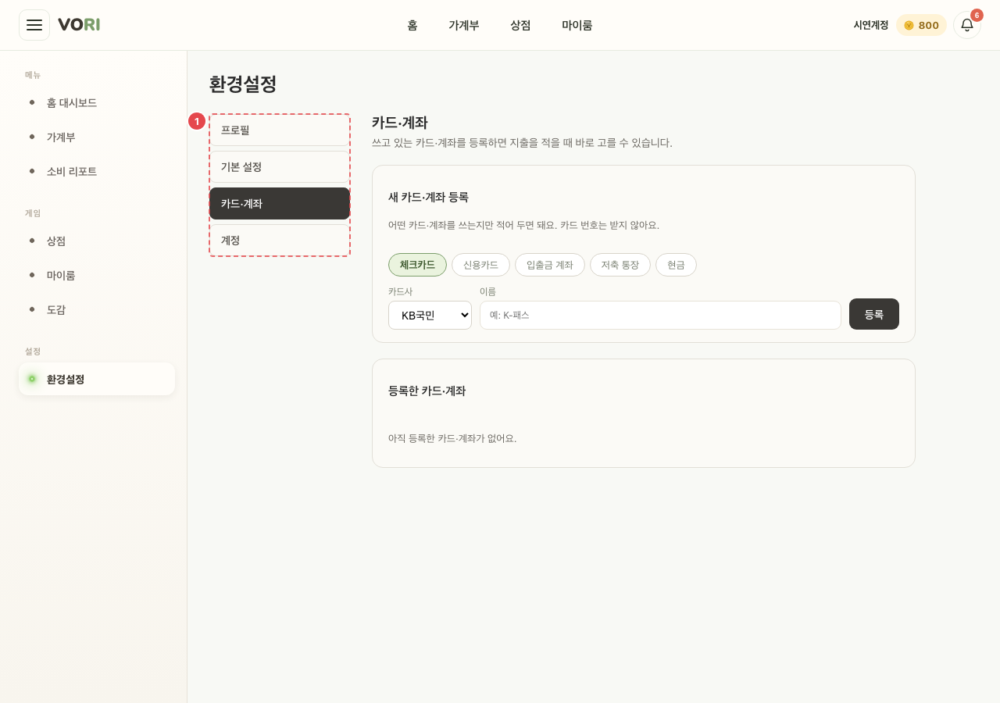
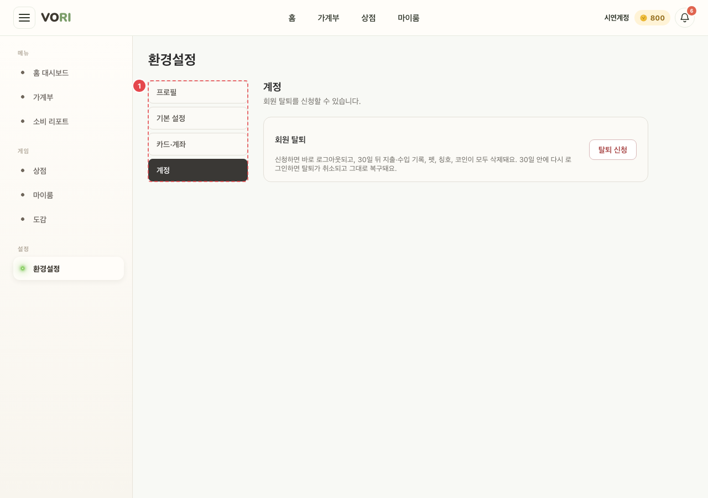

# SET_MAIN_01~04 · 환경설정

| 화면ID | 화면명 | 경로 | 파일 | 인증 | 버전 | 수정일 | 이미지 출처 |
|---|---|---|---|---|---|---|---|
| `SET_MAIN_01` | 환경설정 — 프로필 | `/settings/profile` | `frontend/src/pages/Settings/ProfileSettingsPanel.jsx` | 로그인 | v0.3 | 2026-10-15 | 실제 화면 캡처 (`0c0a9e4`, 1280px) |
| `SET_MAIN_02` | 환경설정 — 기본 설정 | `/settings/general` | `frontend/src/pages/Settings/GeneralSettingsPanel.jsx` | 로그인 | v0.3 | 2026-10-15 | 실제 화면 캡처 (`0c0a9e4`, 1280px) |
| `SET_MAIN_03` | 환경설정 — 카드·계좌 | `/settings/payment` | `frontend/src/pages/Settings/PaymentSettingsPanel.jsx` | 로그인 | v0.3 | 2026-10-15 | 실제 화면 캡처 (`0c0a9e4`, 1280px) |
| `SET_MAIN_04` | 환경설정 — 계정(탈퇴) | `/settings/account` | `frontend/src/pages/Settings/AccountSettingsPanel.jsx` | 로그인(일반) | v0.3 | 2026-10-15 | 실제 화면 캡처 (`0c0a9e4`, 1280px) |

**한 줄 목표**: 사용자가 내 정보·가계부 기본값·고정비·카드·계좌를 고치고, 일반 계정은 회원 탈퇴를 신청할 수 있어야 한다.

## 화면

**SET_MAIN_01 프로필**



**SET_MAIN_02 기본 설정**



**SET_MAIN_03 카드·계좌**



**SET_MAIN_04 계정**



<details>
<summary>와이어프레임 (텍스트로 보기)</summary>

```
┌────────────┬──────────────────────────────┐
│ 환경설정     │ 프로필                          │
│ ① 프로필    │ 내 정보를 수정하면 VORI 화면에 바로 반영됩니다.│
│   기본 설정  │ ② 이메일 (수정 불가)              │
│   카드·계좌  │    닉네임 · 이름 · 나이 · 직업 · 월 수입│
│   계정      │ ③ [취소] [저장하기]               │
└────────────┴──────────────────────────────┘
```

</details>

## Description

번호는 위 와이어프레임의 번호와 짝이다. 번호 없는 행은 와이어프레임에 없는 다른 탭의 구성요소다 (공통 틀: `frontend/src/pages/Settings/SettingsPage.jsx`).

| # | 요소 | 기능 | 동작 (누르면·입력하면) | 상태 | 예외·정책 |
|---|---|---|---|---|---|
| ① | 탭 목록 | 프로필 / 기본 설정 / 카드·계좌 / 계정 | 누르면 `/settings/:tab` 로 이동 | 평소: 고른 탭 강조(`aria-current="page"`) | **ADMIN 에겐 계정 탭이 안 보인다**. `/settings` 는 `/settings/profile` 로, 없는 탭은 첫 탭으로 보낸다 |
| ② | 프로필 입력칸 (`SET_MAIN_01`) | 이메일(수정 불가), 닉네임(2~12자), 이름(2~30자), 나이(1~120), 직업(최대 50), 월 수입(0 이상) | 입력하면 안내·오류 문구를 지운다 | 평소: 이메일 칸 비활성 · 실패: 불러오기 실패 "프로필을 불러오지 못했어요." | 저장 전 검사 "닉네임은 2~12자로 입력해 주세요." / "이름은 2~30자로 입력해 주세요." |
| ③ | [취소] [저장하기] (`SET_MAIN_01`) | 되돌리기·저장 | [취소]는 마지막으로 불러온 값으로 되돌린다. [저장하기] → `PUT /users/me` | 바뀐 값이 없으면 [저장하기] 비활성 · 저장 중: "저장 중..." 비활성 · 성공: "프로필을 저장했어요." · 실패: 서버 문구 또는 "프로필 저장에 실패했어요." | — |
| — | 기본 결제수단 (`SET_MAIN_02`) | 기본 결제수단(이 브라우저에만 저장) | 고른 뒤 [저장하기] | 바뀐 값이 없으면 [저장하기] 비활성 · 저장 후 "저장됨" 1.5초 | 서버 저장 없음 |
| — | 고정비 (`SET_MAIN_02`) | 고정비 추가·삭제, 이번 달 스탯별 월 예산 4칸 | [추가] → `POST /spending-plan/fixed-expenses`, [삭제] → `DELETE /spending-plan/fixed-expenses` | 빈: "등록한 고정비가 없어요." · 실패: "고정비를 불러오지 못했어요." 또는 서버 문구 | "새 고정비는 다음 달 자동 예산에 반영되고, 이번 달 예산과 이미 받은 판정은 바뀌지 않아요." |
| — | 새 카드·계좌 등록 (`SET_MAIN_03`) | 종류(체크카드·신용카드·입출금 계좌·저축 통장·현금), 카드사·은행 16곳, 이름(비우면 "{카드사} {종류}"), 잔액(계좌·저축·현금만) | [등록] → `POST /payment-instruments` | 처리 중: "등록 중…" 비활성 · 실패: 등록 칸 아래 오류(`role="alert"`) | "카드 번호는 받지 않아요." |
| — | 등록한 카드·계좌 (`SET_MAIN_03`) | 목록 | 목록에서 인라인 수정(`PATCH`)·삭제(`DELETE`). 삭제는 확인창을 거친다 | 로딩: "불러오는 중…" · 빈: "아직 등록한 카드·계좌가 없어요." · 처리 중: [저장] "저장 중…", [삭제] 비활성 · 실패: 목록 위 오류(`role="alert"`) | 삭제해도 지난 내역은 남음. 수정 중 종류는 바꿀 수 없다 |
| — | 회원 탈퇴 (`SET_MAIN_04`) | 회원 탈퇴 | [탈퇴 신청]을 누르면 확인 칸이 열린다. [탈퇴하기] → `POST /users/me/withdrawal` → 성공하면 삭제 예정일 알림 → 로그아웃 → `/` | 비밀번호 계정은 비밀번호, 구글 계정은 '탈퇴' 문구를 입력해야 [탈퇴하기] 활성 · 처리 중: "처리 중…" · 실패: 서버 문구 또는 "탈퇴 신청을 처리하지 못했어요." | **ADMIN 에겐 탭이 안 보인다** (서버도 403) |

## 세부

| 화면 ID | 탭 | 내용 | API |
|---|---|---|---|
| `SET_MAIN_01` | 프로필 | 이메일(수정 불가), 닉네임(2~12자), 이름(2~30자), 나이(1~120), 직업(최대 50), 월 수입(0 이상). 바뀐 값이 없으면 [저장하기] 비활성 | `GET`·`PUT /users/me` |
| `SET_MAIN_02` | 기본 설정 | 기본 결제수단(이 브라우저에만 저장). 고정비 추가·삭제, 이번 달 스탯별 월 예산 4칸. "새 고정비는 다음 달 자동 예산에 반영되고, 이번 달 예산과 이미 받은 판정은 바뀌지 않아요." | `GET /spending-plan`, `GET`·`POST`·`DELETE /spending-plan/fixed-expenses` |
| `SET_MAIN_03` | 카드·계좌 | 종류(체크카드·신용카드·입출금 계좌·저축 통장·현금), 카드사·은행 16곳, 이름(비우면 "{카드사} {종류}"), 잔액(계좌·저축·현금만). "카드 번호는 받지 않아요." 목록에서 인라인 수정·삭제 (삭제해도 지난 내역은 남음) | `GET`·`POST`·`PATCH`·`DELETE /payment-instruments` |
| `SET_MAIN_04` | 계정 | 회원 탈퇴. 비밀번호 계정은 비밀번호, 구글 계정은 '탈퇴' 문구를 입력해야 [탈퇴하기] 활성. 성공하면 삭제 예정일 알림 → 로그아웃 → `/`. **ADMIN 에겐 탭이 안 보인다** | `POST /users/me/withdrawal` |

`/settings` 는 `/settings/profile` 로, 없는 탭은 첫 탭으로 보낸다.

## 상태별 화면

| 상태 | 보이는 것 | 사용자가 할 수 있는 것 |
|---|---|---|
| 로딩 | 프로필: 세션 값으로 먼저 채우고 `GET /users/me` 결과로 바꾼다(따로 로딩 표시 없음). 카드·계좌 목록 "불러오는 중…" | 입력 |
| 실패 | 프로필 "프로필을 불러오지 못했어요.", 고정비 "고정비를 불러오지 못했어요.", 카드·계좌 목록 위 서버 문구 또는 "카드·계좌를 불러오지 못했어요." | 다른 탭 이용. 다시 시도 버튼은 없다 |
| 빈 | "등록한 고정비가 없어요.", "아직 등록한 카드·계좌가 없어요." | 추가·등록 |
| 권한 없음 | ADMIN 은 계정 탭이 숨겨지고 `/settings/account` 로 들어오면 첫 탭(프로필)으로 보낸다 | — |

## 접근성

- 키보드: 탈퇴 확인 칸이 열리면 입력칸에 `autoFocus`. 카드·계좌 수정 행이 열리면 이름 칸에 `autoFocus`. 그 밖은 확인 필요.
- 스크린 리더 라벨: 탭 목록 `nav` "환경설정 항목", 패널 `section` 은 탭 제목(`settings-panel-heading`)에 연결. 카드·계좌 종류 `role="radiogroup"` "종류" + `role="radio"` `aria-checked`. 수정 행의 카드사/은행·이름·잔액 칸 `aria-label`. 기본 결제수단 `label htmlFor`. 탈퇴 안내 `label htmlFor`. 카드·계좌·탈퇴 오류 `role="alert"`, "저장됨" `role="status"`. 프로필 오류·성공 문구는 `role` 이 없다.
- 포커스: 위 `autoFocus` 외 확인 필요

## 참고

- API: `GET`·`PUT /users/me` · `GET /spending-plan`, `GET`·`POST`·`DELETE /spending-plan/fixed-expenses` · `GET`·`POST`·`PATCH`·`DELETE /payment-instruments` · `POST /users/me/withdrawal`
- 반응형·쿼리·기타: `/settings` 는 `/settings/profile` 로, 없는 탭은 첫 탭으로 보낸다.

## 의문·미해결

- 코드와 다름 (0c0a9e4, `2047c7f`): `SET_MAIN_03` 에 원문에 없는 동작이 생겼다. ① 오류가 일어난 자리에 뜬다 — 등록 오류는 등록 칸 아래, 수정·삭제·불러오기 오류는 "등록한 카드·계좌" 목록 위 (`frontend/src/pages/Settings/PaymentSettingsPanel.jsx:180`, `:185`). ② 잔액 상한 20억(서버와 같음) — 입력칸 `max` 와 저장 전 검사, 문구 "잔액은 2,000,000,000원까지 적을 수 있어요." (`:11-13`, `:46-49`, `:80-83`). ③ 삭제 중에는 다른 삭제를 막는다 — 처리 중 [삭제] 비활성 (`:102`, `:254`).
- 코드와 다름 (0c0a9e4): `SET_MAIN_03` 에서 등록·수정·삭제가 처리 중 상태 하나(`saving`)를 같이 써서, 삭제하는 동안 등록 버튼이 "등록 중…" 으로 바뀌고 수정 행 [저장]도 "저장 중…" 이 된다 (`PaymentSettingsPanel.jsx:104`, `:175-176`, `:231-232`). [수정] 버튼은 처리 중에도 눌린다 (`:251`).
- 코드와 다름 (0c0a9e4): `SET_MAIN_01` 이름은 저장 전에 2자 미만만 검사한다. 30자 상한은 입력칸 `maxLength` 로만 막는다 (`ProfileSettingsPanel.jsx:51`, `:92`).
- 코드와 다름 (0c0a9e4): `SET_MAIN_02` 고정비는 이름이 비었거나 금액이 0 이면 아무 안내 없이 추가하지 않는다 (`GeneralSettingsPanel.jsx:70`).
