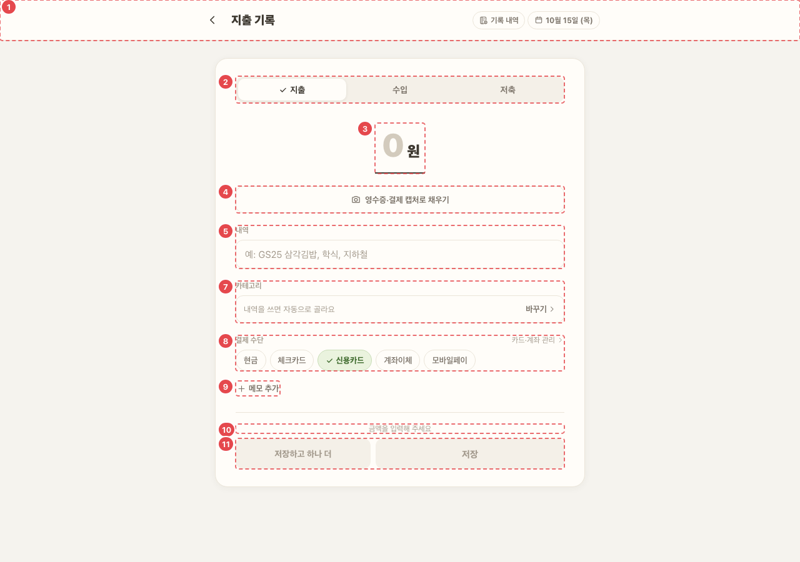
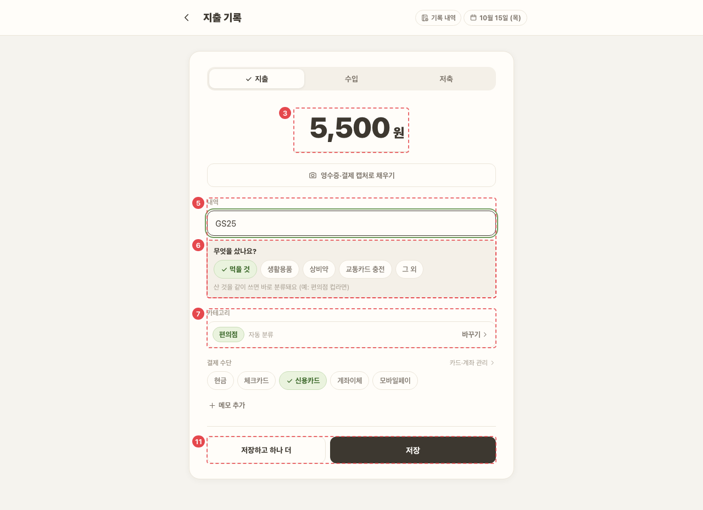

# WAL_ENT_01 · 가계부 작성

| 화면ID | 화면명 | 경로 | 파일 | 인증 | 버전 | 수정일 | 이미지 출처 |
|---|---|---|---|---|---|---|---|
| `WAL_ENT_01` | 가계부 작성 | `/wallet/new` | `frontend/src/pages/WalletEntry/WalletEntryPage.jsx` | 로그인 | v0.3 | 2026-10-15 | 실제 화면 캡처 (`0c0a9e4`, 1280px) |

**한 줄 목표**: 사용자가 지출·수입·저축 한 건을 금액·내역·카테고리·결제 수단으로 적어 저장하거나, 저장된 지출을 고치고 지울 수 있어야 한다.

## 화면

AppShell 없이 단독 화면.

**새 기록 (빈 폼)**



**금액·내역 입력 뒤 — ⑥ 되묻기와 ⑦ 자동 분류**



<details>
<summary>와이어프레임 (텍스트로 보기)</summary>

```
┌─────────────────────────────┐
│ ① ‹  지출 기록   기록 내역 3  10월 15일 (수)│
│ ② [지출 | 수입 | 저축]         │
│ ③ 금액        [      5,500] 원│
│ ④ [📷 영수증·결제 캡처로 채우기] │
│ ⑤ 내역 [GS25 삼각김밥        ] │
│ ⑥ 무엇을 샀나요? [컵라면][음료][그 외]│
│ ⑦ 카테고리 [식비 > 편의점] 자동 분류  바꾸기 ›│
│ ⑧ 결제 수단 [●신한체크] | 현금 체크 신용 이체 페이│
│              카드·계좌 관리 ›   │
│ ⑨ + 메모 추가                  │
│ ⑩ (금액을 입력해 주세요)         │
├─────────────────────────────┤
│ ⑪ [저장하고 하나 더]  [저장]     │  ← 폰은 하단 고정
└─────────────────────────────┘
```

</details>

## Description

번호는 위 와이어프레임의 번호와 짝이다.

| # | 요소 | 기능 | 동작 (누르면·입력하면) | 상태 | 예외·정책 |
|---|---|---|---|---|---|
| ① | 상단바 | 제목은 종류·수정 여부에 따라 "지출 기록"/"수입 기록"/"저축 기록"/"지출 수정" | ‹ 뒤로(이전 기록이 없으면 `/home`). [기록 내역 n]은 그날 기록 시트. 날짜 칩은 바꾸면 주소도 바뀐다 | 평소: 그날 기록이 있으면 건수 숫자 · 기록 시트 로딩: "불러오는 중…" · 실패: "기록을 불러오지 못했어요." · 빈: "아직 이 날 기록이 없어요." | 날짜 칩은 오늘까지만 고를 수 있다 |
| ② | 종류 탭 | 지출 / 수입 / 저축 | 바꿔도 내역·금액·결제수단·메모는 유지하고 분류만 다시 한다 | 평소: 고른 종류에 체크 · 비활성: 수정 중 다른 종류 | 수정 중에는 다른 종류로 못 바꾼다 |
| ③ | 금액 | 숫자만, 최대 12자리, 쉼표 자동 | Enter → 내역 칸 | 평소: 새 기록이면 처음 포커스 | — |
| ④ | 영수증 | 영수증·결제 캡처로 폼 채우기 | 흐름은 README 5-4 (원문 7-4) | 처리 중: "사진 읽는 중…" 비활성 + 안내 "사진을 읽는 중이에요. 10~15초쯤 걸려요." · 성공: "사진을 읽었어요. 금액과 내역을 확인해주세요." · 실패: 오류 안내 | 지출·새 기록에서만 |
| ⑤ | 내역 | 거래 내역 입력 | 입력을 멈추고 400ms 뒤 자동 분류 요청 | 평소: placeholder 는 종류별 예시 · 수입·저축은 서버 분류 없이 브라우저 안 키워드 규칙으로 출처·유형을 바로 제안 | — |
| ⑥ | 되묻기 | "무엇을 샀나요?" 또는 "어떻게 먹었나요?" + 후보 칩 + [그 외](카테고리 시트) | 후보 칩을 누르면 그 카테고리로 정한다 | 평소: 고른 칩에 체크 | 분류가 애매하고 후보가 2개 이상일 때만 |
| ⑦ | 카테고리 | 자동 분류 결과 | [바꾸기 ›] → 카테고리 선택 시트(대분류별 소분류 칩, 더블클릭 바로 확정) | 로딩: "분류 중…" · 실패: "분류하지 못했어요 — 골라 주세요" · 내역 없음: "내역을 쓰면 자동으로 골라요" · 시트 로딩: "불러오는 중…" · 시트 [선택 완료] 비활성: 고른 칩 없음 · 직접 고른 뒤에는 자동 분류가 덮지 않음 | — |
| ⑧ | 결제 수단 | 등록 카드 칩 + 기본 종류 5개 | 등록 카드를 고르면 종류도 맞춘다. "카드·계좌 관리 ›" → `/settings/payment` | 평소: 고른 칩에 체크 · 빈(수입·저축): 등록한 통장이 없으면 "통장·체크카드·현금을 등록하면 어디로 받았는지 고를 수 있어요." / "저축 통장을 등록하면 어디에 모았는지 고를 수 있어요." | 기본값은 기본 설정의 결제수단(없으면 신용카드). 수입은 "받은 곳", 저축은 "모은 곳"(투자면 숨김)으로 바뀐다 |
| ⑨ | 메모 | 지출만 | 누르면 펼침 | 평소: 접힘("+ 메모 추가") · 펼치면 입력 칸에 포커스 | 최대 200자, 비운 채 벗어나면 다시 접힘 |
| ⑩ | 저장 전 안내 | 위에서부터 하나만: "금액을 입력해 주세요" → "내역을 입력해 주세요" → "카테고리를 분류하는 중이에요…" → "카테고리를 골라 주세요" | — | 저장 실패: 같은 자리에 오류(서버 메시지 또는 "저장 중 오류가 발생했어요") | 하나라도 걸리면 저장 비활성 |
| ⑪ | 저장 | [저장하고 하나 더] / [저장]/[수정 완료] | [저장하고 하나 더]: 종류·결제수단을 남기고 폼을 비운 뒤 "'{내역}' {금액}원을 저장했어요. 다음 것을 적어 주세요." [저장]/[수정 완료]: `POST /ledger/entries` 성공 → `/wallet?date=` | 처리 중: "저장 중…" 비활성 · 비활성: ⑩ 안내가 있을 때 | [저장하고 하나 더]는 수정 중엔 없음 |

## 세부

- `?edit=true`: 그날 첫 지출을 불러와 수정. 수정 배너 "저장된 지출을 고치는 중이에요" + [새로 쓰기], 하단에 [이 지출 삭제](확인 후 `DELETE /ledger/expenses/{id}`).
- 새 기록 중 내용은 브라우저 세션에 임시 저장해 새로고침해도 남는다 (수정 중엔 저장 안 함).
- 반응형: 폰은 한 줄 + 하단 고정 버튼, 1024px 이상은 가운데 640px 카드.

## 상태별 화면

| 상태 | 보이는 것 | 사용자가 할 수 있는 것 |
|---|---|---|
| 로딩 | ⑦ "분류 중…", 카테고리 시트·기록 내역 시트 "불러오는 중…", ④ "사진 읽는 중…", ⑪ "저장 중…" | 입력 계속 (저장은 끝날 때까지 비활성) |
| 실패 | 저장 실패: ⑩ 자리 오류 문구(`role="alert"`). 삭제 실패: "지출을 삭제하지 못했어요." 영수증 실패: "사진이 너무 커요 (N MB). 10MB 이하로 올려주세요." / "결제가 여러 건 보여요. …" / "결제 내역이 보이지 않아요. …" / "사진을 읽지 못했어요. …" 기록 내역: "기록을 불러오지 못했어요." 카드·계좌·카테고리 트리 조회 실패는 표시 없음 | 다시 저장, 직접 입력 |
| 빈 | 기록 내역 시트 "아직 이 날 기록이 없어요." `?edit=true` 인데 그날 지출이 없으면 빈 새 기록 폼 | 새로 기록 |
| 권한 없음 | 로그인 안 됨: `/login` 으로 보낸다 | 로그인 |

## 접근성

- 키보드: 금액 Enter → 내역 칸, 내역 Enter → 입력 칸에서 빠짐(한글 조합 중 Enter 는 무시). 시트는 Esc 로 닫는다.
- 스크린 리더 라벨: 뒤로 "뒤로", 기록 내역 "기록 내역 n건 보기"(`aria-haspopup="dialog"`), 날짜 "기록할 날짜", 종류 탭 `role="tablist"` "기록 종류"(`aria-selected`), 금액은 숨긴 라벨 "금액", 내역·메모는 `label` 연결, 되묻기 `role="group"`(질문 문구) + 칩 `aria-pressed`, 결제 수단·받은 곳·모은 곳 `role="radiogroup"` + `role="radio"` `aria-checked`, 안내 문구 `role="status"`, 저장 오류 `role="alert"`, 시트 `role="dialog"` `aria-modal` + 제목 연결, 기록 내역의 지출 행 "{내역} 고치기".
- 포커스: 새 기록이면 금액 칸 자동 포커스, [저장하고 하나 더] 뒤 금액 칸, 메모를 펼치면 메모 칸. 시트를 열면 시트 자체에 포커스. 시트 안 Tab 가두기·닫은 뒤 포커스 복귀는 없다.

## 참고

- API: `POST /ledger/entries`, `DELETE /ledger/expenses/{id}`. (그 밖에 코드가 부르는 것: `GET /categories`, 그날 지출·수입·저축 조회, `POST /categories/categorize`, `POST /receipts`, `GET /payment-instruments` — README 3-3 참고)
- 반응형·쿼리·기타: AppShell 없이 단독 화면. 반응형: 폰은 한 줄 + 하단 고정 버튼, 1024px 이상은 가운데 640px 카드. `?date=` (틀리거나 미래면 오늘), `?edit=true`.

## 의문·미해결

- `WAL_ENT_01` — 영수증 날짜가 다를 때 "금액만 채웠어요" 라고 안내하지만 실제로는 내역·결제수단도 채운다 (README 8-2).
- 코드와 다름 (0c0a9e4): [그 외] 칩은 "무엇을 샀나요?" 되묻기에만 있다. "어떻게 먹었나요?" 에는 없다 (`WalletEntryPage.jsx:41-51`, `:641`).
- 코드와 다름 (0c0a9e4): 종류 탭을 바꾸면 결제수단 종류는 남지만 고른 등록 카드(`paymentInstrumentId`)는 비워진다 (`WalletEntryPage.jsx:269`).
- 코드와 다름 (0c0a9e4): 카테고리·기록 내역 시트(`Sheet`)는 가계부 목록 탭의 시트 공통 규칙과 달리 Tab 포커스 가두기와 닫은 뒤 포커스 복귀가 없다 (`WalletEntryPage.jsx:929-960`).
- 코드와 다름 (0c0a9e4): 수정 중 날짜 칩을 바꾸면 주소가 `/wallet/new?date=` 로 바뀌며 `edit=true` 가 빠져 새 기록 모드가 된다 (`WalletEntryPage.jsx:520`).
- 코드와 다름 (0c0a9e4): 결제 수단·받은 곳·모은 곳 칩은 `role="radio"` 인데 화살표 키 이동이 없다. 같은 문제를 가계부 목록 필터에서는 881394d 에서 `aria-pressed` 버튼으로 고쳤다 (`WalletEntryPage.jsx:680-831`).
- 코드와 다름 (0c0a9e4): 기록 내역 시트에서 지출 행을 누르면 그 지출을 폼으로 불러와 고친다. 수입·저축 행은 보기만 한다. 원문에 없다 (`WalletEntryPage.jsx:1016-1077`).
