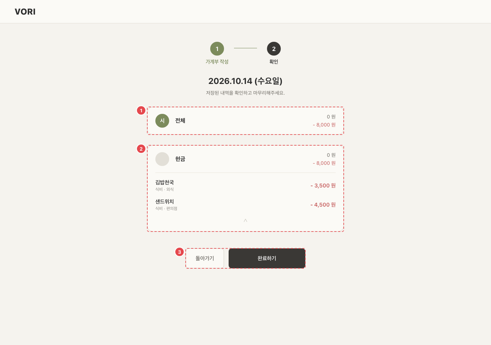

# WAL_ENT_02 · 작성 확인

| 화면ID | 화면명 | 경로 | 파일 | 인증 | 버전 | 수정일 | 이미지 출처 |
|---|---|---|---|---|---|---|---|
| `WAL_ENT_02` | 작성 확인 | `/wallet/new/confirm` | `frontend/src/pages/WalletEntry/WalletConfirmPage.jsx` | 로그인 | v0.3 | 2026-10-15 | 실제 화면 캡처 (`0c0a9e4`, 1280px) |

**한 줄 목표**: (예전 흐름 기준) 사용자가 그날 저장된 내역을 합계와 결제수단별로 확인하고 마무리할 수 있어야 한다. 지금은 이 화면으로 오는 길이 없다.

## 화면

예전 2단계 작성 흐름의 확인 화면. **지금은 이 화면으로 오는 길이 없다.** 작성 화면은 저장 후 바로 `/wallet` 으로 간다.

**주소로 직접 연 화면 (/wallet/new/confirm?date=2026-10-14)**

## Description

원문에 와이어프레임이 없어 번호는 화면 위에서 아래 순서다.

| # | 요소 | 기능 | 동작 (누르면·입력하면) | 상태 | 예외·정책 |
|---|---|---|---|---|---|
| ① | 날짜별 합계 카드 | 그날 수입·지출·저축 합계 | — | 로딩: "불러오는 중…" · 실패: "저장된 내역을 불러오지 못했어요. 저장이 사라진 게 아니니 네트워크 확인 후 다시 시도해주세요." + [다시 시도] · 빈: "이 날짜에 저장된 내역이 없어요." | — |
| ② | 결제수단별 카드 | 결제수단별로 묶은 내역 (저축은 따로 묶음) | 카드 머리를 누르면 펼치기·접기 | 평소: 펼침/접힘 | — |
| ③ | [돌아가기]/[완료하기] | 화면을 마치는 버튼 | [돌아가기] → `/wallet/new?date=`, [완료하기] → `/wallet?date=` | 정적 | — |

## 세부

날짜별 합계 카드와 결제수단별 카드, [돌아가기]/[완료하기]로 구성된다. 남길지 지울지는 9절 참고 (지금 문서에서는 [README](README.md) 8절).

## 상태별 화면

| 상태 | 보이는 것 | 사용자가 할 수 있는 것 |
|---|---|---|
| 로딩 | "불러오는 중…" | 기다리기 |
| 실패 | "저장된 내역을 불러오지 못했어요. 저장이 사라진 게 아니니 네트워크 확인 후 다시 시도해주세요." | [다시 시도] |
| 빈 | "이 날짜에 저장된 내역이 없어요." | [돌아가기]/[완료하기] |
| 권한 없음 | 로그인 안 됨: `/login` 으로 보낸다 | 로그인 |

## 접근성

- 키보드: 버튼만 있다 (Tab·Enter). 그 밖은 확인 필요.
- 스크린 리더 라벨: 로고 "VORI 홈으로", 묶음 펼치기 버튼 "펼치기"/"접기", 장식 아이콘 `aria-hidden`.
- 포커스: 확인 필요.

## 참고

- API: 원문에 없음. 코드는 그날 지출·수입·저축 조회와 `GET /categories` 를 부른다.
- 반응형·쿼리·기타: `?date=` (없으면 오늘).

## 의문·미해결

- `WAL_ENT_02` — 들어오는 길이 없는 화면. 수입이 모두 "현금" 묶음으로 들어가는 문제도 있다 (README 8-2).
- 코드와 다름 (0c0a9e4): 라우트는 아직 살아 있고 `App.js` 주석도 "가계부 작성 Step 2 (확인)" 으로 남아 있다 (`App.js:91`, `:268-275`). 화면에는 단계 표시(`StepIndicator`, 2단계)가 그대로 보인다 (`WalletConfirmPage.jsx:163`).
- 코드와 다름 (0c0a9e4): 수입 묶음 문제의 근거 — 수입은 `paymentMethod` 없이 저장되는데(`WalletEntryPage.jsx:396`) 이 화면은 비어 있으면 `"CASH"` 로 묶는다 (`WalletConfirmPage.jsx:116`).
- 코드와 다름 (0c0a9e4): `?date=` 를 검사하지 않아 미래·잘못된 날짜도 그대로 조회한다 (`WalletConfirmPage.jsx:42`).
