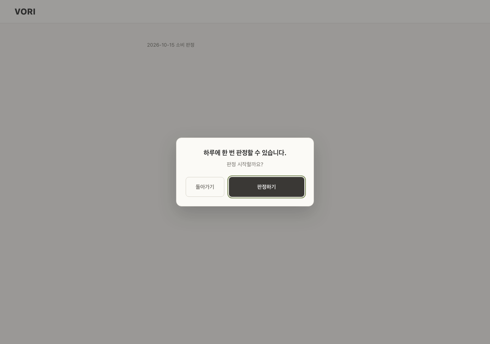
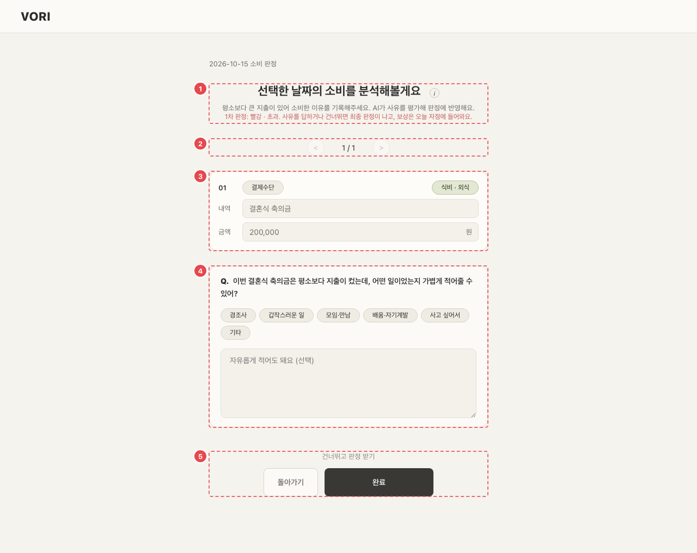
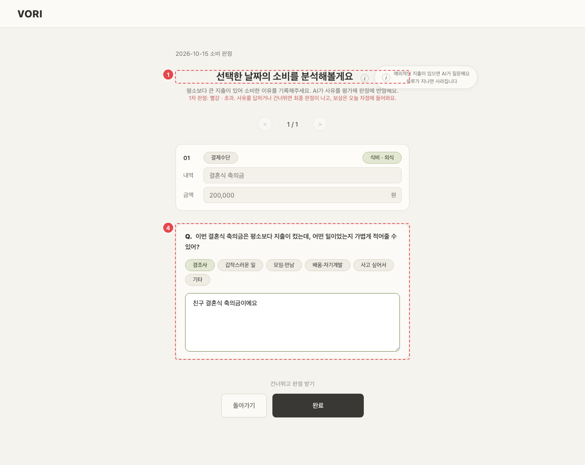

# WAL_JDG_01 · 하루 판정

| 화면ID | 화면명 | 경로 | 파일 | 인증 | 버전 | 수정일 | 이미지 출처 |
|---|---|---|---|---|---|---|---|
| `WAL_JDG_01` | 하루 판정 | `/wallet/analysis` | `frontend/src/pages/WalletEntry/WalletAnalysisPage.jsx` | 로그인 | v0.3 | 2026-10-15 | 실제 화면 캡처 (`0c0a9e4`, 1280px) |

**한 줄 목표**: 사용자가 하루 한 번 판정을 시작해 예외 지출 질문에 사유를 답하거나 건너뛰고, 확정된 하루 신호와 보상을 확인할 수 있어야 한다.

## 화면

**확인 모달 (판정 기록 없음)**



**질문 있음 — 1차 판정 PENDING**



**④ 사유 칩·자유 입력 후 · ① (i) 안내**



<details>
<summary>와이어프레임 (텍스트로 보기)</summary>

```
(확인 모달)
┌───────────────────────────┐
│ 하루에 한 번 판정할 수 있습니다. │
│ 판정 시작할까요?               │
│      [돌아가기] [판정하기]      │
└───────────────────────────┘

(질문 있음)
┌───────────────────────────────────┐
│ 10월 15일 소비 판정                   │
│ ① 선택한 날짜의 소비를 분석해볼게요 (i)  │
│   1차 판정: 적정. 사유를 답하거나 건너뛰면 │
│   최종 판정이 나고, 보상은 오늘 자정에…  │
│ ② < 1 / 2 >                         │
│ ③ ┌ 지출 카드 (읽기 전용) ───────────┐│
│    │ 신한체크  쇼핑 · 의류            ││
│    │ 겨울 코트            189,000원  ││
│    └──────────────────────────────┘│
│ ④ Q. 평소보다 큰 지출인데, 어떤 일로…?  │
│    [경조사][갑작스러운 일][모임·만남]    │
│    [배움·자기계발][사고 싶어서][기타]    │
│    [자유롭게 적어도 돼요 (선택)       ]  │
│ ⑤ [건너뛰고 판정 받기] [돌아가기] [완료] │
└───────────────────────────────────┘
```

</details>

## Description

번호는 위 와이어프레임의 번호와 짝이다.

| # | 요소 | 기능 | 동작 (누르면·입력하면) | 상태 | 예외·정책 |
|---|---|---|---|---|---|
| ① | 제목 · 1차 판정 | (i) "예외적인 지출이 있으면 AI가 질문해요 / 하루가 지나면 사라집니다" | (i) 에 마우스를 올리거나 포커스하면 안내가 뜬다 | 평소: PENDING 이면 "1차 판정: {신호}. 사유를 답하거나 건너뛰면 최종 판정이 나고, 보상은 오늘 자정에 들어와요." | PENDING 이면 1차 판정 신호를 미리 알려 준다 |
| ② | 페이저 | 질문이 여러 개일 때 하나씩 | < > 로 앞뒤 질문 | 비활성: 첫 질문에서 <, 마지막 질문에서 > | — |
| ③ | 지출 카드 | 질문 대상 지출 | — | 비활성: 내역·금액 칸 `disabled` (읽기 전용) | 수정 불가 |
| ④ | 질문 · 답 | 사유 칩 6개 + 자유 입력 | 칩을 다시 누르면 해제 | 평소: 고른 칩 강조 | 자유 입력은 최대 500자, 선택 |
| ⑤ | 버튼 | [건너뛰고 판정 받기] / [돌아가기] / [완료] | [건너뛰고 판정 받기]: 답 없이 확정. [돌아가기]: PENDING 으로 두고 `/wallet?date=`. [완료]: 답한 질문만 `POST /inquiries/{id}/answer` → `POST /daily-judgments/finalize` | 처리 중: 세 버튼 비활성, [완료]는 "저장 중…" · 실패: 버튼 위에 오류 문구(서버 메시지 또는 "판정을 확정하지 못했어요") | 이미 보낸 답은 다시 보내지 않는다 |

## 세부

진행 순서와 상태

1. 들어오는 순간 판정 가능 여부와 날짜를 **고정**한다 (23:59 에 답을 쓰다 자정에 쫓겨나지 않게). 닫혀 있으면 `/wallet` 으로.
2. `GET /daily-judgments?date=` — 판정 기록이 없으면 확인 모달, 있으면 바로 3번.
3. 확인 모달 [판정하기] → `POST /daily-judgments?date=` (1차 판정). 모달은 바깥 클릭으로 안 닫히고 Esc = 돌아가기.
4. 로딩: "분석 중이에요" (진행 막대 8→20→45→95→100%). 질문이 아직 생성 중이면 "질문을 준비하고 있어요" 로 바꾸고 2초 간격 최대 2번 다시 조회.
5. 질문 0건이면 바로 확정(`finalize`)하고 결과 화면. FINALIZED 면 질문 없이 결과 화면.
6. 오류: "질문을 불러오지 못했어요 / 네트워크 상태를 확인하고 다시 시도해주세요." + [돌아가기] [다시 시도].

결과 화면 (`JudgmentResults.jsx`)

| 영역 | 내용 |
|---|---|
| 하루 신호 | 가장 나쁜 지출 신호 (지출이 없으면 초록, "선택한 날짜에는 지출이 없습니다") |
| 보상 카드 | "오늘의 판정 보상" — 신호, 판정 지급 코인 / 자정에 받을 코인, 스탯 보상, "판정 뒤에 지출을 고쳐도 보상은 바뀌지 않아요." |
| 그룹 카드 4개 | 식비 / 쇼핑·뷰티 / 문화·여가 / 생활·고정비. "n건 합계 X원 · 절약 X원 · 내일 +X원". 판정 이유(월예산·하루 기본 예산·사용 가능 금액·오늘 사용·85% 기준). 사유가 인정돼 순해진 그룹은 "1차 판정은 …이었지만 예외 지출 사유가 인정돼 …로 바꿨어요." |
| 버튼 | [가계부로 돌아가기] |

## 상태별 화면

| 상태 | 보이는 것 | 사용자가 할 수 있는 것 |
|---|---|---|
| 로딩 | 판정 기록 조회 중에는 날짜 줄만 보인다. 판정 중에는 "분석 중이에요" + "AI가 예외적인 지출을 살펴보고 있어요. 잠시만 기다려주세요." + 진행 막대·%, 질문 대기 중에는 "질문을 준비하고 있어요" + "평소보다 큰 지출이 있어서 물어볼 말을 고르는 중이에요. 조금만 더 기다려 주세요." | 기다리기 (상단 VORI 로고 → `/home`) |
| 실패 | "질문을 불러오지 못했어요" / "네트워크 상태를 확인하고 다시 시도해주세요." 그날 지출을 이미 불러왔으면 지출별 판정 카드도 보인다. 확정 실패는 ⑤ 위 오류 문구 | [돌아가기] [다시 시도] |
| 빈 | 질문 0건 → 결과 화면. 지출이 없으면 "선택한 날짜에는 지출이 없습니다" / "지출이 없어 초록으로 표시했어요. 지급 보상은 아래에서 확인하세요." | [가계부로 돌아가기] |
| 권한 없음 | 로그인 안 됨: `/login` 으로 보낸다. 판정 시각 밖(일반 사용자): `/wallet` 으로 보낸다 | 로그인 / 가계부로 |

## 접근성

- 키보드: 확인 모달은 [판정하기]에 자동 포커스, Tab 이 모달 버튼 안에서만 돌고 Esc = 돌아가기. 나머지는 모두 `button`·`textarea` 라 Tab·Enter 로 쓴다.
- 스크린 리더 라벨: 확인 모달 `role="dialog"` `aria-modal` + 제목·본문 연결(`aria-labelledby`·`aria-describedby`), 진행 막대 `role="progressbar"` "소비 판정 진행률"(`aria-valuenow`), (i) 버튼 "안내" + 안내 문구 `role="tooltip"`(버튼과 `aria-describedby` 연결은 없음), 페이저 "이전"/"다음", 사유 칩 묶음 `role="group"` "이유 고르기" + 칩 `aria-pressed`, 결과 그룹 카드 펼치기 `aria-expanded`·`aria-controls`, 보상 카드 "일일 판정 보상", 로고 "VORI 홈으로". 지출 카드의 "내역"·"금액" 과 자유 입력 칸은 `label` 연결이 없다(자유 입력은 placeholder 만).
- 포커스: 확인 모달은 열릴 때 [판정하기]. 그 밖의 포커스 이동은 확인 필요.

## 참고

- API: `GET /daily-judgments?date=`, `POST /daily-judgments?date=`, `POST /inquiries/{id}/answer`, `POST /daily-judgments/finalize`.
- 반응형·쿼리·기타: 확인 모달은 바깥 클릭으로 안 닫히고 Esc = 돌아가기.

## 의문·미해결

- `HOME`·`WAL` — 판정 시각 표기가 "오후 8시부터" 와 "20시부터" 로 섞여 있다 (README 8-2, 이 화면은 판정 시각 밖이면 `/wallet` 으로 돌려보낸다).
- 코드와 다름 (0c0a9e4): 와이어프레임의 제목 "10월 15일 소비 판정" 과 달리 코드는 `YYYY-MM-DD 소비 판정` 이고, ADMIN 이면 " · 관리자 시연" 이 붙는다 (`WalletAnalysisPage.jsx:233`).
- 코드와 다름 (0c0a9e4): ③ 지출 카드의 결제수단은 등록 카드 이름("신한체크")이 아니라 종류 라벨("체크카드" 등)이다 (`WalletAnalysisPage.jsx:408`, `:586-595`).
- 코드와 다름 (0c0a9e4): 진행 막대는 다시 조회할 때 45 → 70 → 95% 로 오른다 (원문 8→20→45→95→100). (`WalletAnalysisPage.jsx:109`)
- 코드와 다름 (0c0a9e4): 5번 "질문 0건이면 바로 확정" 은 판정이 PENDING 일 때만이다. 질문 없는 빨강 지출이 끝내 남으면 결과 화면에 "질문이 없는 빨강 지출이 있어요. …" 안내를 띄운다 (`WalletAnalysisPage.jsx:113-123`, `:328-332`).
- 코드와 다름 (0c0a9e4): 6번 오류 화면에 그날 지출별 판정 카드가 함께 보일 수 있다. 원문에 없다 (`WalletAnalysisPage.jsx:267-291`).
- 코드와 다름 (0c0a9e4): ADMIN 은 `?date=` 로 판정할 날짜를 정한다(일반 사용자는 들어온 날 고정). 원문에 없다 (`WalletAnalysisPage.jsx:40`).
- 코드와 다름 (0c0a9e4): 결과 화면 보상 카드의 큰 신호는 하루 판정 신호(`judgment.signal`)이고, 예산을 다 쓴 그룹이 있으면 "주황 · 예산 소진" 으로 바뀐다. 원문에 없다 (`JudgmentResults.jsx:7`, `:82-86`).
