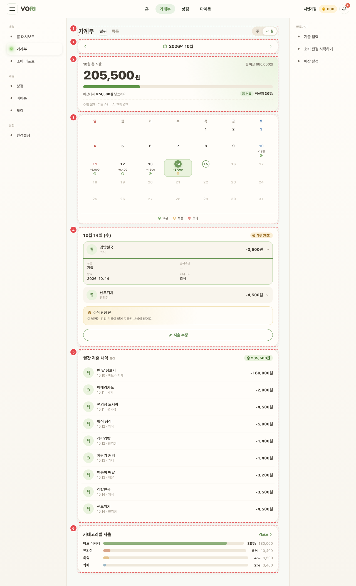
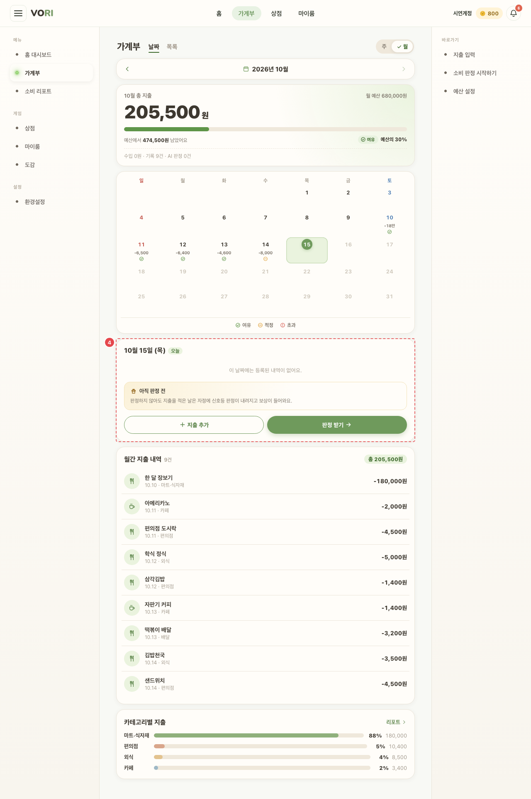

# WAL_MAIN_01 · 가계부 — 날짜 탭

| 화면ID | 화면명 | 경로 | 파일 | 인증 | 버전 | 수정일 | 이미지 출처 |
|---|---|---|---|---|---|---|---|
| `WAL_MAIN_01` | 가계부 — 날짜 탭 | `/wallet` | `frontend/src/pages/Wallet/WalletPage.jsx` | 로그인 | v0.3 | 2026-10-15 | 실제 화면 캡처 (`0c0a9e4`, 1280px) |

**한 줄 목표**: 사용자가 달력에서 날짜를 골라 그날 내역·신호·판정 보상을 보고, 지출을 추가·수정하거나 오늘의 판정을 받으러 갈 수 있어야 한다.

## 화면

**지출이 있는 날을 고르고 행을 펼친 상태 (10월 14일)**



**오늘 — 빈 날 · 판정 전 보상 상자**



<details>
<summary>와이어프레임 (텍스트로 보기)</summary>

```
┌──────────────────────────────┬───────────────────────────┐
│ 가계부   ① [날짜|목록]  [주|월]  │ ④ 10월 15일 (수) 오늘 [적정](예상)│
│        ‹ 2026년 10월 ›         │   학식   식비      -5,500 ▾  │
│ ② 10월 총 지출   월 예산 600,000 │    결제수단·카테고리·메모·사유  │
│   ■■■■■□□□ 예산에서 312,000원   │   ┌ 보상 상자 ─────────────┐│
│   남았어요 [여유] 예산의 48%      │   │ 아직 판정 전             ││
│   수입 0 · 기록 23건 · AI 판정 4건│   └────────────────────────┘│
│ ③ 일 월 화 수 목 금 토          │   [지출 수정] [판정 받기]    │
│    1   2   3   4 ...           │   오늘 답하지 않은 질문 1건   │
│   -1.5만                        │ ⑤ 10월 지출 내역 23건 총 X원  │
│    ●                            │   ‹ 1 / 3 ›                │
│   ● 여유 ● 적정 ● 초과          │ ⑥ 카테고리별 지출   리포트 › │
└──────────────────────────────┴───────────────────────────┘
          (본문 860px 이상 2단, 그보다 좁으면 한 줄)
```

</details>

## Description

번호는 위 와이어프레임의 번호와 짝이다.

| # | 요소 | 기능 | 동작 (누르면·입력하면) | 상태 | 예외·정책 |
|---|---|---|---|---|---|
| ① | 탭 · 기간 | [날짜\|목록] 탭, [주\|월] 보기(기본 월) | ‹ › 기간 이동 | 평소: 고른 탭·보기에 강조(주·월은 체크 아이콘) · 비활성: 이번 달(주 보기면 다음 주가 오늘 뒤)에서 › 비활성 | 미래 달·주로는 못 간다 |
| ② | 총 지출 | 월 예산 대비 사용률과 신호 | — | 로딩: 금액 자리 스켈레톤 · 예산 조회 실패: "예산을 불러오지 못했어요." · 예산 초과면 금액에 초과 표시, "예산보다 X원 더 썼어요" | 예산이 없으면 "월수입을 입력하면 고정비·예비비를 뺀 예산과 비교해 드려요." |
| ③ | 달력 | 날짜·축약 금액(`-1.5만`, 수입만 있으면 `+`)·신호 점 | 날짜를 누르면 그날을 ④에 연다 | 평소: 오늘·선택한 날 강조, 확정 판정이 있는 날은 신호 점에 확정 표시 · 로딩: 달력 아래 "불러오는 중…" · 실패: 달력 아래 오류 문구 · 비활성: 미래 날짜 | 하루 신호는 그날 지출 중 가장 나쁜 신호, 확정 판정이 있으면 그 신호로 덮는다. 미래 날짜 비활성 |
| ④ | 선택한 날 | 행을 누르면 펼쳐서 구분·결제수단·날짜·카테고리·메모·소비 사유·AI 판정. 보상 상자(아래 표) | [지출 추가](→`/wallet/new?date=`) 또는 그날 지출이 있으면 [지출 수정](`&edit=true`). 판정 버튼: "20시부터 판정"(비활성) / "판정 받기" / "판정 보기" | 평소: 머리 신호 칩은 확정 판정 전이면 "(예상)" · 빈: "이 날짜에는 등록된 내역이 없어요." · 보상 상자 로딩: "보상 정보를 불러오는 중이에요." · 보상 상자 실패: "판정 보상 정보를 불러오지 못했어요. 백엔드를 다시 시작해 주세요." · 비활성: 판정 시각 전 판정 버튼 | 판정 버튼은 오늘(또는 ADMIN)만. ADMIN 은 "시연할 날짜" 선택. 미래 날짜는 보상 상자·버튼을 그리지 않는다. 오늘 답하지 않은 질문 수는 조회 실패 시 숨긴다 |
| ⑤ | 기간 지출 내역 | 10건씩 페이지 | 행을 누르면 그날로 옮기고 ④에서 펼친다 | 빈: "이 달에는 등록된 지출이 없어요." (주 보기 "이 기간에는 지출이 없어요.") · 비활성: 첫·끝 페이지에서 ‹ / › · 페이지가 1개면 페이저 숨김 | — |
| ⑥ | 카테고리별 지출 | 상위 4개 막대 + % | "리포트 ›" → `/report` | 빈: "이번 달 지출이 없어요." | — |

## 세부

④ 보상 상자 상태

| 상태 | 문구 |
|---|---|
| 판정 없음 · 오늘 | 판정하지 않아도 지출을 적은 날은 자정에 신호등 판정이 내려지고 보상이 들어와요. |
| 판정 없음 · 지난 날 | 이 날짜는 판정 기록이 없어 지급된 보상이 없어요. |
| PENDING · 오늘 | 사유 답변 대기 — 예외 지출 사유를 답하거나 건너뛰면 최종 판정이 나요. |
| PENDING · 지난 날 | 1차 판정으로 확정 중 — 자정이 지나 1차 판정 내용으로 확정돼요. |
| FINALIZED | 판정 완료 — 받은 코인 / 자정에 받을 코인 +N, 스탯 보상 |

## 상태별 화면

| 상태 | 보이는 것 | 사용자가 할 수 있는 것 |
|---|---|---|
| 로딩 | ② 금액 스켈레톤(화면 낭독기용 "불러오는 중"), ③ 아래 "불러오는 중…", ④ 보상 상자 "보상 정보를 불러오는 중이에요." | 탭·기간 이동, 날짜 선택 |
| 실패 | 가계부 조회 실패: ③ 아래 오류 문구(서버 메시지 또는 "불러오기 실패"), 내역은 빈 상태. 판정 조회 실패: 보상 상자에 "판정 보상 정보를 불러오지 못했어요. 백엔드를 다시 시작해 주세요." 예산 조회 실패: "예산을 불러오지 못했어요." 카드·계좌·오늘 질문 조회 실패는 표시 없음 | 기간을 옮겨 다시 불러오기 |
| 빈 | ④ "이 날짜에는 등록된 내역이 없어요.", ⑤ "이 달에는 등록된 지출이 없어요.", ⑥ "이번 달 지출이 없어요." | [지출 추가] |
| 권한 없음 | 로그인 안 됨: `/login` 으로 보낸다. 가계부 조회가 401 이면 `/login` 으로 보낸다 | 로그인 |

## 접근성

- 키보드: 탭·주/월·기간 이동·달력 칸·내역 행·페이저가 모두 `button` 이라 Tab·Enter 로 쓴다. [날짜|목록] 은 `role="tablist"`/`tab` 이지만 화살표 키 이동은 없다. 미래 날짜 칸은 `disabled`.
- 스크린 리더 라벨: 탭 묶음 "가계부 보기"(`aria-selected`), 주/월 "보기 방식"(`aria-pressed`), 기간 이동 "이전 달"/"다음 달"(주 보기 "이전 주"/"다음 주"), 달력 칸은 "10월 15일, 오늘, 지출 …, 수입 …, 신호, 판정 완료" 식 `aria-label` + `aria-pressed`, 요일 머리는 `aria-hidden`, 범례 "판정 범례", 예산 막대 `role="progressbar"` "N월 예산 사용률"(`aria-valuetext` "N% 사용, 신호"), 하루 행 `aria-expanded`, 펼친 상세 `aria-live="polite"`, 보상 상자 `aria-label` "선택한 날짜의 판정 보상", 관리자 날짜 "관리자 판정 날짜", 페이저 "이전 페이지"/"다음 페이지".
- 포커스: ⑤ 행을 누르면 ④로 스크롤만 하고 포커스는 옮기지 않는다. 그 밖의 포커스 이동은 확인 필요.

## 참고

- API: 달이 바뀔 때 `GET /ledger?yearMonth=`, `GET /daily-judgments/month?month=`, `GET /spending-plan?yearMonth=`. 처음 한 번 `GET /payment-instruments`, `GET /inquiries?date=오늘`.
- 반응형·쿼리·기타: 쿼리: `?date=YYYY-MM-DD` 로 처음 고를 날 지정 (틀리거나 미래면 오늘). 본문 860px 이상 2단, 그보다 좁으면 한 줄.

## 의문·미해결

- `WAL_MAIN_01` — 판정 보상 조회 실패 문구 "백엔드를 다시 시작해 주세요." 가 사용자에게 그대로 보인다 (README 8-2).
- `HOME`·`WAL` — 판정 시각 표기가 "오후 8시부터" 와 "20시부터" 로 섞여 있다 (README 8-2).
- 코드 정리 — `pages/Wallet/BudgetCard.jsx` 는 어디서도 쓰지 않는다 (README 8-2).
- 코드와 다름 (0c0a9e4): 881394d 이후 ④ 하루 카드 행·펼친 상세와 ⑤ 행의 카테고리 글자가 `rowCategoryLabel` 로 바뀌었다. 수입은 출처 enum(`ALLOWANCE` 등) 대신 한글 라벨(없으면 "수입"), 카테고리 없는 지출은 "미분류" 로 보인다. 원문에는 이 규칙이 없다 (`WalletPage.jsx:66-70`, `:1138`, `:1166`, `:1295`).
- 코드와 다름 (0c0a9e4): ADMIN 의 판정 버튼은 ④에서 고른 날이 아니라 "시연할 날짜" 값으로 `/wallet/analysis?date=` 에 간다. 날짜를 비우면 버튼이 비활성이다 (`WalletPage.jsx:1246-1247`).
- 코드와 다름 (0c0a9e4): 판정 시각은 고정 20시가 아니라 `AI_ACTIVE_FROM_HOUR`(환경 변수, 기본 20) 기준이고, 60초마다 다시 계산한다 (`WalletPage.jsx:231-238`, `:750`, `config.js:14-20`).
- 코드와 다름 (0c0a9e4): 보상 상자 PENDING 문구가 원문보다 길다. 오늘은 "… 최종 판정이 나요. 보상은 오늘 자정에 들어와요.", 지난 날은 "… 확정돼요. 잠시 뒤 다시 확인해 주세요." (`WalletPage.jsx:1207-1209`).
