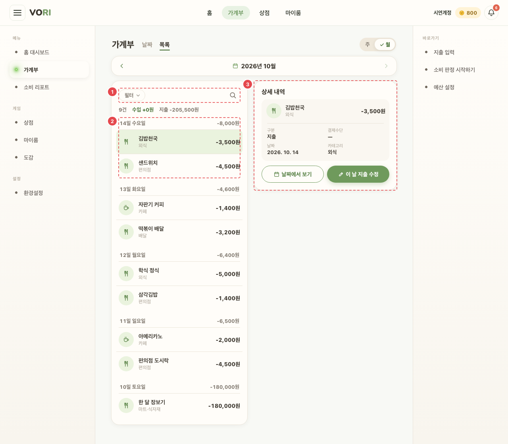
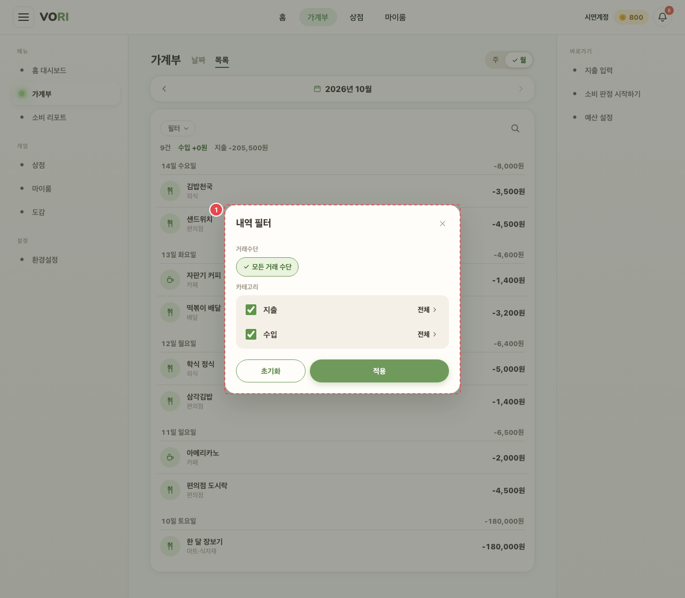
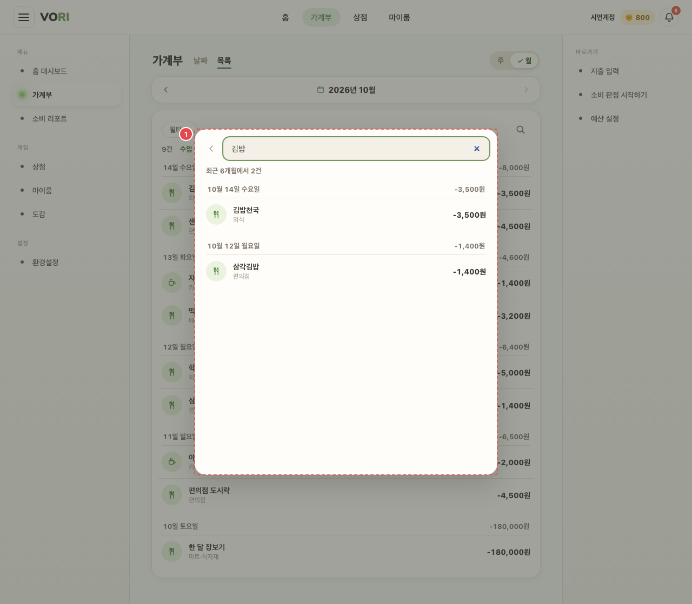

# WAL_MAIN_02 · 가계부 — 목록 탭

| 화면ID | 화면명 | 경로 | 파일 | 인증 | 버전 | 수정일 | 이미지 출처 |
|---|---|---|---|---|---|---|---|
| `WAL_MAIN_02` | 가계부 — 목록 탭 | `/wallet?view=list` | `frontend/src/pages/Wallet/WalletPage.jsx` | 로그인 | v0.3 | 2026-10-15 | 실제 화면 캡처 (`0c0a9e4`, 1280px) |

**한 줄 목표**: 사용자가 기간의 수입·지출을 날짜별 목록으로 보고, 거래수단·카테고리로 거르거나 최근 6개월에서 검색해 한 건의 상세를 열 수 있어야 한다.

## 화면

**평소 — 행을 눌러 ③ 상세를 연 상태**



**① [필터] 시트**



**① [검색] 시트 — "김밥" 검색**



<details>
<summary>와이어프레임 (텍스트로 보기)</summary>

```
┌──────────────────────────────┬─────────────────────┐
│ ① [필터 ▾•] [🔍]               │ ③ 상세 내역           │
│   23건 · 수입 +0 · 지출 -288,000│   구분 지출           │
│ ② 15일 수요일 오늘   -10,000    │   결제수단 ● 신한체크   │
│   학식   식비 ●신한체크 -5,500  │   날짜·카테고리·메모    │
│   스타벅스 카페      -4,500 [초과]│   소비 사유 · AI 판정   │
│   14일 화요일        -32,000    │   [날짜에서 보기]       │
│   ...                          │   [이 날 지출 수정]     │
└──────────────────────────────┴─────────────────────┘
      (본문 740px 이상은 오른쪽 패널, 그보다 좁으면 바텀시트)
```

</details>

## Description

번호는 위 와이어프레임의 번호와 짝이다.

| # | 요소 | 기능 | 동작 (누르면·입력하면) | 상태 | 예외·정책 |
|---|---|---|---|---|---|
| ① | 툴바 | [필터]: 거래수단(등록 카드 중 하나) + 카테고리(지출·수입, 세부 칩). [검색]: 최근 6개월에서 이름·메모·사유·카테고리 검색 | [필터] → 필터 시트, [초기화]/[적용]. [검색] → 검색 시트, placeholder "거래처 및 메모 내용을 입력하세요." | 평소: 적용 중이면 점 표시 · 검색 시트 로딩: "내역을 불러오는 중…" · 검색 실패(6개월 모두 실패): "내역을 불러오지 못했어요." · 검색 빈: "'검색어'에 맞는 내역이 없어요." · 검색어 없음: "수입·지출 내역 또는 메모 내용을 손쉽게 찾을 수 있어요" / "예) 스타벅스" · 필터 비활성: 지출·수입 체크를 끄면 그 줄의 세부 펼치기 버튼 비활성 | 필터는 [적용]을 눌러야 반영된다 |
| ② | 날짜별 목록 | 최신 날짜가 위. 그룹 머리에 그날 수입·지출 합. 행: 아이콘·이름·카테고리·카드(색 점)·금액·신호(AI 판정 거친 것만) | 행을 누르면 ③ 상세를 연다 | 평소: 고른 행 강조 · 로딩: "불러오는 중…" · 실패: 오류 문구(서버 메시지 또는 "불러오기 실패") · 빈: "이 달에는 내역이 없어요." (주 보기 "이 주에는 내역이 없어요.", 필터 적용 중 "필터에 맞는 내역이 없어요.") | 신호는 AI 판정 거친 것만 |
| ③ | 상세 | 구분·결제수단·날짜·카테고리·메모·소비 사유·AI 판정 | [날짜에서 보기]는 날짜 탭으로 바꿔 그 행을 펼친다. [이 날 지출 수정] → `/wallet/new?date=&edit=true` | 평소: 넓은 화면은 오른쪽 패널(닫힐 때 짧은 접힘 애니메이션, 동작 줄이기 설정이면 바로 닫힘), 좁은 화면은 바텀시트 | 패널은 바깥 클릭·Esc·같은 행 재클릭으로 닫힘. [이 날 지출 수정]은 수입 행엔 없다. 달·주·보기를 바꾸면 닫힌다 |

## 세부

시트 공통: 넓은 화면은 가운데 창, 640px 이하는 바텀시트. 뒤 화면 스크롤 잠금, Tab 포커스 가두기, 닫으면 여는 버튼으로 포커스 복귀.

## 상태별 화면

| 상태 | 보이는 것 | 사용자가 할 수 있는 것 |
|---|---|---|
| 로딩 | 목록 자리에 "불러오는 중…" (검색 시트는 "내역을 불러오는 중…") | 탭·기간 이동, 필터·검색 열기 |
| 실패 | 목록 자리에 오류 문구(서버 메시지 또는 "불러오기 실패"). 검색 시트는 6개월 모두 실패하면 "내역을 불러오지 못했어요." 카드·계좌 조회 실패는 표시 없이 결제수단 종류로 보인다 | 기간을 옮겨 다시 불러오기 |
| 빈 | "이 달에는 내역이 없어요." / "이 주에는 내역이 없어요." / "필터에 맞는 내역이 없어요." | 필터 초기화, 기간 이동 |
| 권한 없음 | 로그인 안 됨: `/login` 으로 보낸다. 가계부 조회가 401 이면 `/login` 으로 보낸다 | 로그인 |

## 접근성

- 키보드: 툴바·행·시트 안 칩이 모두 `button`. 넓은 화면 상세 패널은 Esc 로 닫으면 고른 행으로 포커스를 돌린다(바깥 클릭으로 닫으면 돌리지 않는다). 시트는 Esc 로 닫고 Tab 이 시트 안에서만 돈다.
- 스크린 리더 라벨: 목록 영역 `role="tabpanel"` "내역 목록", 카드 "수입·지출 내역", [필터] `aria-haspopup="dialog"` + 적용 중 점 `aria-label` "필터 적용 중", [검색] "내역 검색", 행 `aria-pressed`, 패널 `aside` "내역 상세". 시트는 `role="dialog"` `aria-modal`, 제목으로 이름을 붙이고 제목 없는 검색 시트는 "내역 검색". 필터 시트: 거래수단 `role="group"` "거래수단" + 칩 `aria-pressed`, 카테고리 칩 묶음 "지출 카테고리"/"수입 카테고리", 세부 펼치기 `aria-expanded`. 검색 입력 "내역 검색", 검색 결과 수 `aria-live="polite"`, 검색 닫기 "검색 닫기".
- 포커스: 시트를 열면 처음 포커스는 검색 입력(검색) · 닫기 버튼(필터) · 시트 자체(닫기 버튼 없는 상세 시트). 닫으면 열기 전 포커스로 돌아간다. 필터 칩은 `:focus-visible` 외곽선.

## 참고

- API: `GET /ledger?yearMonth=` (보고 있는 달), 검색 시트가 열릴 때 최근 6개월 `GET /ledger?yearMonth=` 를 한 번씩, `GET /payment-instruments`. (원문에 따로 적힌 API 없음 — 코드 기준)
- 반응형·쿼리·기타: 본문 740px 이상은 오른쪽 패널, 그보다 좁으면 바텀시트. 시트는 640px 이하 바텀시트. `?view=list` 로 목록 탭.

## 의문·미해결

- README 8-2 에 이 화면 줄 없음.
- 코드와 다름 (0c0a9e4): 881394d 이후 필터의 지출 카테고리 칩은 고정 기본 칩 없이 이 달에 실제로 쓰인 카테고리만 많이 쓴 순으로 보여 주고, 하나도 없으면 "이 기간에 기록된 지출 카테고리가 없어요." 를 띄운다. 원문은 "세부 칩" 만 적었다. 주 보기에서도 칩은 달 전체 내역 기준이다 (`WalletPage.jsx:541-550`, `LedgerFilterSheet.jsx:53-55`).
- 코드와 다름 (0c0a9e4): 881394d 이후 넓은 화면 상세 패널의 바깥 판정이 `mousedown`·`touchstart` 에서 `click` 으로 바뀌었다. 원문 "바깥 클릭" 과 맞고, 목록을 스크롤하려고 손가락만 대서는 닫히지 않는다 (`WalletPage.jsx:676-683`).
- 코드와 다름 (0c0a9e4): 881394d 이후 거래수단 칩은 `radio` 가 아니라 `aria-pressed` 버튼(`role="group"`)이다. 하나만 고르지만 화살표 키 이동은 없다 (`LedgerFilterSheet.jsx:84-127`).
- 코드와 다름 (0c0a9e4): 881394d 이후 시트(`LedgerSheet`)는 부모가 다시 그려져도(60초 판정 시각 타이머 등) 포커스가 시트 맨 앞으로 튀지 않고, 제목 없는 시트 이름은 `ariaLabel` 로 받는다 (`LedgerSheet.jsx:26-47`, `:77`).
- 코드와 다름 (0c0a9e4): 881394d 이후 필터 칩 최소 높이 36px·포커스 외곽선, 폰 시트 하단 safe-area 여백, 시트 최대 높이 `90dvh` (`WalletScreen.css`).
- 코드와 다름 (0c0a9e4): 행·상세의 카테고리는 `rowCategoryLabel` — 수입은 한글 출처 라벨, 카테고리 없는 지출은 "미분류". 상세의 결제수단 칸은 수입이면 "받은 곳" 이고 등록 카드면 이름·색 점을 붙인다 (`WalletPage.jsx:66-70`, `ListTxDetail.jsx:36-46`).
- 코드와 다름 (0c0a9e4): 원문에 없는 동작 — 검색 결과 행을 누르면 시트를 닫고 날짜 탭으로 바꿔 그날 카드에서 그 행을 펼친다(다른 달이면 그 달을 불러온 뒤) (`WalletPage.jsx:603-616`). 필터 시트에는 지출·수입 체크박스가 있어 종류째 끌 수 있다 (`LedgerFilterSheet.jsx:37-41`). 필터는 주소에 남지 않는다 (`WalletPage.jsx:536`).
